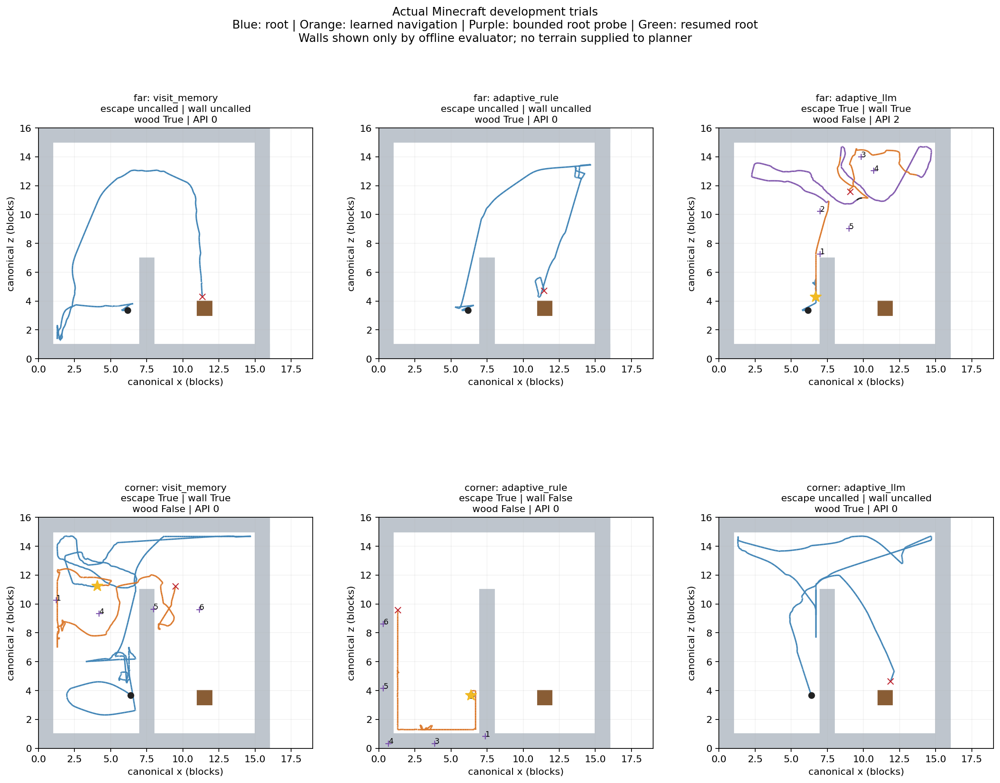

# 실패 방향 기억·LLM 후보 선택 실제 검증 — 2026-10-14

**복구가 호출된 개발3게임 모두 정체 지점을 벗어났고, 그중2게임은 벽을 건넜다.
복구 후 원목 획득은3게임 모두 실패했다.** 나머지3게임은 원래 정책이 먼저 원목1개씩을
획득했으므로 복구 성공/실패 분모에서 제외한다. LLM의 추가 성능 효과는 확인되지 않았다.

[고정 프로토콜](adaptive-recovery-protocol-2026-10-14.md),
[실제 결과·원본 SHA256](reports/2026-10-14/recovery-summary.json),
[최종 검사 요약](reports/2026-10-14/verification.json).
6게임·4,814전이 완료. 원본은 `results/adaptive-recovery-20261014`에 보존하며 완료 배치는 재실행하지 않는다.

## 조건과 실제 결과

개발 far/corner 월드 seed104761, sampling seed14021/14022, 기존 부모/이동 head/목표 embedding 고정.
추가 학습0·최종5평가시드 사용0. 제어180초, 복구400행동/60초, 도착반경0.35블록을 유지했다.
adaptive 조건의400행동에는 이동과 제한된 원래 수집 정책 시험을 함께 센다.
LLM 대기는60초/180초에 포함하며 중립 release/refresh4전이는 정책 행동과 구분한다.

후보 생성/LLM에는 자기 좌표·시선·방문·시도 이력만 공급한다. 벽·출구·나무 좌표는 없다.
좌표와 root RM/접근 감지는 privileged server 관측이며 F3-only 조건이 아니다.
그림의 벽 구조는 종료 뒤 평가에만 사용했다. 모터 행동은 기존 신경망에서 샘플했다.

| 월드 / 선택기 | root / 이동 / 수집 시험 / 중립 전이 | 국소 이탈 | 정체 뒤 벽 횡단 | 목표 도달 | 원목 순증가 | API |
|---|---:|---|---|---:|---:|---:|
| far / 방문 기억 | 520 / 0 / 0 / 0 | 미실행 | 미실행 | 미실행 | +1·원래 정책 | 0 |
| far / 개선 규칙 | 520 / 0 / 0 / 0 | 미실행 | 미실행 | 미실행 | +1·원래 정책 | 0 |
| far / 제한된 LLM | 273 / 200 / 200 / 4 | 확인 | 441번째 | 1 | 0 | 2 |
| corner / 방문 기억 | 800 / 400 / 0 / 0 | 확인 | 1107번째 | 1 | 0 | 0 |
| corner / 개선 규칙 | 400 / 400 / 0 / 0 | 확인 | 실패 | 0 | 0 | 0 |
| corner / 제한된 LLM | 1097 / 0 / 0 / 0 | 미실행 | 미실행 | 미실행 | +1·원래 정책 | 0 |

국소 이탈은 정체 지점에서3블록 이상 떨어진 뒤2블록 밖에서20전이를 유지하는 별도 판정이다.
corner/방문 기억은 root가471번째에 한 번 건넌 뒤 원래 쪽으로 돌아와800번째에 정체했다.
1107번째 횡단은 정체 이후 다시 건넌 결과다. 횡단을 원목 획득으로 세지 않는다.
복구 호출3건 모두 `planning_paused`로 종료했고 원래 RM은 미완료다.

파랑은 root, 주황은 이동, 보라는 제한된 수집 시험이다. 별은 정체, 번호는 선택한 후보이며
도달을 뜻하지 않는다. 수집 시험은 탐색 중 잠깐 원래 정책을 실행한 것으로 접근 회복 선언이 아니다.

## 실패 원인과 수정

1. **방문하지 않은 후보의 통행 가능성은 여전히 모른다.** corner/개선 규칙에서12개의
   정렬된 저변위 이동을 근거로635번째에 막힌 방향 가설1개를 기록했다. 다음 후보 선택
   (이동263번째)에서 그 방향 후보0을 실제로 제외하고 후보1을 골랐다. 기억이 선택을 바꾼
   근거는 있지만 벽 전체 지도를 알아낸 것은 아니다. 외벽 너머의 다른 후보와 정밀 도착
   실패가 남아 목표 도달0·벽 횡단0이었다. 회전/이동 불일치를 벽으로 단정하지 않았다.
2. **벽 통과 뒤 원래 목표에 접근하는 행동이 부족했다.** far/LLM은 목표1개 도달과 지속
   이탈 뒤 원래 수집 정책을100행동씩 두 번 시험했다. 모두 접근/채굴 가능 상태를 회복하지
   못했다. 복구400관측에서 wood 목표는 유지됐지만 reachable은0이었다. 따라서 단순한
   나무 미발견으로 분류하지 않는다. 이동 목표3/4도 실제 최소거리1.4207/1.0917블록까지
   접근했을 뿐0.35반경에 도달하지 못했다. 시험 예산을 늘리거나 성공 임계값을 바꾸지 않았다.
3. **중단한 이동 목표를 이동 실패로 잘못 전달했다.** 수집 시험 뒤 `root_probe_no_access`
   처리가 아직 완료하지 않은 경유점을 `failures`에 추가했다. 이 때문에 두 번째 LLM 요청이
   실제 이동 실패 전에 발생했고, 응답도 이전 선택을 실패로 취급했다.6조건을 같은 구현으로
   마친 뒤 `interruptions`와 진짜 `failures`를 분리했다. 새 요청은
   `navigation_choice_v2`의 `interrupted_candidates`를 별도로 보내고, 지시문에 중단이
   통행 불가 증거가 아님을 명시한다. 두 번째 요청의 조건은 실제 이동 실패에만 걸린다.
   기존 RM·목표·이력은 보존하고 과거v1 요청/응답도 검증할 수 있게 했다.

마지막 수정은 재현2검사의 RED→GREEN과 실제677전이/이동200행동 재생으로 확인했다.
기존 기록3건을 **이동 중단2건·실제 무진전 실패1건**으로 분리했다. 두 번째 요청 시점의
실제 이동 실패는0건이었다. 원본 파일 해시·기존 관측/선택 경로는 유지했다.
근거: `results/adaptive-recovery-20261014/route-history-replay.json`.
**수정 뒤 새 API/실게임은0이며, 수정 후 실게임 성능을 검증한 것으로 표현하지 않는다.**
게임별 `source-at-game`과 수정 전 `source-at-audit`를 보존한다.

## LLM의 영향과 비교 한계

LLM은 최초 정체와 첫 실패로 기록된 사건에서4개 후보 중 하나를 골랐다. 이후에는 명시된
규칙 선택을 사용했다. 두 요청 모두 실제 응답 후보0이 적용됐지만, 두 후보는 규칙의
최저비용 선택과도 같았다. 이번 실행은 LLM이 대안을 통해 규칙보다 잘 우회했다는 증거가 아니다.
두 번째 요청의 실패 이력 오류도 위와 같이 보존/수정했다.

조건을 적용하기 전부터 root 입력이 달랐다. 기준선과 비교한 최초 화면/행동/위치 차이는
far 개선 규칙5/13/44, far LLM5/13/28, corner 개선 규칙6/36/41, corner LLM6/46/57번째였다.
세계와 난수 seed를 맞춘 것만으로 영상·게임 상태가 동일해지지 않았다. 성공/실패 차이를
선택기의 인과 효과로 해석하지 않으며, 각1회 개발 진단을 일반 성능으로 제시하지 않는다.

## 유료 사용·지연·자원

승인 상한은 US$1·4회. 실제 `gpt-5.3-codex`2회, 재시도0·다른 모델 대체0·도구 호출0.
입력/출력 token은563/141과696/234, 요청 지연4.531초/4.453초,
controller 계획 대기5.257초/5.096초다. 요청 전 키 해제, 대기 중 정책 전이0,
응답 뒤 중립 관측 갱신4전이를 원시 로그에서 확인했다.

추정 사용 비용 **US$0.00745325**, 영속적인 보수적 예약 합계 **US$0.50**.
추정치는 [프로토콜에서 확인한 공식 단가](adaptive-recovery-protocol-2026-10-14.md)를 적용한 값이며
실제 청구서 확인액이 아니다. 남은 호출을 소진하기 위한 추가 요청은 하지 않았다.

| 조건 | 제어 시간 s | 추론 중앙값 / p95 ms | 전체 제어 주기 중앙값 / p95 ms | 장치 표본 VRAM 최대 MiB |
|---|---:|---:|---:|---:|
| far / 방문 기억 | 112.064 | 48.282 / 57.239 | 124.457 / 493.753 | 2854 |
| far / 개선 규칙 | 64.657 | 51.824 / 62.098 | 114.040 / 174.012 | 2820 |
| far / 제한된 LLM | 93.375 | 51.466 / 60.932 | 113.347 / 166.143 | 2806 |
| corner / 방문 기억 | 139.581 | 49.425 / 59.362 | 109.328 / 145.104 | 2805 |
| corner / 개선 규칙 | 88.757 | 48.528 / 58.618 | 105.274 / 125.357 | 2775 |
| corner / 제한된 LLM | 125.892 | 48.001 / 58.512 | 108.177 / 138.207 | 2771 |

GTX1060 3GB·Windows/WSL 로컬 실행. PyTorch peak allocated1915.001MiB/reserved2056MiB는
모든 조건에서 같았다. 장치 표본은 다른 프로세스를 포함하며 순간 최대치를 놓칠 수 있다.
OOM·표본 오류0, Colab 연결0. 실행 시점/다른 작업 부하가 달라 조건 간 속도 개선을 주장하지 않는다.

## 검사와 보존

- 전체4,814전이 감사: 정책 전이의 저장 특징 action log-prob 재계산 오차0, 중립4전이는 별도 무행동 검사.
  공식 action mapping, root RM
  입력/보상, 정체 판정, 후보/도달/막힘 기록, 계획 대기/응답 적용이 원시 로그와 일치했다.
  모든 영상의 backbone을 다시 추출했다는 뜻은 아니다.
- 6게임 모두 STOP 뒤 새 정책 전달0·해제 뒤 held key0·잔존 소유 PID0.
  자동 STOP은 유지한다. 테스트에서는 대기/응답/추론 중 STOP, 실패 응답/위치 변화도 검사했다.
- Windows 전체566개 중545통과/21제외, WSL 관련28개 통과. 하네스 결과를 실게임 성공과 구분한다.
- 최초 far/방문 기억은 Java 버전 확인20초 제한으로 게임 시작 전 차단됐다(행동0·API0).
  프로젝트 JDK8은 재확인22.577초 후 정상 응답했다. Java 사전 확인만60초로 바꾸고
  원본을 보존한 attempt2에서 실행했다. 이 준비 실패는 게임 표본에 넣지 않는다.
- 원문 명세·부모/이동 가중치·목표 embedding·훈련 캐시·원본 월드 SHA256 보존.
  개발 궤적 학습0·기본 정책/vocabulary 승격0·최종5시드 사용0.
- 로컬 최종 근거는 `results/adaptive-recovery-20261014/final-verification.json`.
  비밀정보·가중치·원본 게임/프레임/런타임은 Git 제외를 유지한다.

다음 검증 단위는 **정렬→정밀 도달→원래 목표 접근 회복**이다. 기존 훈련 월드에서 해당 상태의
교정 자료를 보강하고 분리된 개발 조건에서 검사한다. 이번 개발 궤적을 학습에 투입하지 않는다.
LLM 호출량 확대나 보상 변경만으로 하위 이동 능력 부족을 해결했다고 가정하지 않는다.
