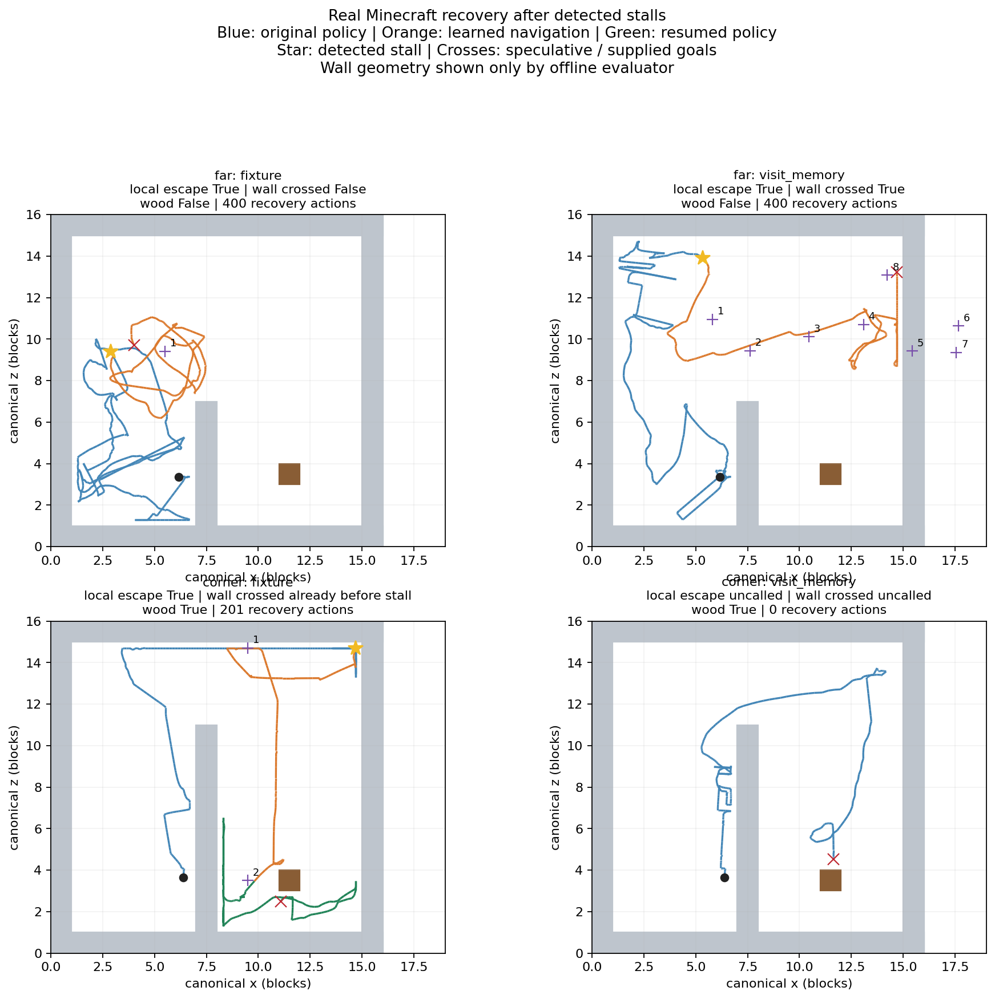

# 실제 정체 후 탈출·벽 정보 제거 비교 — 2026-10-12

**벽 정답 정보를 받지 않은 far 실행 1건에서 실제 정체 지점 이탈과 벽 횡단을 확인했다.
원목 획득은 실패했다.** 새 위치 선호만으로 전체 과업 복구가 해결된 것은 아니다.
다른 corner 조건은 복구 호출 전에 원래 정책이 완료했으므로 복구 평가에서 제외한다.
이 결과는 소규모 개발 진단이며 통계적 개선·일반화·LLM 복구 성공의 증거가 아니다.

[고정 프로토콜](blind-recovery-protocol-2026-10-12.md),
[기계 판독 결과·원본 SHA256](reports/2026-10-12/recovery-summary.json),
[검사 요약](reports/2026-10-12/verification.json).
새 게임4회·실제4,599전이. 완료한 배치는 재실행하지 않는다.

## 조건과 정보 경계

기존 개발 벽 두 곳의 복사본을 10월10일 실제 정체 당시 x/z/yaw로 준비했다.
pitch는 기존 fixture의 -13도, 신경망 기억은 새 episode 초기화다. 과거의 완전한 상태 복원은 아니다.
이번 실행에서도 기존 StallDetector가 실제 관측으로 정체를 감지해야 복구를 호출했다.
검출된3건은 모두800행동 뒤 `no_goal_progress`였다. 이는 목표 진전 없음의 판정이며
800행동 내내 제자리에 있었음을 뜻하지 않는다.

- world seed104761, sampling seed far12021/corner12022. 각 월드의 두 조건에서 동일 설정.
- 같은 부모473142f…·보강 이동 head f1dee801…·wood embedding 사용. 추가 optimizer/API 호출0.
- 제어180초, 복구400행동/60초, 도착 수평반경0.35·높이차1.5. 관측 뒤 기준 변경0.
- `fixture`: 기존 벽 끝·나무 쪽 경로를 아는 경유점 공급.
- `visit_memory`: 현재 좌표/yaw, 방문한2블록 구역, 실패 후보 이력으로3블록 목표를 선택한다.
  벽 구조·출구·나무 위치를 후보 선택기에 전달하지 않는다. 정체 시 옆/뒤 방향을 먼저 검토하고,
  이후 덜 방문한 구역과 방향 연속성을 우선한다. 후보100행동/40행동 무진전이면 대안을 선택한다.
  실제 목표3개 도달 시 원래 정책으로 복귀한다. 후보 최대8개이며 통행 가능하다고 보장하지 않는다.
- 상위 선택은 명시적인 규칙 기준선이다. **LLM을 호출하지 않았고, 실제 모든 게임 행동은 학습 신경망이 샘플했다.**
- 좌표/yaw와 원래 root RM의 상태 입력은 privileged server 출처다. 영상 전용/F3 좌표 기반 실행은 아니다.
  경기장 구조는 대조군 경로와 종료 후 평가/그림에만 사용한다.

## 실제 결과

국소 이탈은 정체 지점에서3블록 이상 이동한 뒤2블록 밖에서20전이 유지로 판정했다.
벽 횡단은 episode 출발 쪽 반대편에 플레이어 몸 전체가 들어갔는지 검사했다.
root가 먼저 벽을 건넌 상태에서 정체했다면 복구의 새 횡단 표본으로 세지 않는다.

| 월드 / 경로 정보 | root / 복구 / 재개 행동 | 국소 이탈 | 정체 뒤 새 벽 횡단 | 실제 목표 도달 | 원목 순증가 |
|---|---:|---|---|---:|---:|
| far / fixture | 800 / 400 / 0 | 확인 | 실패 | 0 | 0 |
| far / visit_memory | 800 / 400 / 0 | 확인 | **확인** | 2 | 0 |
| corner / fixture | 800 / 201 / 406 | 확인 | 이미 root가281번째에 횡단 | 2·경로 완료 | +1 |
| corner / visit_memory | 792 / 0 / 0 | 미실행 | 복구 미실행 | 미실행 | +2·원래 정책 완료 |

far/visit_memory는 복구27번째 행동에서3블록 이탈,47번째까지 유지했다.
전체898번째, 즉 복구98번째 행동에서 벽 반대편에 진입했다. 정체 위치에서 최대10.711블록 이동했다.
원목 수집을 재개하는 기준인 목표3개 도달에는 못 미쳐 복구400행동 뒤 `planning_paused`로 종료했다.
국소 이탈·벽 통과·하위 목표 도달·원목 획득을 서로 다른 결과로 유지한다.

파랑은 원래 정책, 주황은 학습된 이동, 초록은 수집 재개다. 별은 정체 감지,
보라색 번호는 시도한 목표이고 실제 도달을 뜻하지 않는다. 외벽 밖의6·7번 후보도 표시했다.

## 실패 분석

1. **이동의 정밀도와 방향 재정렬.** far/fixture는 첫 목표에0.357669블록까지 접근했지만
   고정0.35반경을 충족하지 못했다. 전진194회 중82회는 목표와45도 이상 어긋났고,
   이동400행동/35.278블록 뒤 도달0이었다. 목표를 아는 것만으로 안정적인 도달이 되지 않았다.
2. **미방문 위치는 통행 가능 위치가 아니다.** far/visit_memory는 첫 후보 실패 뒤 두 목표를
   실제로 달성했지만, 다음 목표는 최소0.395792까지 접근한 뒤 실패했다. 이후 외벽 너머의
   목표도 생성했다. 실패 구역의 점수만 올리면 캐릭터 위치가 조금 바뀔 때 가까운 다른 셀의
   같은 막힌 방향을 다시 고를 수 있다. 이번에 후보 실패5건, 총8개 시도를 기록했다.
   전진236회 중69회는45도 이상 어긋났다. 복구 이동량32.850블록이었다.
3. **복구 완료와 원래 목표로의 인계.** 현재 기준선은 세 목표 도달 뒤 수집으로 돌아간다.
   벽을 건넜다는 종료 후 평가 증거를 실시간 정책에 몰래 전달하지 않았다. 따라서 벽을
   넘은 far도 세 번째 목표에 실패한 뒤 수집으로 돌아가지 못했다. 향후에는 관측 가능한
   접근 회복 증거로 재개하고, 다시 정체하면 같은 시도를 반복하지 않는 계약이 필요하다.
4. **대조 전 상태가 같지 않았다.** far 두 실행은18번째 화면/20번째 행동/22번째 위치부터,
   corner는4번째 화면/23번째 행동/42번째 위치부터 달랐다. 각각800/792개의 root prefix를
   대조했다. 두 계획기 이전부터 궤적이 달라졌으므로 방문 기억의 인과 성능 향상은 주장하지 않는다.

도착 임계값을 넓히거나 실패 후 키 입력을 강제하지 않았다. 이번 개발 궤적을 훈련에 투입하지 않았고,
기본 정책·LLM 실행 vocabulary도 승격하지 않았다.

## 지연·자원·종료

| 조건 | 제어 시간 s | 추론 중앙값 / p95 ms | 전체 주기 중앙값 / p95 ms | 장치 표본 VRAM 최대 MiB |
|---|---:|---:|---:|---:|
| far / fixture | 154.405 | 43.246 / 52.888 | 111.137 / 208.113 | 2748 |
| far / visit_memory | 125.086 | 42.395 / 51.979 | 101.873 / 116.241 | 2745 |
| corner / fixture | 147.613 | 41.947 / 51.326 | 102.082 / 119.015 | 2745 |
| corner / visit_memory | 81.630 | 42.226 / 51.020 | 101.319 / 114.137 | 2746 |

GTX1060 3GB·드라이버560.94·WSL Ubuntu24.04·torch2.0.1 CUDA 실행이다.
PyTorch 최대 allocated1915.001MiB/reserved2056MiB는 네 조건에서 같았다.
장치 표본 값은 다른 프로세스를 포함하며 순간 peak를 놓칠 수 있다. 표본 오류/OOM0.
첫 게임 제어 중 CPU 하네스 검사/자료 정리도 있어 지연의 조건 간 인과 비교는 하지 않는다.

4,599전이를 해당 저장 특징에서 다시 계산한 action log-prob 오차0으로 감사했다.
공식 action mapping, 원래 RM 보상·조건, 상대 목표, 실제 정체 판정, 방문 기반 후보/실패 기록도
원시 로그와 일치했다. 이는 이번 모든 영상의 backbone 특징을 다시 추출했다는 뜻은 아니다.
네 게임 모두 STOP 뒤 새 정책 전달0·해제 뒤 held key0·잔존 소유 PID0.
입력 해제용 중립 step과 진행 중이던 step은 새 정책 행동과 구분한다. 자동 STOP 래치를 유지한다.

## 검사와 보존

- Windows 전체548개 중527통과/21제외, 이후 수정한 판정2개 재통과. WSL 관련23개 통과.
- 최초 Windows 전체 검사는 sandbox 임시 폴더의 rename/replace WinError5로44실패·63오류였다.
  원본 로그를 보존하고 프로세스 TMP/TEMP를 프로젝트 안으로 지정한 뒤 통과했다. 전역 설정 변경0.
- 월드 준비는 global/STEVE-1 환경에 nbtlib이 없어 실행 전 중단됐다. 기존 Windows
  `.runtime/fixture-tools` 환경에서 생성/NBT 검사를 완료했다. 게임 실패 표본은 아니다.
- 첫 전이 감사에서 JSON list와 런타임 tuple의 직접 비교가 실패했다. 판정 값은 동일했으며
  `jsonable(trigger)`로 형식을 맞춰 네 게임 전체를 재감사했다. 게임 재실행0, 첫 오류 로그 보존.
- 원문 명세·부모/이동 가중치·원래 훈련 캐시·원본 월드의 SHA256을 확인했다.
  실제 게임별 `source-at-game`과 새 월드·프레임·궤적을 로컬에 보존한다.
- 학습/유료 API/Colab 연결/최종5시드 사용0. 이 네 게임은 로컬 개발 결과다.

로컬 완료 근거는 `results/blind-recovery-20261012/final-verification.json`이다.
이 GitHub 정리본에는 코드·문서·작은 검사 요약/그림만 포함한다. 원본 results·가중치·외부 코드·
런타임·비밀 파일은 제외한다. 원시 자산이 없으면 기존 실행을 clone만으로 재현할 수 없다.

[비공개 저장소](https://github.com/csb1004/MinecraftRL)의 첫 연구 정리본
`d9338046bd9d154d90d88146c0cee157ceea8778`과 원격 일치를 확인했다.
[업로드 영수증](reports/2026-10-12/publication.json)은 별도 문서 갱신으로 남긴다.

다음 단위는 (1) 관측한 이동 실패를 방향/연결 단위로 기억하기, (2) 학생 이탈 상태의 재정렬·
정밀 도달 학습, (3) 접근 회복 증거에 따른 원래 목표 재개다. 벽 정답 정보 없이 검증하고,
그 뒤에 실제 F3 관측 공급 및 LLM 선택 가능한 스킬로의 승격을 검토한다.
