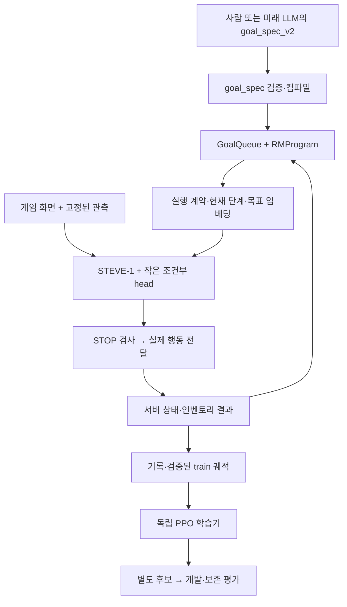

# 현재 코드 구조

[시작 안내](agent-start.md) · [개발 방법](development.md) · [모듈별 지도](../../src/minecraftrl/README.md)

## 현재 E2 실행 경로

미래 LLM은 현재 사람과 같은 스키마를 사용하도록 계약을 만들었다. 그림의 미래 작성자를
현재 자동 서비스가 구현됐다는 의미로 읽지 않는다. E2의 서버 관측은 privileged 입력이며
영상 전용 조건과 구별한다. 정확한 관측/효과 규칙은 [E2 명세](../specs/2026-11-03-execution-contract-e2.md)를 따른다.

| 책임 | 기준 구현 | 변경 시 함께 볼 검사 |
|---|---|---|
| 인수·모드 선택 | `cli_arguments.py`, `cli.py` | `test_goal_recovery_cli`, `test_rm_conditioning`, `test_rm_finalization` |
| 목표 의미·가능한 과업 | `goal_spec.py`, `goal_queue.py`, `rm_program.py` | `test_goal_spec`, `test_goal_queue`, `test_rm_program` |
| 현재 요청·우선순위 적용 | `execution_contract.py` | `test_execution_contract` |
| 관측→정책 조건 | `rm_conditioning.py`, `recovery_learning.py`, `execution_learning.py` | `test_recovery_learning`, `test_execution_learning` |
| 원본 결과→return | `execution_returns.py`, `execution_training.py` | `test_execution_learning`, `test_execution_training` |
| 공통 독립 학습 | `training/adapter.py`, `training/validation.py`, `training/provenance.py` | `test_training_entrypoints`, `test_recovery_learning` |
| 실행 중단·프로세스 | `runtime.py`, `processes.py`, `cli.py` | `test_runtime`, `test_supervision`, `test_rm_finalization` |

모듈명은 `src/minecraftrl/`, 검사는 `tests/` 기준이다. 정확한 파일 목록은 폴더 지도를 따른다.

## 데이터 경계

- **요청**: 사람이든 LLM이든 대상, 수량, 효과, 보존 조건을 같은 검증기에 전달한다.
  완료 기준은 호출자 소유다. 현재 지원되지 않는 효과/스킬은 실행 가능 목록에 넣지 않는다.
- **관측**: 보여 보이는 나무, 기억한 위치, 실제 획득은 다른 근거다. 인벤토리/서버 판정이
  최종 성공을 정한다. 현재 목표 정보가 들어간다는 사실만으로 그 정보를 잘 사용한다고 보장하지 않는다.
- **행동**: 추론과 실제 dispatch를 구분한다. STOP 또는 완료 후 계산된 행동도 새로 전달하지 않는다.
- **학습**: parent·특징·행동 확률이 일치하는 새 train 궤적만 PPO에 사용한다. 별도 보존 자료는
  KL에만 사용한다. 개발/최종 평가 자료는 학습에 섞지 않는다.
- **승격**: 후보 저장은 채택이 아니다. 기존 능력 손실을 포함한 평가 후 별도 결정한다.

## 책임을 나눈 이유

`scripts/train_*_adapter.py`는 기존 명령을 유지하는 진입점이다. 공용 학습 코드는 이제
`minecraftrl.training`에 있고 스크립트끼리 import하지 않는다. 학습 자료 검증과 구현 해시 기록을
분리했다. 정책/체크포인트 클래스는 기존 모듈에 남겨 과거 경로를 유지한다.

`cli_arguments.py`는 선언만 담당한다. `cli.py`가 모드 검증, worker 구성, 프로세스 수명과
종료를 담당한다. 과거 `cli.parser`, `cli.sampling_seed` import도 유지한다.
다른 공용 코드를 임의로 새 계층으로 이동하지 않았다. 체크포인트와 실험 코드의 상대 경로가 증거이기 때문이다.

## 연구 단계와 실험 이름

[4단계 연구](../specs/2026-10-31-four-stage-research-spec.md)는
① 사람 RM+RL → ② LLM 작성 RM → ③ 이상 감지+LLM 학습 피드백 → ④ SQL 지식 구축이다.
파일명의 `R1`, `E1`, `E2`, `S2` 등은 개별 실험 이름이며 이 네 단계의 완료 번호가 아니다.
LLM broker, 대화, 공간 기억의 과거 코드가 존재해도 이 전체 파이프라인이 완성된 것은 아니다.
