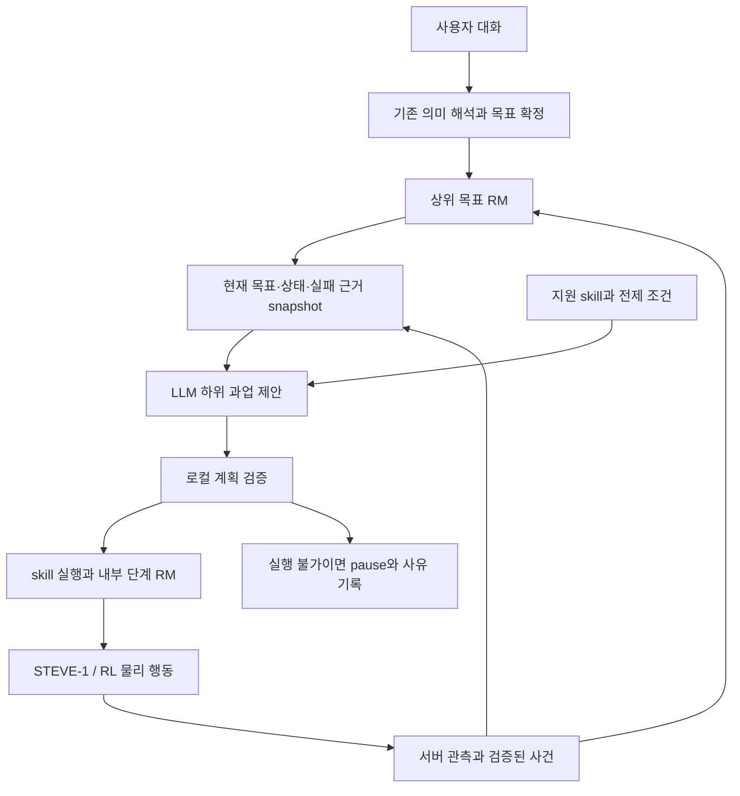

# LLM 상위 플래너 검토안

2026-10-10 우선순위 정정: 기존 두 선택지 복구를 전체 상위 플래너 연결로 해석하지 않는다.
[하위 목표 DAG·우선순위·원래 RM 보존 스케줄러](rm-planner-validation-2026-10-10.md)를 실제 RL
controller에 연결했다. 고정 계획 실제 실행은 원목+1/1004전이이며 LLM 생성 결과가 아니다.
미지원 목적도 제안에는 남고 실행은 차단된다. 실패 후 다음 계획 입력에 이전 계획·실행 결과가 들어간다.
이전의 ‘대안이 없으므로 LLM 호출 자체를 막음’은 새 계획 형식의 제안 단계에는 적용하지 않는다.
별도 승인된 실제 LLM 제안1회는 장애 원인 확인→통로/장애물 끝 이동→우회→기존 수집 복귀를 제안했다.
첫 root 이름 검증 오류를 수정하고 저장 응답을 로컬 재검증했다. 추가 호출/실제 계획 실행0이다.
실행 가능한 하위 skill 한계와 복수 사용자 과업의 장기 스케줄러는 별도 검증 대상이다.
아래 이전 날짜의 기록은 당시 상태를 보존한다.

실패 이력 연결(2026-10-10): [현재 관측·이전 방법·실행 결과→LLM 입력→중복 검사](recovery-memory-validation-2026-10-10.md)를
기존 guard/runtime에 연결했다. 방법의 실제 인자를 비교하고 관측이 바뀐 경우의 재검토를 구분한다.
기존 실제 실패2궤적의 다음 요청 재생과 새 고정 응답 게임1회의 입력/영수증 감사를 완료했다.
새 게임은 원목0·부분 진전1건이며 실제 LLM 추가 호출0이다. 이전 RM과 실패 이력을 보존한다.
이력·검토 계약의 일반화와 실행 가능한 skill의 일반화는 별개다. 현재 live vocabulary와 호출1회 한도는 유지한다.

후속 로컬 수정 완료(2026-10-10): [복구 결과 소비·발견 즉시 인계·재정체 처리](recovery-outcome-fix-validation-2026-10-09.md).
새 고정 응답 실행은478새 나무 발견→479wood→742재정체 중지, 원목0이었다.
서버의 오래된 목표 잠금을 현재 시야로 해석하지 않고, 실제 새 발견이나 상호작용에서만 인계한다.
예산 종료의 무진전은 자동 복귀하지 않으며 원래 RM과 실패 이력을 보존한다.
발견된 나무에 벽이 막힌 경우의 우회 일반화는 미해결이다. 새 API0·다중 RM 스케줄러 미구현.

실시간 유료 연결 결과(2026-10-09): [승인된 LLM1회](planning-recovery-live-validation-2026-10-09.md)가
현재 정체 근거에서 explore_then_resume을 제안했고, 현재 상태 검토 후 실제200tick 탐색/wood 복귀를
실행했다.1579전이/시간 종료·원목0, 벽 횡단·원목 상호작용0이었다. 제안과 실행의 연결은 검증했지만
탐색 skill의 목표 발견 한계가 남았다. 추가 학습0·고정 규칙 대비 인과 효과 미입증·유료 승인 잔여0이다.
다음 단위는 복구 결과의 목표 관련 진전 판정과 잔여 예산/실패 이력에 따른 대응이다.

최신 상태(2026-10-09): [실제 계획 대기/복구·브로커 검사](planning-recovery-validation-2026-10-09.md)에서
정체→중립/RM·기억 갱신→응답 대기→현재 상태 검토→한정된 신경망 탐색→wood 복귀를 연결했다.
고정 응답의 실제2인계 실행은 원목+1/0이었으며 LLM 효과/정책 개선으로 세지 않는다.
실시간 Windows LLM 브로커와 WSL 인터페이스의 무료 통신 검사 뒤 별도 승인을 받아 위 유료1회를 완료했다.
[고정 실행 조건](planning-recovery-live-protocol-2026-10-09.md)은 당시 준비 상태로 보존한다.
복수 RM 우선순위 스케줄러와 복구 후 재정체 처리의 일반화는 남아 있다.

2026-10-09 사용자 추가 지시를 반영했다. [실패 근거와 계층 연결](recovery-failure-evidence-2026-10-09.md),
[실제 일회 조건 전환6회](goal-recovery-validation-2026-10-09.md)에서 상위 wood RM을 보존한 모서리 우회/획득1건을 관측했다.
이 실행에는 LLM이 없었다. 이후 [추가 승인 API2회](recovery-draft-api-validation-2026-10-09.md)에서
두 정체 기록 모두 최대200tick 탐색 후 원래 목표 복귀를 제안했다. 실제 게임 자동 집행은 없었고
고정 규칙 대비 이득은 미검증이다. 실시간 LLM/우선순위 스케줄러의 완료를 뜻하지 않는다.

2026-10-08 추가 사용자 합의: LLM 재계획은 **기존 RM을 삭제하지 않고 목표와 진행도를 보존한 채
우선순위를 조정**한다. 임시 전환·명시적 취소·목표 버전 변경을 구분하며, 취소/대체된 목표와
사용자 pause/STOP을 자동으로 재개하지 않는다. 상세 계약은
[러프 명세의 추가 합의](research-spec-rough.md#추가-합의-rm을-버리지-않고-우선순위를-조정).
기존 RM/완료 증거를 바꾸지 않는 제안 검증은 구현했다. 실제 우선순위 변경/복귀는 미구현이며
아래 실시간 재계획 작업에 포함한다.

상태: **오프라인 계약·기록 대상 API2회·실시간 LLM1회 및 로컬 발견 인계 완료, 막힌 목표의 접근/우회 일반화 미해결**.
사용자가2026-10-07 제안한 LLM planning 참여를 기존 연구 명세에 맞춰 구체화했다.
[2026-10-08 계약 검사](replanning-contract-validation-2026-10-08.md)에서 실제 정체5건의
가상 제안35건을 대조했다. 실제 API 호출/우선순위 전환/게임 dispatch는 연결하지 않았다.
원문 명세와 기본 정책은 유지한다. 아래 그림은 목표 구조이며 전체 구현 완료를 뜻하지 않는다.

## 목적과 현재 상태

사용자의 장기 목표를 유지하면서, 실행 중 정체·자원 변화·실패에 맞춰 다음 하위 과업을
선택한다. 연구 명세4.7의 replanning을 구현하는 방향이며 RL 하위 정책을 대체하지 않는다.
성공은 계획 문장의 타당성뿐 아니라 실제 RM 목표 달성, 반복 실패 감소, 비용/지연으로 평가한다.

`semantic.py`의 현재 `PLANNER`는 대화 의미 해석기다. 원목/흙 수집 순서를 구조화해 제안하지만,
게임 관측을 받아 실시간으로 경로·대안을 정하는 planner는 아니다. `TaskState`에는 task_id,
revision, 현재 plan/stage, completed_stages가 있고 `task_runtime.py`에는 무진전 시 pause가 있다.
RL 수집기는 이 대화 세션 실행기와 별도 경로다. 두 실행기를 동시에 같은 월드에 연결하면 안 된다.

MyWife를 참고한 기존 분리는 유지한다: 의미/도구 선택과 persona 답변 분리, 최근 대화12개,
발췌 요약24개, 사용자별 기억. 근거는 [기존 통합 기록](semantic-integration.md)과 현재
`semantic.py`, `memory.py`다. 이번 검토에서 MyWife 키·개인 대화를 읽거나 복사하지 않았다.

## 방식 비교

| 방식 | 장점 | 현재 제약 |
|---|---|---|
| LLM이 자유로운 STEVE-1 지시문을 계속 생성 | 빠르게 다양한 지시 실험 가능 | 지시 이행 여부와 목표 보존을 보장하지 못함; 별도 실험 조건 필요 |
| **LLM이 검증 가능한 skill/subgoal을 제안하고 로컬 검증기가 선택을 확정** | RM 완료 판정·중단·행동 학습을 유지하며 재계획 가능 | 실행 가능한 skill과 전제/완료 조건부터 갖춰야 함 |
| LLM이 API/코드를 생성해 게임 제어 | 다른 유형의 자동화 연구 가능 | 현재 영상 기반 정책 연구와 제어 조건이 달라 별도 비교 조건이 필요 |

두 번째 안을 제안한다. STEVE-1은 짧은 지시를 영상과 저수준 조작으로 실행하도록 연구된
모델이다. 상위 계획을 붙일 근거는 있지만 임의의 우회 지시까지 성공한다는 보장은 아니다.
[STEVE-1 원 논문](https://arxiv.org/abs/2306.00937).
Voyager의 환경 피드백·skill library는 참고할 수 있으나 실행 코드를 사용하는 체계여서
그 성과를 현재 영상 정책에 그대로 적용하지 않는다.
[Voyager 원 논문](https://arxiv.org/abs/2305.16291).

## 제안하는 경계

LLM 출력은 typed proposal이다. task_id/revision, world/episode 식별자, 관측 sequence와
생성 시각, 선택한 skill ID·인자·예산, 근거 event ID를 포함한다. 근거 없는 월드 사실,
목표 완료 선언, 보상값, 임의 키 입력/실행 코드는 출력 계약에서 제외한다.
RM이 이미 완료됐거나 STOP·사용자 pause/cancel·목표 변경이 발생하면 늦게 도착한 제안을 폐기한다.
과거 대화 요약이나 과거 계획으로 현재 목표를 복원하지 않는다.

호출은 단계 완료, 정체/실패, 유효한 환경 변화에 제한한다. 매tick 호출하지 않는다.
정체 시 현재 dispatch를 멈추고 neutral 확인 후 snapshot을 만든다. LLM 대기와 STOP 처리는
분리하고 timeout/잘못된 응답 시 pause를 유지한다. 사용자 pause를 planner가 자동 해제하지 않는다.
응답 적용 직전 revision·실행 세대·대상/전제 조건을 다시 확인한다. 관측 번호만 다르다는 이유로
무조건 실행하거나 무조건 재요청하는 반복 대신, 바뀐 사실이 제안의 전제에 영향을 주는지 검사한다.
호출/재시도 예산은 실험 시작 전 고정하고 소진 후 반복하지 않는다.
LLM 대기 시간도 세션의180초 제어 예산에 포함하며 응답 때문에 세션을 자동 연장하지 않는다.
기존 task 저장 schema를 planner 이력 때문에 즉시 바꾸지 않고, 제안/검증 결과는 task revision을
참조하는 별도 이벤트로 남긴다. 복원 시 기존 과업의 paused 상태를 유지한다.

Skill 목록은 실제 capability를 반영한다. 원목/흙 수집은 실행 가능하지만 모든 배치에서
성공을 보장하는 것은 아니다. 우회는 아직 검증되지 않았고, 제작/작업대는 명시적 GUI 보조와
학습 정책을 구분해야 한다. ‘우회’, ‘작업대 제작’을 이름만 추가해 실행 가능한 RL skill로
취급하지 않는다. 미지원 제안은 capability 부족으로 남기고 다른 제어로 몰래 대체하지 않는다.

예: 목표는 원목 확보이고 벽 공격 정체가 관측됐다. planner는 대안 경로/다른 나무를 제안할 수
있지만, 이를 수행할 이동 skill이 없다면 아직 실행할 수 없다. 현재 진행 중인 우회 경험 수집이
그 간극을 줄이는 선행 작업이다. 나무 목표를 흙 수집으로 임의 변경하지 않는다.

현재 `WorkshopObservation.java`는 hit 좌표와 일부 원목/작업대 상태를 제공하지만 일반적인
hit 블록 재질이나 검증된 통행 경로 지도를 planner 관측으로 내보내지는 않는다. 따라서
현재 snapshot만 보고 ‘파괴 불가 벽’이나 ‘오른쪽 길이 열렸다’를 단정할 수 없다.
관측 계약에는 필요한 서버 블록 정보 또는 영상 기반 추정과 그 불확실성을 명시해야 한다.
실험용 fixture 설계 정보를 실제 시각 관측인 것처럼 넣지 않는다. privileged 추가 관측은 별도 조건이다.

## 기억과 RL 연결

실행 기억은 RM 현재 상태, 남은 하위 과업, 완료 evidence, 실패 원인/재시도 횟수로 구조화한다.
최근 대화와 발췌 요약은 지시의 참조·선호 해석에 사용한다. 과거 월드 기억에는 source/world ID와
관측 시각을 붙이고 재확인한다. 현재 위치·인벤토리·표적은 실제 최신 관측이 우선한다.
LLM 입력에는 해당 과업에 필요한 상태와 비영 인벤토리 수량만 투영하고, 모든 슬롯/레시피와
수천tick 원시 로그를 그대로 넣지 않는다. 생략 의미와 관측 출처는 함께 전달한다.

RL reward는 서버 사건/RM에서 계산한다. LLM의 칭찬·완료 추정으로 보상을 만들지 않는다.
planner가 선택한 goal/skill ID와 조건 embedding·전환 이유를 각 전이에 기록하고,
학습 입력에도 동일하게 연결해야 한다. 현재 고정 collect-wood 수집과 동적 LLM 선택 수집은
다른 behavior 조건이다. 새 조건을 기록/재현하기 전에는 한 PPO 배치에 혼합하지 않는다.

## 구현·검증할 작업 단위

| 단위 | 완료 근거 |
|---|---|
| 관측 snapshot과 capability 계약 | 실제 정체 로그로 유효/미지원 제안을 구분; 개인정보·무관한 대화 배제 |
| offline planner 제안 검증 | 지연 응답·stale revision·완료/취소·미지원 skill·근거 누락을 fake provider로 거부 |
| 관찰 전용 LLM 시험 | 실행 없이 실제 실패 snapshot에 제한된 제안을 생성하고 사람/로컬 조건과 대조; 비용 승인 별도 |
| 실행 가능한 하위 과업 연결 | 우회/재탐색 skill 자체가 서버 상태 변화로 검증됨; STOP/입력 해제 통과 |
| 제한된 실시간 재계획 | 같은 하위 checkpoint를 고정해 planner 없음/고정 규칙/LLM을 분리 비교 |

마지막 비교에서는 실제 획득, 정체 탈출, 제어 시간/tick, 호출 비용/지연, 잘못된 제안 거부율,
STOP 이후 전송을 측정한다. LLM 문장이 좋아진 것과 게임 성능 개선을 구분한다.
유료 호출 승인 없이 기존 API 키나 과거5회 시험의 승인 한도를 재사용하지 않는다.
이 문서는 구현 결과가 아니며 이번 로컬 실험 결과와 합산하지 않는다.

실제 정체2건과 새 획득1건의 [검토용 snapshot](../results/high-level-planner-cases-20261007.json)을
추출했다. 원시 event hash와 관측 출처를 보존했다. RL episode이므로 존재하지 않는 대화
task_id/revision을 만들어 붙이지 않았고 실행 권한은 false다. LLM의 답변이나 실행 성공 표본이 아니다.
