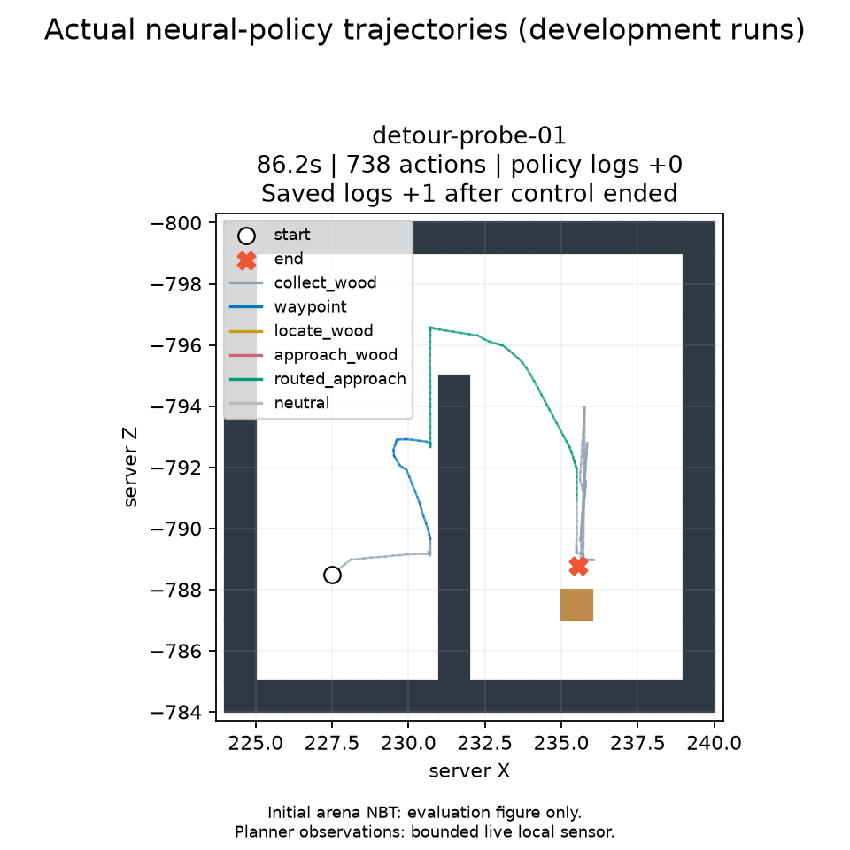
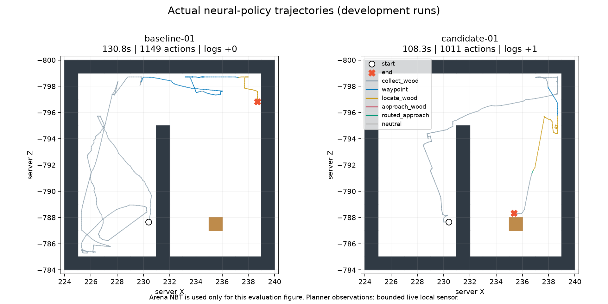

# 통행 가능한 경유점과 나무 우회 접근 — 2026-10-19

사용자 요청에 따라 경유점 선택과 발견한 나무의 접근 경로를 개선하고 로컬 개발 월드에서 실제 신경망 정책을 실행했다.
원본 월드·가중치·연구 명세는 보존했으며 학습, 유료 API, Colab 연결, 최종 평가, GitHub 공개는 수행하지 않았다.

## 구현

- `--rl-navigation-strategy local_passability`로 선택한다. 기존 비교 조건은 유지한다.
- 서버의 현재 위치 주변 13×13칸에서 두 칸의 빈 몸 공간, 마른 바닥, 단단한 지지면을 읽는다.
  모르는 공간, 벽, 지지면이 없는 공간은 경로에서 제외한다. 계단·점프 경로를 보장하는 일반 지형 탐색기는 아니다.
- 현재 위치부터 경유점까지 플레이어 폭 0.6블록이 통과하는지 검사한다. 외벽 밖 목표와 대각선 모서리 통과를 제외한다.
  나무를 모를 때는 관측한 통행 영역에서 덜 방문한 곳과 아직 관측하지 못한 영역의 경계를 향한다.
- 나무의 위치는 기존 서버 시선 ray가 실제로 발견해야 등록된다. 주변 공간 관측으로 새 나무를 검색하지 않는다.
  발견 후에는 기억한 통행 가능 칸을 BFS로 연결하고, 나무와 실제 시선이 통하며 상호작용 거리 안인 위치를 향한다.
  가장 가까운 직선 목표가 벽 건너에 있으면 벽 끝을 돌아가는 중간 목표를 선택한다.
- 좌표 목표는 기존 학습된 navigation actor의 실제 입력에 연결한다. `approach_wood`의 actor/embedding 해시를 실행 registry에 명시하고,
  `local_route`, `waypoint_goal`, `subgoal_context`를 전이와 학습 특징 저장본 양쪽에 기록한다.
  이동·시점·채굴을 키 스크립트나 API로 대체하지 않는다. 접근 완료는 실제 서버의 상호작용 가능 상태로 판단한다.
- 점프 중에는 바닥 높이를 잘못 바꿔 지도를 지우지 않는다. 최신 관측에서 닫힌 칸은 경로에서 제거하고,
  반복된 낮은 이동량은 일시적인 재계획 근거로만 사용한다. 원목 목표 RM·보상·종료 조건은 바꾸지 않는다.

이 조건은 **서버 위치·주변 통행 정보·기존 나무 관측을 쓰는 privileged 조건**이다. 영상 전용 개선으로 분류하지 않는다.
평가 그림의 전체 NBT 지도는 정책에 공급하지 않았다.

## 원래 corner 시작 월드의 실제 비교

두 실행의 시작 ZIP, 모델, 샘플링 시드 14031, 게임 시드 104761, 180초 제어 한도, 고정 플래너, Java 패치를 맞췄다.
같은 로컬 관측을 기록하되 기준 방식은 이를 의사결정에 사용하지 않는다.

| 실행 | 종료 | 제어 시간 | 행동 수 | 계획 호출 | 서버 원목 |
|---|---|---:|---:|---:|---:|
| `baseline-01` / `coverage_motion` | `planning_request_budget_exhausted` | 130.793초 | 1,149 | 3 | 0 |
| `candidate-01` / `local_passability` | `target_reached` | 108.260초 | 1,011 | 1 | +1 |

기준 실행은 나무를 발견하지 못했다. 경유점 세 개 중 두 개가 실패했고, 두 번째 목표의 Z=-800.583은 외벽 밖이다.
개선안은 통행 가능한 경유점 `[238.5, 201, -795.5]`에 34행동으로 도착했다.
이후 탐색 87행동으로 923번째 행동에서 나무를 발견하고, 접근 1행동 후 원래 수집 정책으로 돌아가 원목을 얻었다.
따라서 이 비교는 경유점→발견→실제 수집의 동작 증거다. 발견 후 긴 벽 우회는 이 실행에서 검증되지 않았다.

두 실행은 첫 화면이 같지만 7번째 행동부터 달라졌다. 한 쌍의 개발 실행으로 성공률 향상이나 시간 단축의 인과 효과를 주장하지 않는다.
실패 기준 실행의 `execution_valid=false`는 계획 중단 상태이며, 별도 감사로 실제 전이의 무결성을 확인했다. 런타임 예외는 없었다.

## 발견된 나무의 벽 우회 추가 검증

`known-target-protocol.json`에 기준/개선 각 1회, 같은 180초 한도를 실행 전에 기록했다.
같은 미로의 플레이어 위치·방향만 바꾼 `worlds/known-corner.zip`을 생성했다.
원본 ZIP의 지형·인벤토리와 나머지 파일은 바꾸지 않았다. 서버의 실제 시선 관측과 실제 정책 행동으로 판정한다.
준비용 월드 편집은 학습 정책 성공으로 세지 않는다.

| 실행 | 종료 | 제어 시간 | 행동 수 | 계획 호출 | 서버 원목 |
|---|---|---:|---:|---:|---:|
| `known-baseline-01` | `target_reached` | 77.940초 | 721 | 0 | +1 |
| `known-candidate-01` / 수정 전 | `provider_requested_pause` | 89.196초 | 821 | 1 | 0 |

두 실행 모두 첫 행동부터 서버가 나무를 인식했다. 기준 실행은 원래 수집 정책이 먼저 우회해 성공했다.
수정 전 개선안은 점프 중 복구에 진입했다. 발 높이의 공중 평면을 검사해 모든 경유점을 제외한 구현 문제가 확인됐다.
이 실패를 숨기거나 성공 표본으로 바꾸지 않았다. 원시 궤적·월드와 행동 감사를 보존했다.

수정 후에는 현재 위치에서 아래 두 높이까지의 실제 지지면을 검사하고, 그 지지면에 투영한 플레이어 몸통 경로를 검증한다.
공중 평면을 지도로 사용하거나 지난 관측을 현재의 통행 증거로 대신 사용하지 않는다.
실제 지지면이 관측되지 않거나 낙차 범위를 벗어나면 경유점을 만들지 않는다.

`detour-probe-protocol.json`의 마지막 1회는 우회 모듈 자체를 검증하는 별도 진단이다.
격리 소스 사본에서 최초 수집의 목표 정체 대기만 800틱→32틱으로 줄인다. 배포용 소스의 대기 기준,
복귀한 수집 정책의 감시기, 신경망 가중치, 행동·보상은 바꾸지 않는다.
이 진단은 기본 설정의 성능이나 학습 성공으로 합산하지 않는다.

`detour-probe-01`에서 경유점 이동 51행동 뒤, 우회 접근 actor가 **107행동·12.484블록**을 이동했다.
접근 시작 `[230.588, 201, -792.836]`에서 벽 북쪽 끝을 돌아, 162번째 행동의 `[232.258, 201, -796.310]`으로 건넜다.
211번째 행동에서 `[235.503, 201, -790.892]`에 도착해 서버가 나무 상호작용 가능 상태를 확인했다.
이는 벽 왼쪽의 발견된 목표에 대해 새 접근 모듈이 실제로 우회한 증거다.

이후 원래 수집 정책의 60초 노드 예산이 끝나, 제어 기록은 86.219초·738행동·원목0,
`root_skill_budget_exhausted`/`planning_paused`로 종료됐다. **정상 완료 성공으로 올리지 않는다.**
별도로 저장 NBT에는 원목1개가 확인됐다. 마지막 정책 관측의 world time=864와 저장 time=866 사이에 수집됐으며,
마지막 정책 관측 이후 입력 해제의 중립 명령과 저장이 있었다. STOP 뒤 새 정책 행동은 없었다.
저장된 월드에서는 실제 원목 획득이 확인되지만, 제어 시간 내 완료와는 구분한다.
`detour-probe-01/detour-evidence.json`에 이 두 판정과 실제 벽 끝 통과 좌표를 함께 기록했다.



## 확인과 보존

- 최종 관련 단위·통합 테스트 76개 통과 후, 공중에서 플래너가 유효한 경유점을 유지하고 STOP을 지키는 회귀 검사를 추가했다.
  해당 제어 검사 3개도 통과했다(전체 고유 검사 77개). 로그는 `test-suite-final.log`, `test-airborne-control.log`에 있다.
- 다섯 실행 모두 행동 확률 재계산 최대 오차 0, 보상과 행동 매핑 일치, 원래 목표 보존을 확인했다.
  STOP 이후 inference/dispatch 0, 입력 해제 뒤 held key 0, 남은 소유 PID 0이다.
- 각 실행의 닫힌 월드 19파일을 해시와 함께 별도 보존했다. 첫 비교의 저장 NBT는 기준0개/개선1개로 실행 중 판정과 일치한다.
  마지막 진단은 위에서 설명한 제어 종료/저장 시점 차이를 그대로 남긴다.
- 현재 PC의 검토된 upstream JAR 해시와 Java 소스 핀을 지원하고, 캐시 키에 upstream/패치 소스를 모두 포함시켰다.
  다른 JAR나 변경된 검토 원본은 거절한다. 첫 네 실행의 패치 JAR SHA256은
  `331e1452dab0dc3a3b631c62a06dee43af10be1d30541a0c90d788f0304df0c9`,
  지지면 수정 후 JAR는 `3ebc2da8dba24d3b7b01e03172c3c0b430ac85dd0ceb4c292c88c31fb87a365b`다.
- 모든 실행별 소스 사본, 명령, 원시 궤적, 화면, 플래너 입력, 결과, 감사, 저장 월드를
  `results/local-navigation-detour-20261019/`에 보존한다.
- 최종 묶음 검증은 `final-verification.json`이다. 저장 사본과 원래 닫힌 월드의 파일 해시, 원본 입력의 해시,
  진단 사본에서 수정한 모듈이 `goal_recovery.py` 하나뿐임을 함께 확인했다.

완료된 실행 이름으로 다시 실행하면 덮어쓰기를 거절한다. 후속 개발 검증이 필요할 때만 새 이름을 사용한다.

```powershell
Set-Location C:\MinecraftRL
python scripts/run_local_navigation_comparison.py new-development-check --strategy local_passability
```

이 명령은 동일한 로컬 개발 입력을 사용한다. STOP 파일이 새 사용자 중단 내용을 담고 있으면 자동으로 재가동하지 않는다.


