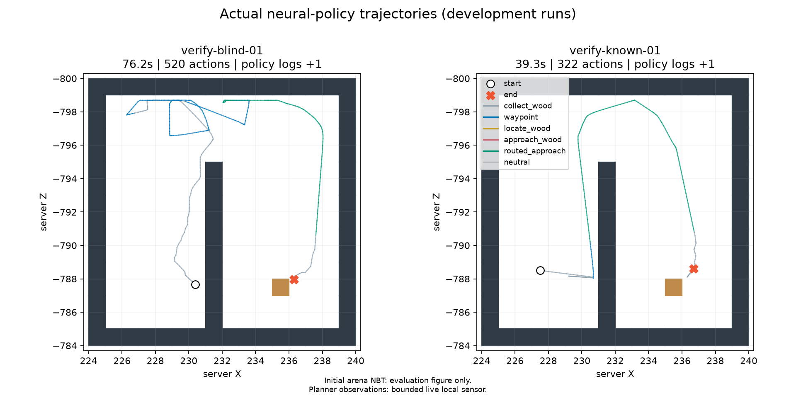

# 벽 우회·발견·원목 획득의 반복 검증 — 2026-10-19~20

사용자 요청으로 `local_passability` 조건의 탐색과 채집 연결을 개선했다.
1차 반복 검증의 미발견 실패를 보존하고 주변 시선 관측을 보완했다.
최종 보완판의 고정 코드 반복 6회 모두 실제 원목을 얻고 `target_reached`로 정상 완료했다.
제어 시간은 39.324~76.218초로 전체 180초 한도 안이다. 같은 미로의 두 시작점에 대한 개발 검증이다.

## 변경과 판정 기준

앞선 진단은 원목을 저장 시점에만 확인했고, 제어 중에는 60초 수집 노드 예산이 끝났다.
원시 행동에서는 나무 앞에서 공격을 간헐적으로 놓거나 시선을 바꿔 채굴이 끊겼다.

- 기존 정체 감지기를 재사용하되, 이 모드에서만 탐색 80틱·접근 64틱의 무진행 창과
  목표 진행 160틱 한도를 적용한다. 기존 방식의 감지기 설정은 유지한다.
- `locate_wood`에서도 통행 가능한 경유점을 계속 갱신해 기존 navigation 신경망에 전달한다.
  탐색 노드 한도는 100틱/20초에서 등록된 skill 한도인 200틱/30초로 조정했다.
  시선으로 새 원목을 발견하면 기존 단계 판정에 따라 접근으로 전환한다.
- 현재 서버가 원목 채굴을 확인하고, 실제 시선 블록과 채굴 대상이 일치할 때만
  수집 신경망의 샘플링 온도를 1.0에서 0.35로 낮춘다. 매 행동을 신경망 분포에서 새로 뽑는다.
  시선이 벗어나거나 블록이 사라지면 즉시 1.0으로 돌아간다. 공격 유지 스크립트나 강제 이동은 없다.
- 실제 사용한 온도·경유점·단계 정보를 원시 전이와 특징 저장본에 남기고, 해당 분포로 행동 확률을 재계산한다.
  학습용 분포와 혼동하지 않도록 기존 개발 궤적의 학습 부적격 표시를 유지한다.
- 상위 원목 RM·보상·인벤토리 완료 기준, 전체 180초 제어 한도, 수집 노드 60초/600틱 한도는 유지한다.

성공은 제어 중 원목 증가, `target_reached`, `execution_valid=true`, worker exit 0,
180초 이하 제어 시간과 저장 NBT를 함께 확인한다. 정리·저장 이후에만 얻은 원목은 정상 성공으로 세지 않는다.
Minecraft/모델 시작 시간은 기존 프로토콜과 동일하게 제어 시간과 구분한다.

## 실행 조건

원래 `corner.zip`과 같은 지형에서 위치·방향만 바꾼 기존 `known-corner.zip`을 사용한다.
모든 시작 인벤토리는 비어 있고, 매번 새로운 격리 월드에 복원한다.
고정 신경망 가중치와 게임 시드 104761을 사용하며, 행동 샘플링 시드만 사전 지정해 바꾼다.

| 구분 | 시작점 | 행동 시드 | 용도 |
|---|---|---|---|
| 2차 개발 | 원래 미발견 시작 | 15102 | 1차 실패 시드의 탐색→발견→접근→획득 점검 |
| 2차 개발 | 벽 너머 원목 관측 시작 | 15002 | 발견 후 우회→획득 점검 |
| 고정 코드 반복 | 각 시작점 3회 | 15101, 15102, 15103 | 동일 코드의 반복 동작 확인 |

최종 계획은 `results/local-navigation-reliability-v2-20261019/protocol.json`,
반복 실행 전 소스 92파일 해시는 같은 폴더의 `verification-freeze.json`에 고정했다.
실행별 소스 사본·명령·화면·전이·인벤토리·종료 감사·닫힌 월드 사본을 모두 보존한다.
완료된 실행 이름으로 다시 실행하지 않는다. 개발에 사용한 시드를 포함하므로 연구용 최종 평가와 구분한다.

## 1차 결과와 발견 센서 보완

1차 결과는 `results/local-navigation-reliability-20261019/`에 있다.
개발 실행은 시드15001의 `dev-blind-01` 47.791초/396행동/원목+2,
`dev-known-01` 74.205초/567행동/원목+2로 모두 정상 완료했다.
두 실행 모두 저장 NBT도 원목2개이며 행동확률 재계산 오차0, STOP 뒤 행동0, 해제 후 키0, 잔여 소유PID0이다.

1차 고정 코드 반복: `verify-blind-01`은 59.585초/원목+1로 정상 완료했지만,
`verify-blind-02`는 61.301초/424행동/원목0으로 `same_failed_condition` 중단했다.
탐색 200행동을 소진한 뒤 새 경유점으로 이동했지만 같은 실패 조건의 탐색 재시도가 거부됐다.
화면 300/320에는 나무가 보이는데 중앙 시선 ray가 빗나가 계속 미발견 상태였다.
3회차는 STOP에 의해 게임 실행 전에 차단됐고, 나머지 예정 실행은 수행하지 않았다.
1차 검증을 6회 완료 또는 6회 성공으로 집계하지 않는다. `batch-interruption.json`에 보존했다.

2차 결과 폴더는 `results/local-navigation-reliability-v2-20261019/`이다.
`local_passability`의 JVM에만 `minecraftRL.cameraWood=true`를 설정하여,
기존 중앙 시선이 새 원목을 찾지 못할 때 수평 ±40도·수직 ±20도, 5도 간격, 16블록 범위를 검사한다.
각 ray에서 첫 충돌 블록이 원목일 때만 발견을 인정한다. 나무 블록을 전역 검색하지 않는다.
시선 방향·충돌 위치·틱을 기록하고, 640×360/수직 FOV70 화면 안의 증거인지 별도로 검증한다.
이것은 서버 시야 센서의 확장이고, 영상 인식 모델 개선은 아니다.
재시도 방지 규칙을 우회하지 않았으며 원본 관측 조건의 이전 결과는 그대로 유지한다.

## 최종 보완판의 개발·고정 코드 반복 결과

2차 `dev-blind-01`은 직전 실패 시드15102로 57.461초/415행동/원목+1 정상 완료했다.
47번째 행동에서 수평+25도·수직-20도 시선이 벽 위에 실제로 보이는 원목에 닿았다.
그 화면은 `dev-blind-01/run/frames/000047.png`, 시선 좌표는 같은 전이의
`wood_camera_acquisition`에 있다. 경유점38행동, 접근126행동 뒤 수집78행동으로 완료했고,
저장 NBT도 원목1개였다. 첫 버전의 실패를 이 성공으로 덮어쓰지 않는다.

2차 `dev-known-01`은 67.644초/472행동에 제어 중 원목+1로 정상 완료했다.
저장 NBT에는 2개가 있으나 정리 중 추가된 1개를 제어 중 획득량에 더하지 않는다.

이후 코드를 고정한 6회 결과는 다음과 같다. 모든 행에서 `execution_valid=true`, worker exit 0이다.

| 실행 | 시작점 | 행동 시드 | 제어 시간(초) | 행동 수 | 제어 중 원목 증가 | 저장 NBT 원목 | 종료 |
|---|---|---:|---:|---:|---:|---:|---|
| verify-blind-01 | 미발견 | 15101 | 76.218 | 520 | +1 | 1 | target_reached |
| verify-blind-02 | 미발견 | 15102 | 63.204 | 440 | +1 | 1 | target_reached |
| verify-blind-03 | 미발견 | 15103 | 55.858 | 368 | +1 | 1 | target_reached |
| verify-known-01 | 발견 상태 | 15101 | 39.324 | 322 | +1 | 1 | target_reached |
| verify-known-02 | 발견 상태 | 15102 | 39.663 | 331 | +1 | 1 | target_reached |
| verify-known-03 | 발견 상태 | 15103 | 64.803 | 523 | +2 | 2 | target_reached |

미발견 시작 3회는 각각 행동 200, 62, 10에서 원목을 발견했다.
첫 반복은 경유점 재계획을 한 번 거쳐 성공했다. 세 반복 모두 경유점 이동·나무 접근·수집 재개가 기록돼 있다.
각 실행의 `reliability.json`에 제어 중 인벤토리 증가, 단계별 행동 수, 정상 종료, 저장 NBT를 함께 기록했다.

위 그림은 최종 반복의 첫 미발견 시작과 첫 발견 상태 시작이다.
실제 이동 궤적이 벽 끝의 통로를 돌아 나무에 접근한다. 전체 지도는 저장 월드로 만든 사후 평가용이며 정책 입력이 아니다.
1차 개발 궤적도 `results/local-navigation-reliability-20261019/development-paths.png`에 보존한다.

## 검증 자료

GitHub에서 읽을 수 있는 [검증 요약·원본 해시·실패 기록](reports/2026-10-20/README.md)을 함께 제공한다.
아래 `results/` 경로는 대용량 원본을 보존한 로컬 경로다.

1차 관련 검사 96개, 주변 시선 증거 검증을 포함한 2차 검사 99개가 통과했다.
각 결과 폴더의 `test-development.log`에 원문 결과를 보존하고, 2차 Java 컴파일 결과는 `java-build.log`에 있다.
최종 반복 완료 및 파일 보존 검증 결과는 `results/local-navigation-reliability-v2-20261019/final-verification.json`으로 확인한다.
최종 확인은 `complete=true`, 개발 2/2회와 고정 코드 반복 6/6회 성공이다.
실행별 `run/rm-navigation-audit.json`은 신경망 행동 확률 재계산·단계 연결·시야 증거·종료 처리를 독립적으로 감사한다.
8회 모두 행동 확률 재계산 최대 오차0, STOP 뒤 정책 행동0, 입력 해제 후 키0, 잔여 소유 PID0이다.
고정 소스92파일, 8회의 동일 JAR, 닫힌 실행 월드152파일의 원본·사본 해시를 확인했다.
원본 가중치·월드·연구 명세 해시가 유지되며, 배치 종료 후 STOP 파일도 유지한다.

## 적용 범위

서버 위치·주변 13×13칸 통행/지지면·중앙 및 주변 시선 원목 관측을 쓰는 privileged 조건이다.
새 원목의 위치를 저장 NBT나 전체 지도로 탐색하지 않는다. 그림의 전체 지도는 사후 평가용이다.
영상 전용 성공이나 학습 성능 향상으로 분류하지 않는다. 실험 단계에서 학습·유료 API·Colab·최종 평가를 수행하지 않았다.
실험 이후 사용자의 별도 요청으로 개선 코드와 위 검증 요약을 GitHub 게시 범위에 포함했다.
검증 범위는 같은 미로의 두 시작점이다. 다른 미로·일반 지형에서의 성공률을 보장하지 않는다.
