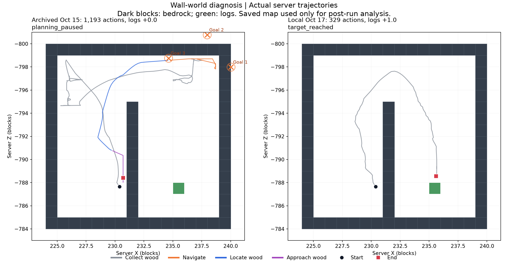

# 벽 뒤 원목 과업의 로컬 실행과 실패 원인 분석 — 2026-10-17

이번 로컬 실행은 **38.110초·정책 행동329회·원목+1개로 성공**했다.
따라서 공개된 실패가 새 PC에서 그대로 재현됐다고 보고하지 않는다.
대신 동일 시작 월드·가중치의 성공 궤적과 공개 실패 원본을 비교했다.
공개 실패의 확인된 병목은 **외벽 밖 경유점 선택과 나무 발견 후 내부 벽을 우회하지 못한 접근**이다.

## 선택한 조건과 비교 가능성

사용자는 특정 실행 ID 없이 저장소의 벽/미로 원목 실패를 설명했다. 공개된 최신
`oct15-motion-corner`를 대표 진단 대상으로 선택했다. 사용자가 이전에 본 실행과 같은 개별
에피소드인지는 미확정이며, 이 결론을 다른 실패 모두에 일반화하지 않는다.

- GitHub main과 로컬 HEAD: `de1d2f932918382dba76ab1a790b788ad00f4346` 일치.
- 공개 자료: `research-20261015`, 전달 기준 커밋 `70d7f6202295643400c44010c13b09e86de120f7`.
- 시작 월드: development corner, seed104761, SHA256 `cbd7890bc992accf4093d6d156f7187f0b03a0af484a40e822ec467f751698a3`.
- 원목 checkpoint: `473142f1283521eb4417d3b4c6f568af27ad4b1a83113c4b506c9f2f6da153dd`.
- 이동 checkpoint: `e033f1ef7902102569d01459d85cdd80252c141f4e1346bdb40832502e8acaea`.
- sampling seed14031, 180초 상한, 고정 RM 계획 최대3회, `coverage_motion`.
- `eval` 개발 진단이며 학습·최종 평가·유료 API·실제 LLM 호출은 없다.

릴리스 자료5묶음의2,575파일을 새 결과 폴더의 `assets/`로 복원·검증했다.
기존 설치 기록과 충돌하지 않으며 원본 결과·체크포인트를 덮어쓰지 않았다.
당시 실행 소스의 사본을 사용하고, 임베딩 catalogue는 로컬 경로만 바꿨다.
실행 사본의 유일한 코드 차이는 아래 JAR 호환성 어댑터다. 정책/플래너 코드는 변경하지 않았다.

| 항목 | 공개 실패 원본 | 새 PC 실행 |
|---|---:|---:|
| 제어 시간 | 141.831초 | 38.110초 |
| 실제 전이 | 1,193 (신경망1,187 + 중립6) | 329 (전부 신경망) |
| 서버 원목 증가 | 0 | 1 |
| 최초 원목 표적 확인 | 1,093번째 행동 후 | 163번째 행동 후 |
| 접근 가능 관측 | 0회 | 151회 |
| 복구 계획 호출 | 3 | 0 |
| 종료 | `planning_paused` | `target_reached` |
| `execution_valid` | false | true |

최초 PNG, 초기 head 지문, 초기 recurrent state 지문은 같다. 그러나 `000004.png`부터
화면이 달라지고22번째 행동부터 정책 행동이 달라진다. GPU/JAR/실행 환경이 다르므로
동일 seed가 동일 궤적을 보장하지 않는다. 차이의 원인을 GPU 성능 하나로 확정하지 않는다.
이번 성공은 복구 전 원래 수집 정책의 성공이며, 복구 알고리즘이 개선됐다는 증거가 아니다.

## 실패 원본의 단계별 판정

| 단계 | 실제 근거 | 판정 |
|---|---|---|
| 원래 수집 정책 | 800행동 동안 서버 원목 표적 잠금0, 원목0 | 탐색/시점 정렬이 획득으로 연결되지 않음 |
| 첫 복구 이동 | 외벽 밖 목표, 82행동 후 `observed_blockage` | 도달 불가능한 후보 선택 |
| 둘째 복구 이동 | 다른 외벽 밖 목표, 100행동 후 예산 소진 | 도달 불가능한 후보 선택 반복 |
| 셋째 복구 이동 | 35행동에 경유점 도착 | 이동 부분 완료; 나무 접근 성공은 아님 |
| 나무 찾기 | 70행동 후 표적 `(235,204,-788)` 확인, 거리6.774블록 | 발견 완료 |
| 나무 접근 | 100행동, 이동 입력93회 중51회 수평 이동0.02블록 미만 | 벽에 막힌 접근 실패 |

원본 NBT의 외벽(y201..204)을 전수 확인했다. 첫 두 경유점은 플레이어가 설 수 있는
내부 영역과 각각1.336·2.069블록 떨어져 있어 도착 반경0.35블록과 겹치지 않는다.
이는 정책에 알려준 지도가 아니라 **실행 후 평가에만 사용한 지도**다.

발견 직후 실제 화면에는 나무가 보인다. 이후 접근은 내부 벽 왼쪽에 머물렀고
플레이어 중심 x는230.700에서 막혔다(벽 블록 x231). 표적은 벽 반대편 x235에 있다.
표적까지 최소 거리는4.874블록, 마지막 거리는5.235블록이며 접근 가능/채굴 관측은0이다.
따라서 이 실행의 마지막 실패를 **끝까지 나무를 발견하지 못함**으로 분류하면 틀린다.

실제 종료 이유는 `planning_request_budget_exhausted`다. 접근100행동 예산을 소진한 뒤
이미3회의 계획을 사용해 중지했다. 전체180초 timeout이나 런타임 크래시가 아니다.

서버의 `target_known`은 화면 전체의 객체 검출이 아니다. 시선 중앙의16블록 ray가 원목에
닿으면 표적을 저장하고, 시선을 돌린 뒤에도 유지한다. 따라서 초기 표적 잠금0만으로
모델이 영상 속 나무를 한 번도 인식하지 못했다고 확정할 수 없다.

## 원인과 수정 우선순위

1. **이동 후보에 통행 가능성 검증이 없다.** 현재 후보는 위치·방문·실패 기억으로 선정하며,
   terrain을 `unknown`으로 둔다. 이번 실패의 첫 두 선택은 실제로 외벽 밖이었다.
   관측한 충돌과 경계를 이용해 도달 가능한 국소 경유점을 선택하도록 보강할 필요가 있다.
2. **발견과 접근을 구분하지만 접근 자체가 우회를 보장하지 않는다.** `approach_wood`는 기존
   신경망에 `walk toward the tree` 임베딩을 적용하는 실행이다. 성공 조건은 서버의 접근 가능
   관측이지만, 실패 궤적에서는 나무 방향으로 이동하다 내부 벽에 막혔다. 발견한 표적을 유지하면서
   접근 실패를 이동 복구로 연결하는 동작을 별도 검증해야 한다.
3. **시간만 늘리는 것은 해결 근거가 아니다.** 잘못된 목표나 벽을 향한 접근에 시간을 더 주는
   것보다 목표 선택과 접근 복구의 실패 조건을 먼저 다뤄야 한다. 이번 작업에서는 정책을 수정하거나
   재학습하지 않았다.

새 실행은 같은 벽 끝을 돌아 나무 쪽으로 진입했다. 정적 NBT에서도 시작 칸에서 원목 인접 칸까지
두 블록 높이 통로가 존재한다(상하좌우 칸 이동20회). 이 수치는 학습 정책 성과가 아니다.

## JAR 호환성, 검증 및 보존

현재 기본 JAR `e5a27c6f...`는 과거 `f7a1e0aa...`와 다르다. 단순 해시 상수 교체 대신
패치 전체 소스 조합이 과거 `58b912b13fbd74933c510c70ba14f9bc911266ce97eb8bc02196422f96e2fc49`와
일치하고, 현재 JAR 대상 Java8 컴파일 및 동일11개 class 출력이 통과함을 먼저 확인했다.
진단용 실행 사본에서 이 **정확한 JAR+패치 조합만** 추가 허용했다. 캐시는 upstream별로
분리하고 영수증도 검사한다. 미검토 빌드/소스 거부 등4개 소프트웨어 검사도 통과했다.
원래 소스와 설치 JAR는 유지했으며 이 어댑터를 일반 지원으로 승격하지 않았다.
게임 실행 후 저장 barrier, 서버 관측과 저장 NBT까지 확인했다.

새329전이 전체의 저장 특징→행동확률 재계산 오차0, RM 보존, 학습 갱신0,
STOP acknowledgment 뒤 추론/정책 전송0, 해제 후 held key0, 소유 잔여 PID0을 감사했다.
종료 후에도 별도 프로세스 조회에서 관련 게임 프로세스가 없었고 `results/STOP`을 유지한다.

최종 정책 전이에서 서버 인벤토리 원목+1로 완료를 판정했다. 종료 저장 NBT의
`level.dat/Player`와 playerdata에는 원목2개가 있다. 관측 시점이 다르므로 위 성과 표는
실행 중 확인한+1을 사용한다. 종료 경계의 추가 수량을 새 정책 행동이나 별도 성공으로 세지 않는다.
새 월드19파일은 원본을 유지한 채 사본/SHA256을 보존했다. 고정 입력10개와 연구 명세도 불변이다.

근거는 `results/local-wall-diagnosis-20261017/`에 있다:

- `protocol.json`, `runtime-compatibility-review.json`: 사전 조건·호환성 검토.
- `diagnosis.json`, `maze-geometry.json`: 두 실행의 단계·NBT 분석과 한계.
- `attempt-01/run/{summary,rm-navigation-audit}.json`: 실제 완료·329전이 감사.
- `attempt-01/run/{events.jsonl,goal-recovery-rows.json,trajectory.pt}`: 원시 정책/서버 기록.
- `attempt-01/world-preservation.json`: 종료 월드19파일과 저장 인벤토리.
- `assets/`: 검증한 공개 실패 원본과 가중치·월드, `execution-source/`: 진단용 사본.

분석 그림용 Python 패키지는 결과 폴더의 `analysis-deps/`에만 설치했다.
STEVE-1 학습 환경을 변경하지 않았고 GitHub 게시·유료 자원·Colab 작업은 없다.
