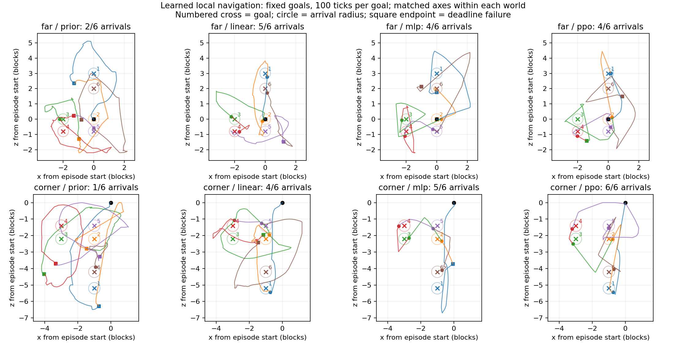

# 이동 교정·BC 비교·짧은 이동 RL

**이번 개발 검증 단위 완료.** 교정 수집, BC 비교, 짧은 이동 PPO와 실제 개발 평가를 마쳤다.
기존3/12도착→선형BC9/12→비선형BC9/12→비선형BC+PPO10/12를 관측했다.
두 개발 월드의 알려진 목표에 대한 소규모 결과이며 일반화나 기본 정책 승격의 근거로 쓰지 않는다.
[실행 전 조건과 결정](navigation-refinement-plan-2026-10-14.md),
전체 원본 `results/navigation-refinement-20261014`. 원문 명세·최종5시드·기본 정책은 유지한다.

## 학습 범위

기존 STEVE-1의 영상/기억/원목 정책은 동결하고 좌표를 받는 이동 head의 보정 부분을 학습한다.
전체 모델의 end-to-end RL이 아니다. privileged 서버 좌표와 fixture의 알려진 빈 공간 목표를
사용하므로 자연 탐험·영상 전용·벽 우회 성과와 구분한다.

- 선형: 기존 이동 prior+목표/이동10차원 선형 보정,87,620파라미터.
- 비선형: 같은 prior+시각16차원 투영과 목표/이동 입력의64차원 tanh 보정,638,746파라미터.
  시각 투영과 구조가 함께 달라지므로 비선형성만의 인과 비교가 아니다.
- 출력0초기화로 시작 분포를 보존한다. 기존 목표6개와 직전1tick의 몸 기준 이동2개·시선 변화1개·
  남은 행동 예산1개를 입력/로그에 연결한다. 수평0.35블록/높이1.5블록·GUI 닫힘 기준을 유지한다.
  이미 만족한 목표는0행동 생략이며 이동 성공/보상 획득으로 세지 않는다.

## 교정과 BC

학생 실제 이동→중립 입력 해제 확인→같은 목표의 교사 인계다. 교사 조향도 공식 행동 공간으로
양자화한 값을 실제 실행한다. 전 소유자의 화면을 순서대로 인코딩하고 전달된 행동에만 기억을
commit한다. 학생/중립은 문맥이며 BC 정답은 교사 행동만이다. 교사 개입 게임은 PPO 자료가 아니다.

| 분할/seed | 전체 전이 | 학생 | 중립 | 교사 정답 | 학생32행동 내 도착 | 교사 도착 |
|---|---:|---:|---:|---:|---:|---:|
| train104743 |337|192|6|139|0|6|
| train104759 |329|192|6|131|0|6|
| development104761 |334|192|6|136|0|6|

총1,000전이의 저장 특징 logp·공식 행동 변환·목표 입력·이동 보상·원래 RM 보상을 재생 감사했다.
logp/원래 보상 오차0, STOP뒤 새 추론/전달0·해제키0·소유PID0이다.
학생32행동 내0회는 이후100행동 평가의 기준선 성공률이 아니다.

train270정답의 각도오차 구간(≤15,15~45,45~135,>135도)은186/41/42/1개,
1블록 이내36개다. 뒤쪽 목표 자료는 아직 작다. 두 후보 모두 train에서만 계산한
각도4구간×근거리 여부의 빈도 역제곱근 가중치(원가중치 최대3,평균1)를 사용한다.
개발136정답은 optimizer와 가중치 계산에서 제외한다.

lr0.003/KL0.01/batch32/24epoch/seed14101, 후보마다216갱신.
학습 스크립트113.78초/GPU 최대 할당448.97MiB를 기록했다.

| 개발 교사 정답 지표 | 기존 | 선형 BC | 비선형 BC |
|---|---:|---:|---:|
| 평균 NLL |4.8873|3.6353|2.7694|
| 저장·재로드 분포 오차 |—|0|0|

NLL 감소는 정답 예측 개선이며 게임 도착 증거가 아니다. 학습 보고서의
`stored_logp_max_error`는 학습 후에는 **기존 행동 정책과의 분포 차이**다.
저장/재로드 오차는 별도 `reload_error`이므로 혼동하지 않는다.

## 이동 RL 계약

원래 wood RM 보상은 유지하며 별도 이동용 value/PPO를 사용한다.

`r = task - 0.002 + 0.2 × (0.99 × Φ(next) - Φ(current))`

`Φ = -min(수평 거리,16)/4`. 도착task+1,100tick 기한 실패task-1, 진짜 option 종료potential0.
남은 기한은 입력에 포함하며 목표가 바뀌면 GAE를 이어 붙이지 않는다. STOP/전체 시간/관측 실패의
중단을 기한 실패로 만들지 않고 학습에서 거부한다. PPO에는 학생 행동만 허용한다.

BC 개발 도착 수→총 행동 수→작은 선형 head 순서로 후보를 고른다. 이는 개발 기반 선택이다.
동일 후보의 train2게임 후 lr0.0001/clip0.1/value0.5/KL0.01/최대4epoch를 적용한다.
전체 KL0.03초과 epoch는 되돌리고 종료한다.

선택된 비선형BC로 train104743/104759에서 각각379/264전이, 각5/6도착을 기록했다.
두 게임 모두 교사/중립0이며643전이의 행동확률/이동보상/value 감사 오차0이다.
이 on-policy 자료로4epoch·84갱신을 완료했다. epoch별 KL은
0.014612/0.005476/0.006848/0.008865로 rollback은 없었고, 재로드 오차0·원래 root 보존이다.
이동 보정638,746개와 별도 value132,225개, 합770,971파라미터를 학습했다.
학습44.83초/최대 할당450.50MiB다. 훈련 도착10/12는 별도 개발 성과로 세지 않는다.
보존한 PPO 후보는 `results/navigation-refinement-20261014/ppo/mlp/checkpoint.pt`,
SHA256 `e033f1ef7902102569d01459d85cdd80252c141f4e1346bdb40832502e8acaea`다.
BC 두 후보와 기존 정책도 각각의 원래 경로에 유지한다.

## 실제 개발 비교

기존/선형BC/비선형BC/PPO 각각 far/corner1회, sampling14131, 목표당100tick/전체180초이다.
1행동=서버1tick을 검증하며 지연과 서버tick 시간을 구분한다. 한 에피소드의6목표를
독립적인6세계로 해석하지 않는다. 초기 상태/화면 일치 여부도 기록한다. 최종5시드는 미사용이다.

현재 기준선 far는6목표 중2개 도착/478행동, 교사0이다. 실패 네 구간의 최소 거리는
0.952/0.623/0.411/0.610블록, 경로 길이10.12/8.47/11.28/12.44블록이었다.
전체 개발 비교 결과는 다음과 같다. 평가에는 교사·중립 행동이 없었다.

| 후보 | far 도착/행동 | corner 도착/행동 | 합계 도착/행동 |
|---|---:|---:|---:|
| 기존 이동 |2/6 ·478|1/6 ·541|3/12 ·1,019|
| 선형 BC |5/6 ·332|4/6 ·427|9/12 ·759|
| 비선형 BC |4/6 ·440|5/6 ·306|9/12 ·746|
| 비선형 BC + PPO |4/6 ·330|6/6 ·319|10/12 ·649|

네 후보 모두 월드별 첫 PNG 해시, 초기 기억 상태, 원래 backbone 가중치가 같다.
비선형을 사전 동률 규칙으로 PPO 대상으로 골랐다. BC의13행동 차이만으로 구조 우열을 주장하지 않는다.
PPO는 비선형BC보다 도착1개 증가·총 행동97개 감소(약13.0%)를 관측했다.
하나의 개발 seed에서 두 시작 배치를 사용한 결과이므로 성공 확률의 일반적 개선으로 추정하지 않는다.
모든 게임의 원목 획득은0이며 이 검증은 원목 수집 성공을 평가한 것이 아니다.

첫 PNG: far `6746690e79920143a5a4644dcb05656a96e880e0d99624149bd45eaaa4cc57ee`,
corner `994f82d71eed890f79ecb7c4362547712a7eeec6403a0e50dfe3714992c0a04e`.

### 남은 실패 원인과 다음 단위

far는4/6도착으로 BC 비선형과 같고 총 행동은440→330이다. 단, 성공한 목표의 구성이
달라지고 목표를 연속 실행하므로 개별 목표의 동일 시작 상태 비교는 아니다.
PPO의 목표3/6 실패는 최소0.440/0.470블록까지 접근했다가 최종1.549/1.055블록으로
멀어졌다. 목표3 뒤의 목표4는 그 실패 종료 위치에서4행동 만에 도착했다.
따라서 행동 수 감소 전체를 각 목표의 제어 능력 향상으로 설명하지 않는다.
이 근접 후 재이탈은 통행 불가의 증명이 아니다. 이동 executor의 정렬/근거리 도착 실패와
경로 차단 가설을 구분하며, 다음 보강 자료는 **train 월드**에서 근접·재이탈·역방향 상태를
수집한다. 개발 실패 궤적 자체를 optimizer에 넣지 않는다.

이번 새 head는 명시적인 `--rl-navigation-trial` 경로에서 실행한다. 기존 RM planner의
기본 capability에는 자동으로 연결하거나 승격하지 않았다. 다음 분리 단위는 후보를 명시적으로
바인딩한 RM 이동→찾기→접근→원래 과업 재개의 실게임 검증이다. 근거리/역방향 보강과
벽 우회·자연 탐험 평가는 별도로 다루며, 원문 장기 연구를 축소하지 않는다.

## 자원과 종료 검증

| PPO 개발 월드 | 추론 중앙값/p95 ms | 전체 주기 중앙값/p95 ms | 제어 시간 s | 기기 VRAM 표본 최대 MiB |
|---|---:|---:|---:|---:|
| far |63.53/78.04|139.92/210.95|50.63|2,903|
| corner |59.48/70.13|133.66/163.85|45.94|2,909 ·표본 timeout|

두 PPO 게임의 PyTorch 최대 할당1,915.00MiB·예약2,126MiB다. 기기 전체 VRAM은 다른
프로세스도 포함하는 표본 측정이다. 비선형BC far와 PPO corner에서 nvidia-smi0.5초
표본 timeout이 기록돼 해당 기기 최대값은 불완전하다. OOM·제어시간 초과는 관측되지 않았다.
서버1tick 전이와 실제 벽시계 주기는 다르며, 이를 실시간20Hz 제어로 해석하지 않는다.

최종13게임4,816전이의 파일 해시·공식 행동 변환·저장 행동확률/value·목표 입력·이동 보상·
원래 RM 보상과 모든 저장 특징의 유한성을 대조했다. logp/보상/value 재생 오차0,
STOP 이후 새 추론/전달0, 입력 해제 후 키0, 소유 자식PID0이다.
완료 후 별도 WSL 프로세스 점검에서도 프로젝트 게임/학습 프로세스0, STOP 유지가 확인됐다.
PPO 체크포인트는 BC 대비 이동 actor12텐서·value4텐서가 실제로 변경됐으며 원래 root는 보존됐다.

Windows594검사 중573통과·21제외, WSL 새12검사 통과.
자기 검토에서 새 경로의 비정상 분포/value/logp 거부 누락을 재현·수정했고 해당 검사를 포함한다.
원문 명세·부모 가중치·기존 이동 가중치·초기 월드 해시를 유지했다.
API·Colab·GitHub 업로드·기본 정책 승격0, 최종5시드는 미사용이다.

기계 판독 근거: [결과 요약](reports/2026-10-14/navigation-refinement-summary.json),
[최종 대조](reports/2026-10-14/navigation-refinement-verification.json),
[종료 후 프로세스 확인](reports/2026-10-14/navigation-refinement-cleanup.json).
전체 궤적·체크포인트·화면·월드는 로컬 결과 폴더에 보존하고 Git에서 제외한다.
