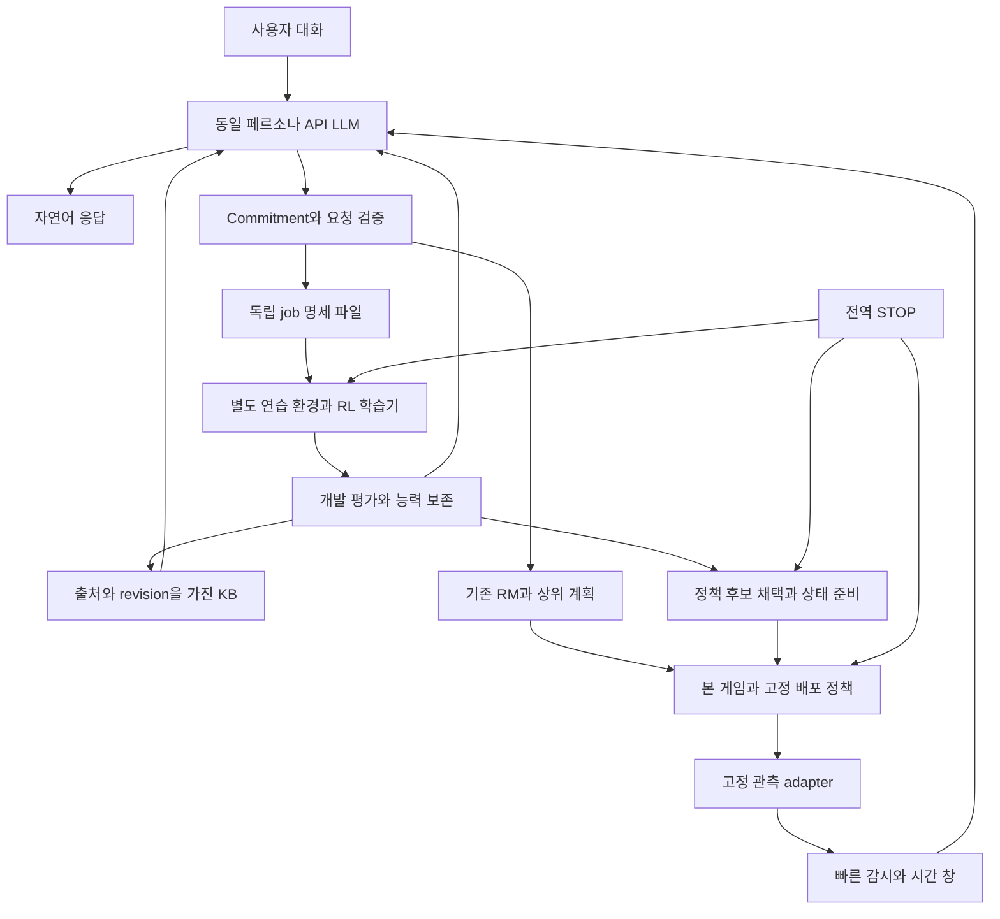
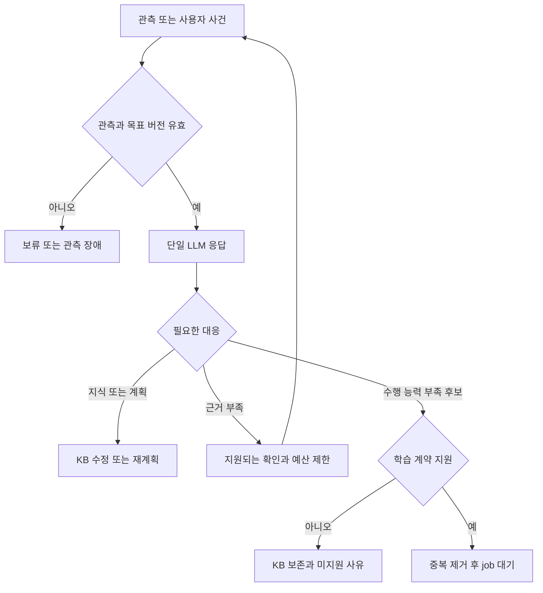
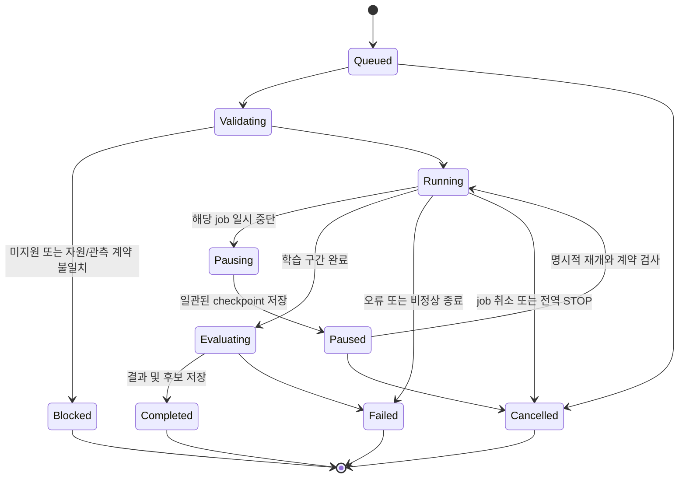

# feat: Validate LLM-guided continual RL under a frozen observer

**MinecraftRL — 고정 관측기·단일 LLM 판단·독립 실행 학습기의 구현 및 병목 검증 명세서**

2026-10-29 후속: 큰 구현 순서와 SQLite 도입 시점은 [4단계 명세](2026-10-29-001-feat-four-stage-llm-rm-rl-plan.md)를
우선한다. 이 문서의 검증 요구는 유지하되 구체적 구현 선택·수치는 추천안이다. D01~D13은 OPEN으로 보존한다.

이 문서는 구현할 계약과 검증 계획이다. 아래 수치와 구성은 별도로 표시한 사용자 요구를 제외하면
개발 시작안이며 측정 결과가 아니다. 2026-10-26 작성 시 게임·학습은 중단 상태다. 이 문서 작성은
STOP 해제, 게임/학습/API 실행, 유료 자원 사용 또는 공개 배포를 수행한 것이 아니다.

---

## Summary

공식 STEVE-1을 공통 초기 정책으로 사용한다. 고정 관측에서 이상 근거를 만들고, 동일 페르소나의
LLM이 대화와 학습 요청을 한 응답에 생성한다. 요청은 검증된 연습·보상·평가 기능에 연결하며,
독립 학습 프로그램이 실제 경험으로 정책을 갱신한다. 본 게임은 검증된 정책으로 계속 움직인다.

완료 목표는 병목이 없다는 선언이 아니다. **병목별 재현 실험·측정값·통과 조건·실패 후 경로를
갖추고, 지원 범위 안의 새 조건에 대해 사람의 코드 수정 없이 학습 요청부터 개선 검증까지
연결되는지 확인하는 것**이다. 개선이 없거나 자원이 부족한 결과도 유효한 연구 결과로 남긴다.

학습 자체는 별도 코드·설정·프로세스로 관리한다. 사용자는 작업을 시작한 뒤 다른 PC 작업을
할 수 있고, 상태 조회·중단·재개를 독립적으로 할 수 있어야 한다. LLM은 기존 API 연동 방식을
사용하되 학습기의 필수 실행 의존성으로 만들지 않는다.

---

## Problem Frame

KB에 사실을 저장하거나 LLM이 올바른 설명을 했다는 것만으로 정책 능력이 생기지 않는다.
정체의 원인도 관측 오류, 지식 오류, 계획 오류, 행동 능력 부족으로 나뉜다. 이 구분 없이
학습하면 잘못된 보상이나 무의미한 경험으로 가중치만 바뀔 수 있다.

현재 공용 코드에는 공식 정책 실행, 인벤토리 판정, STOP, 제한된 정체 감지와 과거 RL 수학
구성 요소가 남아 있다. 새 구조의 범용 학습 서비스·고정 관측 진단·안전한 정책 교체가 완성된
상태는 아니다. 기존 추가 학습 가중치와 전용 자료는 사용자 요청으로 정리됐으므로 재사용을
전제하지 않는다. 과거 문서의 실험 성공·테스트 통과를 이번 구현의 검증으로 인용하지 않는다.

### Existing Evidence

| 근거 | 계획에 반영할 내용 |
|---|---|
| `src/minecraftrl/policies.py`, `Steve1Policy` | 화면과 MineCLIP/prior 목표 임베딩을 입력으로 사용. 텍스트 변경과 가중치 학습을 구별 |
| `src/minecraftrl/rl_policy.py`, `rl_opt.py`, `rl_core.py` | 정규화된 guidance 확률·dispatch 후 순환 상태 반영·GAE/보상 구성 요소를 검토해 재사용. 기존 wood 전용 context를 범용 KB 입력으로 간주하지 않음 |
| `src/minecraftrl/stall_detection.py` | 반복/무진전 근거이며 원인 진단 아님. 위치 기반 입력은 privileged 조건. 관측 간격이 4 tick을 넘으면 이력이 비워지는 기존 동작도 검토 |
| `src/minecraftrl/semantic.py`, `dialogue.py` | 기존 persona 분리 의도 해석을 단일 응답으로 연결하되 취소·수정·가정 표현 검증 유지 |
| `src/minecraftrl/runtime.py`, `StopGate` | 단일 dispatch 소유자, STOP latch, 전송 중 step과 이후 행동의 경계 유지 |
| `src/minecraftrl/world_store.py`, `PersistentMineRLEnvironment` | 정상 저장/종료 기반 복원. 실행 중 월드의 정확한 순간 복제 기능으로 사용하지 않음 |
| `configs/sources.lock.json`, `configs/environment-steve1.yml`, `docs/policy-sources.md` | MineRL/STEVE-1 소스와 Minecraft 1.16.5 기준. 실제 설치 영수증·가중치 hash는 실행 전 다시 수집 |
| 2026-10-25 GPU 확인 기록 | GTX 1060 3GB. 당시 유휴 여유 메모리는 병행 학습 가능성의 증거가 아님 |

---

## Requirements

| ID | 요구 | 출처·완료 근거 |
|---|---|---|
| R1 | 공식 STEVE-1 초기값과 Minecraft 1.16.5 사용, 원본 가중치 불변 | 사용자 공식 정책 전환; 환경/모델 manifest |
| R2 | 실사용 관측 채널·전처리·모델·프롬프트·출력 규격 고정 | 2026-10-25 사용자 요구; 배포 hash 불변 |
| R3 | 같은 페르소나·목표·기억 맥락의 한 LLM 응답에 대화와 개선 후보 포함 | `docs/unified-interaction-knowledge-2026-10-25.md`; 의도/후보 일치 검사 |
| R4 | 검색 범위는 세계 현상·몹·위험·관습·대화 질문까지 허용, KB 근거·예외·철회 이력 보존 | 사용자 넓은 지식·비단조 수정 요구; 지식 수정 시나리오 |
| R5 | 이상 관측과 원인 가설을 구분하고 unknown 허용 | `docs/rl-adaptation-solutions-2026-10-25.md`; 원인별 혼동·보류율 |
| R6 | 학습 요청은 지원되는 관측·연습·보상·독립 성공 판정에 연결 | `docs/knowledge-to-policy-learning-2026-10-25.md`; 미지원 요청 적용 0 |
| R7 | 실제 RL 가중치 갱신과 정책 행동 개선을 별도로 증명 | 사용자 RL 중심 방향; 변경 범위·rollout·전후 평가 |
| R8 | 같은 학습 코드/정책으로 여러 목표·배치를 처리 | 사용자 일반화 요구; 최소 wood/dirt와 배치 변화, 과업별 코드 수정 없음 |
| R9 | 실제 인벤토리/서버 상태/NBT로 성공 판정, vision-only 입력과 특권 평가 분리 | AGENTS.md; 관측 권한 검사와 판정 대조 |
| R10 | 학습·검색·API 대기 중에도 본 게임 플레이와 대화 유지 | `docs/continuous-play-learning-2026-10-25.md`; 지연/공백 측정 |
| R11 | 실행 정책은 불변, 후보는 독립 학습·평가 후 행동 경계에서 교체 | 동일 문서; 버전 혼합·순환 상태 검사 |
| R12 | 원래 목표/RM 이력·완료 증거를 보존하고 우선순위·수정·취소를 구분 | 원문 §4·13 및 사용자 후속 합의; 취소 후 재활성화 0 |
| R13 | STOP 이후 새 정책 dispatch 0, 입력 해제·소유 자식 PID 정리 | AGENTS.md; 실제 초기화/추론/step/교체 중 중단 시험 |
| R14 | 학습/개발/최종 평가 분리, 실패·미실행·취소 및 원본 자료 보존 | 원문 §15·16, `docs/experiment-protocol.md`; manifest와 독립 평가 |
| R15 | 호출·비용·자원 상한을 지키고 유료 자원/Colab/공개를 자동 확장하지 않음 | 승인 범위; 예산 초과 추가 호출 0 |
| R16 | 인간다움·문화 이해·장기 동료 에이전트라는 최종 연구 목표 유지 | `docs/research-spec.md` 20개 항목; 아래 추적표와 주장 경계 |
| R17 | 학습을 독립 코드/설정으로 실행·조회·중단·재개, API 단절 후에도 실행 | 2026-10-26 사용자 추가 요구; 독립 job 수명주기 시험 |
| R18 | 백그라운드 작업이 사용자 화면/입력을 차지하지 않고 자원 간섭을 측정 | 같은 추가 요구; 독립 display·자원 프로파일·사용 중 간섭 검사 |

---

## Scope Boundaries

이번 구현 범위는 고정 관측 계약, 근거 저장, 단일 LLM API 응답, 학습 요청 검증, 독립 RL 학습기,
다양한 수집 조건, 병행 실행과 정책 교체, 비교 평가 및 재현 묶음이다. 모든 실패에 대한 해결이나
Minecraft의 모든 지식을 행동으로 변환하는 범용성을 약속하지 않는다.

### Deferred for Later

장기 제작/전투/동료 보호/네더 과업, 대규모 새 BC 사전학습, 인간 평가, 문화/사회적 행동의 정량
평가, 학습된 world model, 완전한 실시간 월드 복제는 후속 연구로 보존한다. 첫 wood/dirt 검증은
연구 범위 축소나 독립 공통 이동 능력의 완성 선언이 아니다.

### Excluded from This Validation

관측기 재학습·새 센서 삽입, LLM이 생성한 임의 코드의 즉시 실행, 정책 실패를 숨긴 API/키 입력
스크립트 대체, 무검증 후보 자동 승격, 평가 결과를 보고 성공 정의 변경, 삭제된 가중치 복원은
이 실험 경로에 넣지 않는다. 본 문서는 GitHub 게시나 새 유료 API 예산 승인이 아니다.

---

## Key Technical Decisions

- KTD1. **고정된 일반 관측과 동일 LLM의 시각 판단:** 기본안은 RGB/최근 화면 묶음·자신이 보낸
  행동·시각/품질 metadata를 고정 adapter로 제공하고, 이미지 입력을 지원하는 같은 API LLM이
  대화와 상황 판단을 함께 수행한다. 사건마다 별도 전용 인식기를 추가하지 않는다. 이는 작성자의
  구현 선택이며 API 모델의 시각 능력·비용·지연은 G0/G2에서 검증한다. 기존 설정이 텍스트 전용이면
  이미지 판단을 구현된 것으로 간주하지 않고 해당 게이트를 보류한다.
- KTD2. **정보 경계는 세 갈래:** P는 정책 RGB·목표·허용된 기억, M은 감시/LLM이 볼 RGB·자기 행동·
  사용자 맥락, E는 사전에 선언한 환경 성공/보상용 실제 상태다. E의 숨은 위치/레이캐스트/정답 원인을
  P/M에 넣지 않는다. 인벤토리 확인 등 화면에 보이는 것은 M에서 불확실한 인지 결과로 처리할 수 있다.
  E를 사용하는 종료 신호와 보상 권한 자체도 manifest에 명시한다.
- KTD3. **지식은 상태 사실과 분리:** 출처·게임 버전·조건·예외·확인 시각·찬반 근거를 저장한다.
  지지 관계를 보존하고 충돌 시 채택 상태를 철회한다. 독립 근거가 남은 결론은 무조건 삭제하지 않는다.
  KB 수정은 관련 job/계획의 재검토 사유이며 정책 가중치를 자동으로 교정하지 않는다.
- KTD4. **단일 구조화 응답:** reply, 의도, 관측/가설, 근거 ID, 확인 요청, 계획 후보, learning_request를
  한 응답에 둔다. 불필요한 항목은 null/빈 목록. 파서·Commitment·능력 검증기가 적용 권한을 결정한다.
  LLM의 자체 확신 수치는 보정된 확률이나 성공 정답으로 사용하지 않는다.
- KTD5. **독립 학습 job:** LLM은 유효한 job 명세 파일을 만들 뿐 learner에 API key나 대화 실행
  권한을 넘기지 않는다. 동일 파일로 수동 실행·회귀 시험·배치 실행이 가능하다. 학습 루프에는 API
  호출을 넣지 않는다. 학습 결과 파일을 coordinator가 나중에 읽어 LLM에 돌려준다.
- KTD6. **공식 정책의 제한된 PPO 후보:** 초기 S0는 시각/순환부·목표 encoder를 동결한 action head와
  value head, S1은 같은 고정 관측에서 사전에 선언한 마지막 정책/순환 층 일부까지다. S0는 공학
  진단이고 최종 능력 범위를 head에 고정하지 않는다. S1은 순차 데이터·상태 복원·메모리 검증을
  통과해야 한다. 데이터 수집과 surrogate 갱신을 교대하는 [PPO](https://arxiv.org/abs/1707.06347)의
  조건을 따른다. 두 후보가 부족하면 시각 인코더를 몰래 풀지 않고 표현/자원 병목으로 남긴다.
- KTD7. **본 게임 경험과 PPO 경험 분리:** 초기 PPO는 별도 연습 환경에서 배치 수집 정책을 고정해
  얻은 경험으로 학습한다. 본 게임 기록은 진단·조건 선택용이다. 정책 지연이 있는 데이터를 곧바로
  PPO에 섞지 않는다. 비동기 경험을 직접 사용하려면 [IMPALA](https://proceedings.mlr.press/v80/espeholt18a.html)
  같은 보정 문제를 별도 실험으로 다뤄야 한다. 본 안을 순수 본 게임 온라인 RL이라고 부르지 않는다.
- KTD8. **단일 게임 제어 소유자와 별도 프로세스:** 스레드는 빠른 감시·큐·API I/O에, learner/연습
  게임은 별도 프로세스에 둔다. CUDA 자식은 spawn 계열을 사용한다. [PyTorch 2.0 문서](https://docs.pytorch.org/docs/2.0/notes/multiprocessing.html)의
  fork 및 CUDA 객체 수명 제약 때문에 실행 중 GPU 객체를 임의로 공유하지 않는다.
- KTD9. **DB를 제어 루프에서 분리:** immutable snapshot과 bounded queue로 전달하고 기록 소유자
  하나가 파일/SQLite에 쓴다. SQLite는 초기 rollback journal을 기본으로 검증하고 WAL은 배치
  파일시스템 검증 후 선택한다. [SQLite WAL 제약](https://sqlite.org/wal.html)상 Windows와 WSL이
  같은 DB 파일을 각자 열거나 네트워크 파일시스템 동시 접근을 전제하지 않는다.
- KTD10. **연습 세계는 근사 조건:** 동일 엔진의 별도 world를 사용하며 본 게임의 살아 있는 save를
  복사하지 않는다. seed·NBT가 같아도 RNG·entity·GUI·RNN까지 같다고 하지 않는다. 초기화용
  scripted fixture는 준비 개입으로 표시하고 학습 정책 성공에 포함하지 않는다.

---

## High-Level Technical Design

### Components



### Request and Evidence Contract

| 레코드 | 필수 내용과 검사 |
|---|---|
| RunManifest | code snapshot/hash, base weights, 환경/patch receipt, P/M/E 권한, observer/LLM/prompt/persona/KB/RM 버전, seed/split, budget, CPU/GPU/display 설정 |
| ObservationPacket | episode·sequence·서버 tick이 허용되면 그 값, monotonic 수신 시각, frame 참조, 전달 행동/dispatch ID, 품질·누락·출처. 누락을 0으로 채우지 않음 |
| EvidenceBundle | 최근 관측 창, root goal/revision, 기대 변화의 지식 근거, 관측된 변화, 경쟁 가설, 직접 확인하지 못한 내용 |
| UnifiedDecision | 원래 사용자/사건 ID, reply, 질문/정보/제안/요청 구분, 가설, 필요한 확인, 계획/학습 후보, 사용한 근거·revision |
| LearningJobSpec | schema version, source decision, root goal와 적용 조건, 관측/판정 계약 ID, task parameters, 연습 분포, 보상 설정, 학습 scope/seed, 예산, 평가·채택 계약, 부모 정책 hash |
| JobResult | 상태·종료 사유, 실제 경험량/시간/비용, 실패 원인, 후보/optimizer/RNG receipt, 평가 결과, 의존 지식/정책 버전, 미실행 사유 |

새 skill 이름이 있다고 실행 가능한 것이 아니다. 검증기는 형식·출처·지원 기능·예산·버전을
검사한다. 관측 가능성이나 인과성을 프로그램만으로 완전히 증명할 수는 없으므로 실제 진단
시험과 unknown/unsupported 결과를 함께 둔다. 검색 문서의 지시문은 데이터이며 실행 권한이 아니다.

API에는 허용된 게임 화면 영역만 전달한다. 사용자의 데스크톱·다른 앱·환경변수·credential을
관측 묶음에 넣지 않는다. 단일 API 판단은 기본 1개 in-flight로 제한하고, 새 의미 평가 사건은
최신 근거로 합치되 사용자 발화·취소·STOP을 조용히 버리지 않는다. STOP은 API 큐를 거치지 않는다.
미리보기 frame은 gap 표시와 함께 줄일 수 있지만 실제 학습 action/reward/종료 기록은 유실을
허용하지 않는다. 필수 기록을 보존하지 못하면 해당 rollout을 invalid로 남기고 안전하게 종료한다.

### Decision Lifecycle



동일 사건을 새 요청처럼 반복 제출하지 않는다. 중복 키는 goal revision·능력/조건·근거 범위를
포함한다. 관련 정보가 새로 생겼을 때 재검토할 수 있지만 기존 시도와 소모 예산은 유지한다.
KB의 무관한 항목 변경은 모든 job을 무효화하지 않고 의존 항목 hash로 영향 범위를 정한다.

### Job Lifecycle



Completed는 성능 향상/배포 성공을 뜻하지 않는다. 결과에는 improved, no_evidence, regressed,
budget_exhausted 등 학습 결과를 별도 필드로 둔다. 취소·실패 후 재시도는 새 attempt ID이며
부모 job과 누적 예산을 유지한다. STOP이 남아 있으면 새 실행을 자동 재무장하지 않는다.
전역 STOP은 diagram의 모든 비종료 상태에 우선하며, job별 Stop은 해당 job과 자식에만 적용한다.
Pausing/Validating 상태의 오류도 Failed로 기록한다. 상태 파일만 바꾸어 실제 종료로 보고하지 않는다.

### Candidate Handover

```mermaid
sequenceDiagram
  participant Actor as 본 게임 actor
  participant Learner as 독립 learner
  participant Validator as 평가 및 배포 관리자
  Learner->>Validator: 불변 후보와 receipt
  Validator->>Validator: 개발 평가·보존·계약 검사
  Note over Actor: 기존 정책으로 계속 제어
  Validator->>Validator: 새 정책 및 필요한 순환 상태 준비
  Validator->>Actor: 부모 정책·goal·KB 의존 버전과 후보 제안
  Actor->>Actor: STOP 및 stale 검사, 다음 행동 경계에서 교체
  Actor-->>Validator: 적용 버전 또는 거부 사유
```

실행 정책 객체를 learner가 수정하지 않는다. head만 바뀌면 동결 backbone의 동일성·목표 조건을
확인한 뒤 상태를 유지할 수 있다. 순환부가 바뀌면 배포 직전 이력으로 상태를 준비하고 이후
누락된 관측을 따라잡아 동일 경계에서 검증한다. 따라잡지 못하거나 준비 메모리가 부족하면
교체를 보류한다. 에피소드 경계 교체만 성공했다면 연속 플레이 중 교체 성공으로 보고하지 않는다.

---

## Standalone Training Interface

학습 엔진은 `src/minecraftrl/training/` 아래 공통 PPO/runner/job 관리와 과업 모듈로 분리한다.
첫 과업 모듈은 collection이며 wood/dirt를 설정으로 선택한다. 목표마다 PPO 코드를 복제하지 않는다.
새 과업은 고정된 계약을 구현하는 모듈로 개발할 수 있으나 실사용 중 LLM이 코드를 설치하지 않는다.

| 조작 | 요구 동작 |
|---|---|
| Validate | API/게임 없이 job 설정·권한·파일 hash·지원 기능을 검사 |
| Start | PowerShell 진입점이 WSL 독립 프로세스를 숨김 실행, job ID와 로그 경로를 즉시 반환 |
| Status | 상태·heartbeat·진행 episode/update·최근 지표·checkpoint·예산 잔량·오류를 읽기 전용 조회 |
| Pause | 해당 learner가 안전한 update 경계에서 저장 후 멈춤. 중단 요청/완료를 구별 |
| Resume | 코드/모델/관측/보상 계약과 부모 checkpoint 검증 후 명시적으로 재개 |
| Stop | 해당 job과 소유 연습/eval 자식만 취소·입력 해제·종료. 본 게임 STOP과 구별 |
| Evaluate | 지정 checkpoint를 읽기 전용으로 평가. optimizer 갱신·자동 배포 없음 |

로그는 `results/adaptation/<run-id>/jobs/<job-id>/`에 manifest, job spec, status, events,
metrics, checkpoint receipt, stdout/stderr, 평가 결과로 보존한다. 실제 파일 이름/확장자는
구현 시 확정하되 상태와 결과를 stdout만으로 전달하지 않는다. checkpoint는 임시 파일 작성과
hash 확인 후 동일 볼륨에서 원자적으로 발행하며, 미완성 파일을 latest로 가리키지 않는다.

재개 기본값은 optimizer/RNG/예산 상태를 복원하고 새 연습 episode를 시작하는 것이다. 살아 있는
Minecraft/RNN을 정확히 이어받았다고 하지 않는다. 미완성 rollout은 보존하되 PPO 입력에서 제외하고
소모한 시간/경험 비용은 되돌리지 않는다. update 중간을 지원하려면 batch 순서·RNG·optimizer와
데이터 snapshot의 일관성을 별도로 검증해야 한다.

Pause 완료 대기는 시작값 30초로 제한한다. 안전한 checkpoint를 만들 수 없으면 이미 검증된
직전 checkpoint와 미완성 attempt를 보존한 채 중단 사유를 기록한다. 현재 optimizer 파일을
부분 저장해 이어갈 수 있다고 하지 않는다. learner의 pause/stop이 본 게임의 입력을 해제하지 않는다.
job spec은 learner 버전·학습 scope·수집 batch 크기·optimizer/clip/GAE·평가 split·총시간/경험/
업데이트/메모리/디스크 상한을 모두 해석한 resolved config로 저장한다. 이름만 있는 기본 설정을
재개 시 다른 값으로 다시 해석하지 않는다.

PC 사용을 위한 기본 프로파일은 learner 하나만 허용하고 CPU thread 상한·메모리/디스크 상한·
GPU 여유 목표를 둔다. 연습 게임은 별도 가상 display로 실행하며 사용자 Minecraft 창/키보드/
마우스 포커스에 접근하지 않는다. GPU 계산/VRAM의 완전한 격리를 약속하지 않는다. 한도를 넘으면
learner를 줄이거나 보류하고, 본 게임을 몰래 멈추거나 시스템 드라이버/전역 설정을 바꾸지 않는다.
interactive 프로파일의 CPU 시작 상한은 최대 4 thread이며 가능한 경우 논리 CPU 2개를 남긴다.
RAM/VRAM/디스크 수치는 G0의 실제 가용량으로 resolved config에 잠근다. 이미 제출한 CUDA 작업의
즉시 선점을 가정하지 않고 kernel/업데이트의 최장 구간과 pause 완료 지연도 측정한다.

---

## Bottleneck Experiments

모든 시험은 구현 시 새로 실행한다. 합성·기록 재생 시험은 계약 검사이며 실제 정책 성공 표본이 아니다.
각 결과는 pass, fail, inconclusive, unrun 중 하나와 이유를 가진다. 예산 부족으로 못 한 것은 unrun이다.

| ID | 병목 가설 | 드러내는 시험과 측정 | 통과/보류 및 다음 행동 |
|---|---|---|---|
| B1 | 고정 관측으로 필요한 상황을 구별할 수 없음 | 시야 반대·가림·낡은 프레임·대상 소실·같은 화면 다른 이력 사례. 평가용 정답과 비교, unknown 기록 | 보이지 않는 사실을 확정하지 않음. 구별 불가능이면 추가 관찰/기억 범위 검토, 새 센서 없이 한계 기록 |
| B2 | 정상 행동을 이상으로 오탐하거나 원인 오진 | 정상 우회/채굴/로딩과 관측·지식·계획·수행 능력 실패를 포함한 고정 사건 모음. 정답은 시험 개입/사후 정답이며 LLM에 숨김 | 아래 진단 기준 충족. 미달 시 관측기 실사용 수정 대신 개발 버전에서 원인 확인 후 새 protocol |
| B3 | 검색 지식이 버전/맥락에 맞지 않음 | 맞는 사실·옛 버전·상충 근거·오해한 원인·독립 지지 근거가 있는 결론 | 출처/예외·철회·의존 계획 갱신 정확. 거짓 확신은 KB 격리, 잘못된 지식 기반 job 채택 금지 |
| B4 | 자연어 답변과 실행/학습 요청이 어긋남 | 질문·농담·가정·부정·기존 승인·취소 및 API timeout/잘린 JSON/중복 응답 | 미승인/미지원/오래된 요청 적용 0. 형식만 맞는 답변도 의미 평가에 포함 |
| B5 | 학습 요청을 실제 경험/판정으로 연결하지 못함 | wood/dirt를 같은 코드로, 불가능한 predicate·새 센서 요구·평가 seed 요청을 섞어 제출 | 지원 요청 실행, 미지원은 이유 반환. 목표를 wood로 임의 치환하거나 판정 완화 금지 |
| B6 | PPO가 실제 전달 행동과 다른 분포를 학습 | 미갱신 확률 동등성, guidance 정규화, action mask/단위, sample→dispatch 일치, old logp 재계산, scope hash | 수치/계약 위반 0. 실패하면 실제 학습을 중단하고 수집/확률 경로 수정 |
| B7 | 보상 전파/경험 부족으로 학습 신호가 없음 | 지연 보상·시간 제한·terminal·관측 공백 시험, 성공 경험 빈도·advantage 분포·gradient·실제 개선 | 무신호와 작은 scope의 표현 한계를 구별. 연습 난이도/보상 후보는 개발 조건에서만 변경 |
| B8 | 보상만 높이고 목표를 회피 | 제자리 순환, 버렸다 줍기, 초기 아이템, 중복 이벤트, 조기 사망/종료, 불필요한 탐험 | 중복 성공/보상 부풀림 0. 독립 획득이 늘지 않으면 승격 안 함 |
| B9 | 새 조건에 과적합하거나 기존 능력 망각 | 배치/seed/시선 조합을 분리한 전후 평가와 정상 수집 보존 평가 | 개발 승격 기준 및 최종 구간 추정 충족. 미달은 후보 보존 후 이전 정책 유지 |
| B10 | 3GB GPU/CPU/렌더링 자원 경합 | actor 단독, +감시/기록, +API 대기, +learner, +별도 게임, +checkpoint 교체를 점진 추가 | 제어 지연 기준·OOM·메모리 추세 확인. CPU/저빈도 후보 검토, 불가능하면 resource_blocked 및 동일 job 재현 준비 |
| B11 | 후보 교체 시 오래된 목표/RNN/정책 혼합 | 학습 중 목표 취소·KB 철회·부모 정책 변경·교체 준비 중 STOP, head 및 순환 scope 각각 | stale 적용/혼합 버전 0. 준비 실패 시 기존 정책 유지 |
| B12 | thread/DB/API가 제어·중단을 막음 | 기록 지연·큐 포화·DB 잠금·API 장기 응답·env.step hang·자식 종료 실패 주입 | 새 dispatch 차단·bounded queue·실제 PID 정리. 실패를 정상 종료로 숨기지 않음 |
| B13 | 독립 학습이 API/터미널/사용자 화면에 종속 | API 차단 후 학습, 부모 콘솔 종료, 동일 job 중복 시작, Pause/Resume, 사용자 다른 앱 사용 | 학습 지속/명시적 상태 전이, 중복 worker 0, 포커스/OS 전역 입력 0 |
| B14 | 연습 개선이 본 게임으로 전이되지 않음 | 준비된 연습→변형 연습→원래 시작 조건→연속 플레이 적용을 따로 평가 | 조건별 성능을 분리. 연습 성공만 있으면 본 게임 적응 성공으로 보고하지 않음 |
| B15 | 통계/선택 편향으로 가짜 개선 | 반복 seed·학습 seed 분리, 고정 프롬프트 전후 평가, 요청 선택 대조군, 미실행 분모 검사 | 최종 평가 잠금·구간 추정·전체 비용 보고. 불확실하면 inconclusive |

---

## Experimental Protocol

### Fixed Variables and Data Splits

공식 모델 hash, MineRL/게임/patch, action space, renderer/해상도, P/M/E 권한, observer, API model
버전·프롬프트·페르소나, goal encoder와 guidance, 제어 시간 단위, 보상/평가 식을 manifest에 잠근다.
서로 다른 KB 조건은 별도 실험군이며 같은 학습 batch 안에서는 KB/RM/보상 버전을 바꾸지 않는다.

기본 목표군은 원목/흙 수집이고 첫 최소 성공은 초기 인벤토리 대비 해당 아이템 1개 이상 증가다.
원목 범위는 현재 1.16.5의 선언된 log 집합이며 판자나 블록 파괴를 수집 성공으로 세지 않는다.
학습용·개발용·최종 평가용 world seed와 배치 조합을 분리하고 목록/hash를 실행 전에 저장한다.
초기 월드, 첫 제어 전 인벤토리·화면, fixture 개입을 기록한다. 초기 아이템 지급·startup pickup은
정책 획득에서 제외한다. 최대 순증가와 최종 순증가를 모두 남기며 재획득을 총량으로 부풀리지 않는다.

개발은 목표군별 고정 5개 world seed, 각 조건 2회 rollout으로 시작한다. 매 rollout의 새 행동
허용 제어 시간은 최대 180초다. 행동 수·server tick·현실 시간은 별도로 기록하고 1 action=1 tick을
가정하지 않는다. 초기화/종료 시간은 180초와 분리하되 총 자원 비용에는 포함한다.

정책 학습 seed는 pilot 1개로 수치/실행 확인 후 3개로 반복한다. 개발 평가를 반복해서 봤다면
그 자료는 최종 평가가 아니다. 최종평가 표본은 아래 절차로 잠그고 비공개 배치 조합을 사용한다.

**적응 스트림과 최종 probe를 추가로 분리한다.** 적응 스트림에서는 실패 관측을 LLM에 주고
허용된 연습 조건을 선택해 학습할 수 있다. 이 스트림의 점수는 온라인 적응 중 성능이다. 최종
held-out probe의 화면·원인·배치·점수는 LLM/KB/learner/연습 생성기에 되돌리지 않는다. probe는
checkpoint와 정책 조건을 동결한 읽기 전용 평가이며, 모든 군의 결과가 잠긴 뒤에만 집계한다.
각 독립 학습 seed/비교군은 같은 초기 KB·대화 상태에서 시작하고 다른 군의 학습 결과를 공유하지 않는다.
계획의 최종 표본 수/주 비교는 이 held-out probe를 뜻한다. 적응 스트림 경험은 별도 예산에 모두 센다.

### Learning and Credit Assignment

기본은 실제 획득 보상과 terminal/truncation을 구별한 PPO다. 시도한 행동이 아니라 실제
전달한 행동만 trajectory에 넣는다. STOP·기술 오류를 과업 실패 보상으로 학습시키지 않는다.
시간 제한은 truncation으로 처리하고 유효한 마지막 관측에서 bootstrap한다. 실제 terminal은
bootstrap 0이며 다른 episode의 value/RNN/advantage를 이어 붙이지 않는다.

할인과 GAE의 시간 단위를 명시한다. 시작 후보는 논리적 서버 시간 기준 보상 반감기 60초,
trace 반감기 5초이며 실제 tick 증가에 맞춰 계수를 계산한다. 이는 최적값 주장이 아니다.
긴 지연 보상 시험에서 기여도가 소실되는지 기록하고 개발 단계에서만 수정한다. 시간 비용은
처음부터 무조건 추가하지 않으며 조기 실패가 유리해지는지 검사 후 별도 조건으로 도입한다.

방향성 수식은 nominal game time의 20 tick/초를 기준으로 보상 반감기 1,200 tick, trace 반감기
100 tick이다. 간격 d에 대해 gamma(d)=2^(-d/1200), gamma(d)·lambda(d)=2^(-d/100)로 정의해
lambda를 정한다. 이는 wall-clock 20 FPS라는 가정이 아니다. 실제 tick/행동 간격이 유효하지 않으면
임의의 d=1로 대체하지 않고 해당 데이터의 학습 적격성을 판정한다. episode 종료까지의 보상 지연과
유효 반환 기여를 함께 기록한다.

중간 보상은 검증된 상태 변화의 고정 potential 후보로 제한한다. 정책과 같은 할인·시간 단위,
terminal potential·truncation 처리를 맞추고 KB 변경 중 potential이 흔들리지 않게 한다.
부분 관측/근사 상태에서 정책 불변성을 자동 주장하지 않는다. reward 성분·최종 실제 성공·
진행 지표를 분리한다. 보상 총량만 좋아진 후보는 채택하지 않는다.

첫 job의 시작 상한은 총 20개 연습 rollout, rollout당 180초이며 두 목표를 포함한다. 초기 진단에서
환경/성공 조건을 단순화할 수 있지만 미리 정의한 curriculum 범위 안에서만 한다. 실패 rollout도
경험/예산에 포함한다. 성공 경험이 없거나 개선이 없으면 무제한 재학습하지 않고 B7 진단 결과를 남긴다.
S0/S1 비교의 경험 예산을 맞추고 변경한 층·gradient·KL·entropy·value 오차·분포 변화를 기록한다.

### Comparison Arms

| 군 | 정책 갱신 | LLM 역할 | 구별할 효과 |
|---|---|---|---|
| A | 없음, 공식 초기 정책 | 고정 목표만 전달 | 공식 실행 기준선 |
| B | 없음 | 같은 API 모델로 대화/검색/재계획 | 지식·계획만의 개선 |
| C | 고정 schedule/공통 curriculum의 RL | B와 같은 대화/재계획, LLM 학습 선택은 적용 안 함 | RL을 추가한 효과 |
| D | LLM 요청이 선택한 연습/RL | 같은 단일 응답에서 학습 필요성과 조건 선택 | 학습 선택의 추가 효과 |

B/C/D는 동일한 허용 정보·모델·도구·최대 API/경험 예산을 가진다. C/D는 같은 learner·scope·
보상 조합 가능 범위를 사용한다. 주 비교는 D-C, 보조는 D-B다. A 비교에는 여러 구성 변화가
있으므로 단일 원인의 인과 효과로 해석하지 않는다. 모든 군에서 실제 소비량과 상한을 함께 보고한다.

별도의 **정책 단독 평가**에서는 동일 목표 임베딩·관측·추가 힌트 없는 조건에서 전후 가중치만
교체한다. 본 게임 시스템 평가와 분리해 가중치 자체의 개선을 확인한다. 데이터/비용 집계에는
진단, 연습, 평가, 본 게임이 모두 들어가며 D에만 공짜 추가 경험을 허용하지 않는다.

텍스트가 같아도 prior 샘플링에 따라 임베딩이 달라질 수 있으므로 정책 단독 평가에서는 실제
임베딩 tensor/hash와 guidance를 고정한다. 시스템 평가에서 LLM이 목표 문구를 바꾼 효과는 별도다.
개발 평가 결과만 의사결정 피드백으로 사용할 수 있으며 최종 probe 결과는 사용할 수 없다.

KB 검색의 효과는 1차 RL 검증 후 같은 코드에서 고정 초기 KB와 검색/수정 허용 KB를 비교한다.
사전학습 모델에 이미 존재할 수 있는 지식을 '모델이 처음 배운 지식'이라고 단정하지 않고,
시스템이 이번에 검색·채택한 지식과 정책의 새 조건 적응으로 범위를 한정한다.

### Metrics and Proposed Gates

아래는 개발 시작 시 사용할 수치 계약이다. 개발 자료에서 실현 가능성을 검토해 수정할 경우
이유와 버전을 남기고 최종 평가 전에 고정한다. 평가를 본 뒤 기준을 낮춰 통과시키지 않는다.

| 항목 | 시작 기준 및 보고 방식 |
|---|---|
| 절대 불변식 | STOP 이후 새 dispatch 0, 미승인/미지원 요청 적용 0, stale 후보 적용 0, 비허용 관측 유입 0, 관측기 hash 변경 0 |
| 수치 동등성 | 같은 입력/상태의 미갱신 정책 log-prob에 FP32 atol 1e-5·rtol 1e-4 시작값. AMP 별도 대조, NaN/Inf 0. 행동이 우연히 같다는 것만으로 통과 안 함 |
| 진단 | 정상·관측·지식·계획·수행 능력·판정 불가 6분류를 각 20사건으로 시작. 관측 가능한 사례의 이상 recall≥0.8, 정상 오탐≤0.1, 원인 macro-F1≥0.7, 판단 coverage≥0.7. 분류별 구간/unknown도 보고 |
| LLM 의미/형식 | 질문·가정·농담·부정·명령·취소·지식 충돌을 포함한 최소 100사건. strict 파싱 유효율≥0.95 목표, 의미 오류와 안전 검증 차단을 각각 집계 |
| 빠른 감시 | actor가 snapshot을 발행한 시각부터 빠른 이벤트 준비까지 p95≤200ms. 실제 사건이 화면에 들어오기 전 시간과 LLM 판단 지연은 별도 |
| API/대화 | 요청 deadline 20초 시작값, 자동 재시도 0 기본. 시각 판단과 대화 queue 지연을 분리. API timeout 동안 제어 루프 동기 대기 0 |
| 제어 간섭 | actor 단독 대비 병행 제어 주기 p95 증가≤20% 목표. 2초 또는 단독 p95의 2배 중 큰 값을 넘는 추가 공백 0 목표. 절대 주기/스텝률도 공개 |
| 자원/장기 실행 | 30분 병행 soak에서 OOM 0, bounded queue 상한 준수, CPU/GPU/RAM/disk/VRAM peak 및 시간 추세 기록. 사용자 앱 포커스 전환/전역 입력 0 |
| 개발 승격 | 3 학습 seed 평균에서 정책 단독 성공률 +10pp 이상을 다음 단계 진입 신호로 사용. 어느 목표군/보존 과업도 평균 -5pp 초과 퇴행이면 보류. 파일럿 근거로 연구 효과 확정 안 함 |
| 최종 효과 | 주 비교 D-C 성공률 차이의 95% 구간 하한>0 및 점 추정≥10pp를 연구 목표로 둠. 보존 차이의 95% 구간 하한≥-5pp를 별도 요구. 미충족은 fail 또는 inconclusive |

진단 사건의 참고 라벨은 통제된 개입과 독립 판정 근거를 기록한다. 실제 화면 사건은 서로 독립적인
두 판정의 불일치를 unknown으로 보존하며, 시나리오 설명만으로 참 원인을 안다고 간주하지 않는다.
특히 '수행 능력 부족'은 충분한 관측/전제 근거에 따른 학습 후보 판정이며 신경망 내부 원인의
확정 진단이 아니다. 형식 검사용 합성 사건과 실제 화면 사건의 결과를 분리하고 같은 episode의
인접 frame을 독립 사건으로 부풀리지 않는다. 참고 라벨 없이 정확도를 계산하지 않는다.

실제 STOP 시험은 초기화·추론·step·학습 갱신·정책 교체 단계 각각에서 반복한다. 이미 전송한
step은 완료될 수 있다. stop 요청부터 acknowledgment 지연, acknowledgment 이후 dispatch 수,
cleanup 입력 해제, PID/시작 시각에 따른 자식 정리를 각각 측정한다. 응답하지 않는 엔진을
강제 종료했다면 입력 해제는 미검증일 수 있으며 정상 종료로 바꾸어 보고하지 않는다.

### Statistical Lock

최종 평가 전 pilot 분산·성공률로 +10pp 차이에 대한 검정력 0.8, 유의수준 0.05의 표본 설계를
계산한다. 시작안은 독립 학습 seed 5개, 목표군별 최종 world 20개 이상, world당 rollout 2회다.
최종 seed/배치와 학습·개발 자료의 중복 검사는 필수다. 추가 표본이 필요하지만 예산이 없으면
underpowered/inconclusive로 기록하고 데이터 확인 후 선택적으로 늘려 유의성을 만들지 않는다.

world와 학습 seed의 의존성을 반영한 paired cluster bootstrap을 시작 분석으로 둔다. 목표군별로
world ID와 학습 seed를 재표집하고 같은 비교군 쌍 및 world 내부 rollout 반복을 묶어 유지한다.
bootstrap 반복은 10,000회로 시작하며 작은 학습 seed 수의 한계도 보고한다. 분석 변경은 최종
평가 전에 잠근다. frame/action 수를 독립 표본 수로 사용하지 않는다.
성공률·획득량·완료 시간·제어량과 기술 실패율을 분리한다. [RL 평가 연구](https://arxiv.org/abs/2108.13264)가
지적한 소수 run의 불확실성 때문에 점 추정만으로 우월성을 선언하지 않는다.

주 성공률은 유효한 실제 정책 rollout의 성공/전체다. 기술 실패/취소/미실행의 수와 비율을 따로
보고하고, 모든 attempted trial에서 시스템이 완료한 비율도 함께 제시해 기술 실패 제외가 성능을
부풀리지 않게 한다. 보상·loss·모델 load·준비 probe는 실제 성공 표본이 아니다.

---

## Phased Delivery and Failure Routing

| Gate | 범위·필요 단위 | 통과 시 | 실패/보류 시 |
|---|---|---|---|
| G0 | U1·U8 기반 환경/공식 정책/고정 관측·권한·자원 단독 검사 | 구현 기준 manifest 잠금 | 환경/지원 계약 수정. GPU 부족을 학습 실패로 세지 않음 |
| G1 | U2·U3의 실제 rollout/PPO 수치·보상·경험·pilot 개선 | 3 seed 반복 및 두 목표군 검증 | 확률·보상·경험·표현 scope를 분리 진단. 자동 학습 선택 주장 보류 |
| G2 | U4·U5의 관측/KB/원인·의도·학습 요청 검사 | 실제 API의 요청 정확성 검증 | 관측 불가능/진단 오류/미지원/API 미실행을 구분. fake 응답 통과를 실제 LLM 성능으로 세지 않음 |
| G3 | U6의 본 게임+learner 병행·STOP·후보 교체·백그라운드 사용 | 통합 파일럿 | learner 보류, 기존 actor 유지. 지속 병행 불가면 resource_blocked |
| G4 | U7의 잠근 대조군/정책 단독/최종 평가 | 해당 범위의 연구 결론 | 효과 없음/퇴행/불확실성 그대로 보고. 최종 평가를 개발 자료로 재활용하지 않음 |
| G5 | U8의 독립 Start/Status/Pause/Resume/Evaluate와 재현 묶음 | 다른 세션/PC에서 같은 job 재현 준비 | 의존성·설정·checkpoint 일관성 보완. 환경 차이 결과는 별도 |

G0와 독립 학습 진입점을 먼저 만들고 G1의 실제 학습 가능성을 확인한다. U4/U5의 기록 재생 검사는
그 사이에 가능하지만 G1 실패를 LLM/KB 확장으로 덮지 않는다. G3의 자원 admission은 충분히
작은 부하 시험으로 일찍 수행하고 최종 30분 soak는 모든 경로 연결 후 수행한다.

---

## Implementation Units

아래 신규 경로는 제안 파일이다. 기존 코드 전체를 갈아엎지 않고 검증된 경계와 수학 함수를
재사용한다. 현재 테스트가 존재한다는 사실은 통과 상태를 의미하지 않는다. 위험 경계에는
특성 보존/실패 시나리오 검사를 먼저 추가한다.

### U1. Freeze contracts and run identity

- **Goal / Requirements:** 관측 권한·버전·예산·event/job 계약을 잠근다. R1·R2·R6·R9·R12~R15.
- **Dependencies:** 없음.
- **Files:** 신규 `src/minecraftrl/training/contracts.py`, `configs/adaptation-protocol.json`,
  `tests/test_training_contracts.py`; 기존 `artifact_hash.py`, `runtime.py`, `tasks.py` 활용.
- **Approach / Patterns:** 구조화 파일 검증, 불변 snapshot, 기존 TaskState/revision/StopGate 패턴.
  API credential은 manifest/로그에 넣지 않는다. code snapshot과 dirty diff를 비밀정보 제외 후 보존.
- **Test scenarios:** (1) 유효 spec round-trip; (2) 잘못된 hash·schema·관측 권한·NaN budget 거부;
  (3) 취소된 goal revision/중복 job 거부; (4) 미지원 predicate를 자동 치환하지 않음;
  (5) 원본 모델/관측 계약이 바뀌면 resume/승격 거부; (6) 예산 차감이 재시도 후 되돌아가지 않음.
- **Verification:** 계약과 코드 경로의 권한이 일치하고 실패가 명시적 상태로 남는다.

### U2. Implement the independent policy learner

- **Goal / Requirements:** 공식 초기값에서 올바른 경험/확률로 제한된 PPO를 실행한다. R1·R7·R14·R17.
- **Dependencies:** U1.
- **Files:** 신규 `src/minecraftrl/training/ppo.py`, `training/runner.py`, `tests/test_training_runner.py`;
  기존 `rl_policy.py`, `rl_opt.py`, `rl_core.py`, `rl_horizon.py`, `policy_tail.py`,
  `tests/test_rl_optimization.py`, `tests/test_rl_horizon.py`의 관련 부분을 검토/확장.
- **Approach / Patterns:** old logp/실제 dispatch/정규화 guidance 연결, scope 명시와 동결 hash 검사.
  S0 특징 재사용과 S1 순차 재계산을 분리하고 unroll/burn-in/reset 조건을 기록한다.
- **Test scenarios:** (1) 동일 입력·RNN 상태의 미갱신 동등성; (2) sampling 후 STOP으로 폐기된 행동이
  학습에 안 들어감; (3) 정상/terminal/truncated/오류 rollout과 지연 보상; (4) 동결 파라미터 불변과
  허용 층 gradient; (5) 다른 policy 버전/목표 임베딩의 old logp 거부; (6) 저장 전후 optimizer/RNG
  재현; (7) 실제 MineRL rollout의 유한 갱신과 평가용 별도 checkpoint 출력.
- **Verification:** 수학/수집 계약을 통과한 뒤 G1에서 실제 정책 전후 성능을 평가한다.

### U3. Compile reusable learning tasks

- **Goal / Requirements:** 동일 엔진에서 wood/dirt와 여러 조건의 job을 실행한다. R6·R8·R9·R14·R17.
- **Dependencies:** U1; 실제 학습 검사는 U2.
- **Files:** 신규 `src/minecraftrl/training/tasks/__init__.py`, `training/tasks/collection.py`,
  `training/evaluate.py`, `tests/test_learning_task_registry.py`, `tests/test_collection_training.py`;
  기존 `rl_worlds.py`, `saved_inventory.py`, `world_store.py` 재사용 가능 부분 검토.
- **Approach / Patterns:** 과업·배치·보상 parameter를 공통 registry로 검증. 준비 fixture와 행동
  정책을 분리하고 E 전용 실제 성공 판정과 P/M 정보 경계를 유지한다.
- **Test scenarios:** (1) item parameter만 바꾼 두 목표; (2) 초기 아이템·재획득·중복 사건·수집 후
  소비의 정확한 집계; (3) 실제 월드 초기값과 manifest 대조; (4) 평가 seed를 curriculum에서 거부;
  (5) 미지원 조건/시작 상태는 unrun; (6) shaping 순환/조기 실패 악용; (7) 자연 시작 조건 전이 평가.
- **Verification:** 새 배치마다 코드를 수정하지 않고 같은 계약으로 실행·판정한다.

### U4. Build frozen observation and evidence storage

- **Goal / Requirements:** 관측 품질과 KB 근거를 고정된 형식으로 모은다. R2·R4·R5·R9·R10.
- **Dependencies:** U1.
- **Files:** 신규 `src/minecraftrl/observation_contract.py`, `evidence_store.py`,
  `tests/test_observation_contract.py`, `tests/test_evidence_store.py`;
  기존 `stall_detection.py`, `memory.py`, `dialogue_context.py` 경계 연동.
- **Approach / Patterns:** 기본 시각 창은 최근 2초에서 최대 4 frame, 행동 이력은 별도 sequence로
  유지하는 시작안. frame 시각/누락을 보존하고 지원 영상 수·해상도는 G0 후 고정한다. 빠른 루프는
  전송/관측 공백 등 비용이 작은 검사만 하며 느린 의미 판정은 LLM으로 넘긴다.
- **Test scenarios:** (1) 가림·시선 반대·역순/누락 frame; (2) 정책용 스트림에 E 필드 혼입 거부;
  (3) 큐 포화 시 제어 비차단과 gap 기록; (4) DB 쓰기 지연/실패; (5) KB 충돌·철회·독립 지지;
  (6) 돼지 번개 변환의 일반 사실과 현재 사건 원인 미확정 분리; (7) 실사용 observer hash 불변.
- **Verification:** 고정된 입력·추출 방식으로 다양한 사건을 표현하며 unknown을 지우지 않는다.

### U5. Integrate the unified API decision

- **Goal / Requirements:** 동일 페르소나 응답을 대화·계획·학습 후보로 처리한다. R3~R6·R12·R15.
- **Dependencies:** U1·U3·U4.
- **Files:** 신규 `src/minecraftrl/unified_decision.py`, `tests/test_unified_decision.py`;
  기존 `semantic.py`, `dialogue.py`, `dialogue_context.py`, `task_runtime.py`,
  `configs/dialogue-persona.txt`, `tests/test_dialogue.py`, `tests/test_sequence_semantic.py`.
- **Approach / Patterns:** 기존 API adapter의 인증/timeout 경계를 사용하되 프롬프트와 schema를
  단일 응답으로 통합. 원문 발화와 기억의 출처 유지, LLM의 '해볼게'를 사용자 승인으로 쓰지 않음.
  검색 근거는 데이터로 전달하고 job spec은 검증 후 파일로 발행한다.
- **Test scenarios:** (1) 질문/부정/가정/기존 승인/취소; (2) reply와 학습 요청의 모순; (3) timeout·
  malformed/부분 JSON·중복 응답; (4) KB 변경/목표 취소 뒤 늦은 응답; (5) 호출 예산 소진;
  (6) 같은 persona의 사용자 대화와 자율 이상 사건; (7) 실제 API의 고정 사건 집합 평가.
- **Verification:** fixture 기반 계약 검사와 실제 API 의미 성능을 구분해 보고한다. 유료 호출
  예산이 없는 경우 (7)은 unrun이며 나머지 구현을 막지 않는다.

### U6. Coordinate concurrent jobs and policy deployment

- **Goal / Requirements:** 본 게임을 유지하면서 학습·평가·후보 교체를 관리한다. R10~R13·R15·R18.
- **Dependencies:** U1~U5, 독립 job 실행 기반은 U8과 함께 연결.
- **Files:** 신규 `src/minecraftrl/adaptation_controller.py`, `policy_deployment.py`,
  `tests/test_adaptation_controller.py`, `tests/test_policy_deployment.py`;
  기존 `runtime.py`, `tests/test_runtime.py`, `tests/test_supervision.py`, `scripts/run_stop_probe.py`.
- **Approach / Patterns:** learner 1개 제한, process 소유권, bounded queue, actor 우선 admission,
  불변 후보/원자적 교체. API/DB의 느린 응답을 env.step lock 안에서 기다리지 않는다.
- **Test scenarios:** (1) actor가 계속 움직이는 동안 학습/평가; (2) 목표·KB 의존 변경;
  (3) head/순환 scope별 상태 인계와 실패 rollback; (4) 교체 중 STOP; (5) learner OOM·hang·
  디스크 부족; (6) process PID 재사용/자식 orphan; (7) 동일 job의 중복 실행; (8) 30분 실제 soak.
- **Verification:** 불변식 0위반과 제어 간섭·자원 기준 충족. 단일 게임 순차 학습만 되면 G3 미통과.

### U7. Lock evaluation and produce attributable results

- **Goal / Requirements:** 학습 효과·LLM 선택 효과·비용을 분리한다. R7~R9·R14·R16.
- **Dependencies:** U2~U6; 표본 계획/집계 검사는 U1 후 먼저 작성 가능.
- **Files:** 신규 `src/minecraftrl/training/comparison.py`, `tests/test_adaptation_metrics.py`,
  `configs/adaptation-evaluation.json`; 기존 `reporting.py`, `tests/test_reporting.py` 경계 검토.
- **Approach / Patterns:** train/dev/test manifest 검사, paired 조건, cluster 단위 불확실성,
  정책 단독과 시스템 arm 분리. 비용은 본 게임·진단·연습·평가·API를 합산한다.
- **Test scenarios:** (1) 실패/기술 오류/취소/미실행 분모; (2) 0개 표본이면 null; (3) 같은 seed의
  반복 frame이 표본 수를 늘리지 않음; (4) final seed 누출 거부; (5) 보상만 증가한 후보 거부;
  (6) 보존 능력 퇴행; (7) A/B/C/D와 전후 정책 비교의 동일 정보/예산 검증;
  (8) final probe의 관측/결과가 API·KB·job compiler에 전달되지 않음;
  (9) 재개해도 비교군 간 KB/정책 상태가 섞이지 않음.
- **Verification:** 모든 주장이 원본 rollout·checkpoint·계약·불확실성에 연결된다.

### U8. Deliver background training commands and reproducibility

- **Goal / Requirements:** 대화/IDE와 독립적으로 학습을 운영한다. R1·R13~R15·R17·R18.
- **Dependencies:** U1 직후 dry-run/상태 인터페이스 시작, U2·U3 이후 실행 연결, U6 이후 통합 검사.
- **Files:** 신규 `src/minecraftrl/training/jobs.py`, `training/__main__.py`,
  `scripts/Start-MinecraftRLTraining.ps1`, `scripts/Get-MinecraftRLTrainingStatus.ps1`,
  `scripts/Pause-MinecraftRLTraining.ps1`, `scripts/Resume-MinecraftRLTraining.ps1`,
  `scripts/Stop-MinecraftRLTraining.ps1`, `scripts/Test-MinecraftRLPolicy.ps1`,
  `tests/test_training_jobs.py`, `tests/test_training_powershell.py`, `docs/training-jobs.md`;
  기존 `.gitignore`, `README.md`, `docs/progress.md` 연동.
- **Approach / Patterns:** PowerShell/WSL launcher, 숨김 프로세스, 별도 display와 local artifact만 사용.
  API 없이 export된 spec만으로 시작. supervisor와 worker를 콘솔 수명에서 분리하고 소유권/heartbeat
  기반 상태를 제공한다. secrets·weights·대용량 trajectory는 Git 제외, 공개/업로드는 자동 수행 안 함.
- **Test scenarios:** (1) API/network 없이 유효 job 수행; (2) 시작 후 콘솔 종료에도 진행;
  (3) 조회가 학습 상태를 바꾸지 않음; (4) pause checkpoint와 새 episode resume;
  (5) code/hash/예산 불일치 거부; (6) 중복 start와 job별 stop; (7) global STOP;
  (8) 잘못된 경로·partial checkpoint·디스크 부족; (9) 다른 앱 사용 중 focus/입력 간섭 없음.
- **Verification:** 재부팅/세션 종료 후에도 기록된 상태와 재개 가능 범위가 명확하다. 재부팅 뒤
  무조건 자동 실행하지 않는다. fresh 환경 재현 실패는 환경 차이로 기록하고 원본을 보존한다.

---

## Resource and Cost Boundaries

초기 단독 실행, 짧은 병행 admission, 실제 job 순서로 GPU/렌더링 자원을 검사한다. UI가 안 보이는
실행도 렌더러 메모리를 사용하므로 headless를 자원 해결로 간주하지 않는다. CPU learner/작은 batch/
짧은 sequence는 후보이며 처리량·학습 효율을 다시 측정한다. 작업 지연 때문에 본 게임을 주기적으로
멈춰야 한다면 사용자 요구를 충족하지 못한 것으로 기록한다.

개발 1 job 상한 20×180초는 최대 1시간의 제어 예산이며 초기화·학습·평가 시간은 별도다.
개발 평가 2목표×5 world×2회는 정책 버전당 최대 1시간의 제어 예산이다. 모두 성공해 조기 종료하면
짧아질 수 있다. 최종 시작안의 4군×5 학습 seed×2목표×20 world×2회는 1,600 rollout,
최대 80시간의 제어 예산이며 학습 비용을 포함하지 않는다. 이 크기를 한 번에 자동 실행하지 않고
pilot 후 검정력/비용을 확인해 manifest에 전체 상한을 잠근다. 현 장비의 완료 시간을 약속하지 않는다.

LLM은 기존 API 설정을 사용하되 새로운 실험의 호출/입출력 token/USD 상한을 명시한 budget이
없으면 유료 호출을 시작하지 않는다. 과거 다른 실험의 승인 횟수/금액을 자동 갱신하지 않는다.
학습 job은 API 없이도 돌아가므로 API 예산이 없으면 실제 LLM 비교만 unrun으로 남길 수 있다.
공식 가격 확인/예상 비용과 actual usage를 구분한다. Colab 연결·추가 유료 GPU·게시가 필요해지는
실제 시점에만 구체적 자료와 남은 검증을 제시한다.

---

## Research Traceability

원문 `docs/research-spec.md`는 수정하지 않는다. 20개 항목을 이번 단계에서 다 완료했다고 하지 않는다.

| 원문 항목 | 이번 명세와의 연결 또는 보존 |
|---|---|
| 1 연구 개요 | 지속적 동료 에이전트의 적응 기반, 단기 수집으로 목표 축소하지 않음 |
| 2 핵심 질문 | RQ1/2/4의 실행 경계를 보존, RQ3 인간다움 평가는 후속 |
| 3 전체 구조 | 동일 LLM·Commitment·RM·Planner·정책 피드백을 유지 |
| 4 모듈 상세 | 단일 응답/Commitment/RM 기록·검증·재계획과 학습 요청 연결 |
| 5 Skill System | 공통 task 계약부터, 미지원 skill은 후보로만 기록 |
| 6 Human Play Prior | 공식 영상/행동 사전학습 정책을 출발점으로 사용, 새 BC 자료 구축은 후속 |
| 7 문화/커뮤니티 | 넓은 검색·출처 KB 유지, 관습과 물리 규칙 구별 |
| 8 Memory | 대화·세계·사용자 선호·시도/능력 근거와 revision 연결 |
| 9 Persona | 동일 판단 맥락과 행동 선호 전달, 성공 기준 변경 금지 |
| 10 Skill Policy | 공식 정책의 실제 RL 적응을 주 검증 대상으로 삼음 |
| 11 Reward | skill/RM/보존 목적 분리. human reward 효과는 주장하지 않음 |
| 12 동시 처리 | API/학습 중 대화·본 게임 유지와 STOP 검사 |
| 13 Multi-task | 목표 이력 보존·우선순위·취소/revision 보존, 전체 다중 과업 성능은 후속 |
| 14 자율 행동 | 자율 이상 사건도 동일 LLM 경로 사용, 사용자 목표와 권한 구별 |
| 15 평가 | 실제 성공·시간·정확성·오류·불확실성. 인간/사회 평가는 후속 |
| 16 Ablation | A/B/C/D와 정책 단독 평가를 추가. 원래 RM/Commitment/prior/persona ablation은 보존 |
| 17 단계 | 선행 RL 실행·학습 검증을 앞세운 현재 우선순위, 장기 단계 삭제 없음 |
| 18 LWM | 필수로 넣지 않음. 별도 실제 엔진 연습과 학습된 world model을 구별 |
| 19 기여 후보 | 실제 결과가 지지하는 범위만 주장, 단일 LLM 형식만으로 동기화 입증하지 않음 |
| 20 최종 형태 | 장기 행동·대화·사회적 동료 목표 그대로 유지 |

---

## Acceptance Examples

- AE1. 사용자가 돼지의 번개 변환을 물으면 출처/조건을 설명하고 KB 후보를 남긴다. 실험 요청이나
  학습 job을 자동 생성하지 않는다. 현재 관측한 사건 원인을 번개로 확정하지 않는다. R3~R6.
- AE2. 나무 앞 정체 사건에서 관측이 낡았으면 관측 장애/unknown으로 남긴다. 학습을 시작하지 않고
  기존 제어의 관측 상태를 처리한다. 정상 우회처럼 거리가 잠시 증가하는 상황을 실패로 단정하지 않는다. R2·R5.
- AE3. 유효한 수행 능력 부족 후보가 collection job으로 컴파일되면 API 연결을 끊어도 학습이
  계속된다. 사용자 창에 키 입력을 보내지 않고 결과/checkpoint/status를 남긴다. R6~R8·R17·R18.
- AE4. 학습 중 목표 취소 또는 관련 KB 근거 철회가 오면 기존 목표 이력은 남기고 stale 후보를
  적용하지 않는다. 취소된 job은 명시적 상태로 종료/보존한다. R4·R11·R12.
- AE5. loss와 shaping은 개선됐지만 held-out 실제 수집이 늘지 않으면 개선 증거 없음으로 남기고
  실행 정책은 바꾸지 않는다. R7·R9·R14.
- AE6. 정책 교체 준비 중 STOP이면 새 policy dispatch와 승격을 막고 입력/자식을 정리한다.
  멎은 엔진에 이미 전송한 step의 완료와 강제 종료의 한계를 기록한다. R11·R13.
- AE7. 동일 코드와 registry로 다른 item/배치의 job을 처리하고 미지원 과업은 이유를 반환한다.
  그때마다 수동 행동 스크립트나 새 센서를 추가하면 본 검증의 일반화 조건 미충족이다. R2·R6·R8.

---

## Open Questions and Execution-Time Decisions

계획 작성을 막는 사용자 결정은 없다. 아래는 실행에서 증거로 닫아야 하는 항목이며 성공으로
가정하지 않는다.

| 항목 | 해결 게이트·판정 |
|---|---|
| 기존 API 모델의 이미지/구조화 응답·지연·비용 적합성 | G0/G2. 미지원이면 해당 모델 조건은 blocked, 유료 호출 budget 없으면 unrun |
| 고정 RGB 관측으로 원인 진단 가능한 범위 | B1/B2. unknown 허용, 관측기 확장으로 실패를 숨기지 않음 |
| S0/S1에서 실제 학습 가능성과 3GB 적합성 | G1/B7/B10. 변경 층·메모리·성공 경험·정책 개선으로 구분 |
| 병행 actor/learner/연습 게임과 활성 정책 교체 가능성 | G3. 순차 실행만 가능하면 지속 적응 요구는 미달 |
| WSL의 렌더링·파일시스템·백그라운드 프로세스 수명 | G0/G3/G5. Linux/Windows 전역 설정 변경 없이 격리 조건에서 검사 |
| 최종 표본 수와 전체 비용 | pilot 후 통계 잠금. 예산 부족이면 검정력 한계와 미실행 조건 공개 |

---

## Sources and Research

원문 요구의 우선순위는 사용자 최신 합의와 AGENTS.md, `docs/research-spec.md`, `docs/progress.md`,
그에 연결된 2026-10-25 논의 문서다. 설명과 구현이 충돌하면 실제 소스/실행 결과를 기준으로
현재 상태를 판정하고 요구사항을 완료된 것으로 바꾸지 않는다.

- [원본 연구 명세](../research-spec.md), [과업 분해](../task-decomposition.md),
  [기존 실험 원칙](../experiment-protocol.md), [정책 출처](../policy-sources.md).
- [지식과 정책 학습](../knowledge-to-policy-learning-2026-10-25.md),
  [단일 LLM 응답](../unified-interaction-knowledge-2026-10-25.md),
  [병행 플레이](../continuous-play-learning-2026-10-25.md),
  [병목 해결 논의](../rl-adaptation-solutions-2026-10-25.md),
  [감시와 KB](../rl-primary-monitor-discussion-2026-10-25.md).
- [STEVE-1](https://arxiv.org/abs/2306.00937): 목표 조건과 BC 기반 사전학습. 지속 RL은 본 프로젝트의 검증 대상.
- [Eureka](https://arxiv.org/abs/2310.12931): LLM 보상 설계와 RL 연결의 참고 사례. 본 안은 고정 관측/측정 조합부터 시작하며 해당 논문의 성능을 이전하지 않음.
- [PPO](https://arxiv.org/abs/1707.06347), [IMPALA](https://proceedings.mlr.press/v80/espeholt18a.html): 수집/갱신과 비동기 정책 지연을 구별하는 근거.
- [PyTorch 2.0 multiprocessing](https://docs.pytorch.org/docs/2.0/notes/multiprocessing.html),
  [SQLite WAL](https://sqlite.org/wal.html): 프로세스·메모리·파일시스템 설계 제약.
- [Deep RL statistical evaluation](https://arxiv.org/abs/2108.13264): 소수 run의 불확실성을 고려한 평가.

작성일 문헌 확인은 설계 근거이며 로컬 환경/성능 검증이 아니다. 이번 작성에서는 코드를 실행하거나
모델을 로드하지 않았다. 초기화·추론·학습·실게임·과업 성공·통합 적응 성공을 각 결과에서 구분한다.
