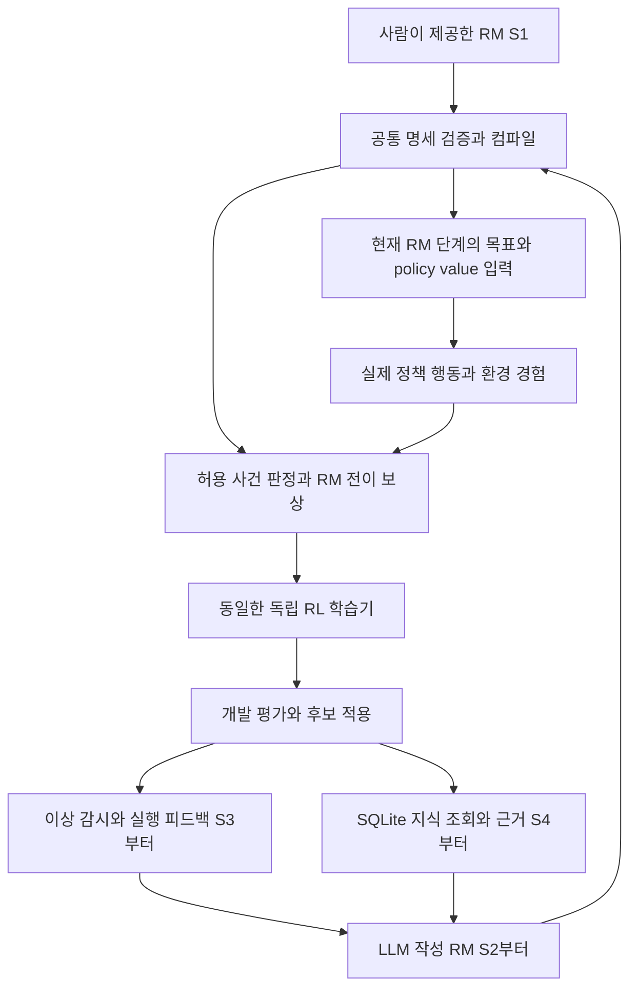

# feat: Stage human and LLM authored reward machines into continual RL

**MinecraftRL 4단계 구현 명세 — 사람이 제공한 RM에서 LLM 피드백 학습과 지식 축적으로 확장**

## Summary

구현 순서는 ① 사람이 제공한 RM + RL, ② LLM이 작성한 RM + 같은 RL, ③ 이상 감시와 LLM 피드백에
따른 추가 RL, ④ SQLite 지식 축적·검색·수정의 추가로 구성한다. 이전 검토의 D01~D13은 모두
**OPEN**으로 유지한다. 이 문서는 구현 순서와 연결 원칙을 정리하며 미결정 설계가 해결됐다고 선언하지 않는다.

원문 [연구 명세](../research-spec.md)는 유지한다. 2026-10-26의 [기존 계획](2026-10-26-001-feat-llm-rl-bottleneck-validation-plan.md)은
검증 항목·공통 제약의 참고 자료이며, 단계의 순서와 SQLite 도입 시점은 이 문서를 우선한다.
게임·학습·프로젝트 API 호출, STOP 해제, 공개 게시를 이번 문서 작성에 포함하지 않는다.

## Problem Frame

최종 목표는 LLM이 상황과 지식을 해석해 RM을 만들거나 수정하고, 그 RM의 목표 조건·보상을 통해
실제 RL 정책을 개선하는 것이다. SQLite는 근거와 지식의 장기 재사용을 추가하는 구성 요소다.
LLM을 통한 RL 학습은 SQLite 도입 전인 2단계부터 시작할 수 있다.

1단계에서 사람이 RM을 주는 것은 학습 경로 자체를 확인하기 위한 기준선이다. RM 작성자가 누구인지와
무관하게 같은 검증기·실행기·목표 표현·보상·학습기를 사용한다면 구조적 일관성이 자동으로 깨지지는 않는다.
다만 생성 주체가 달라지면 RM 의미·난이도·목표 문구·경험 분포가 달라질 수 있으며, 이 차이는 검증해야 한다.
특정 상태 번호나 고정된 나무 과업에 입력·보상을 하드코딩한 뒤 나중에 LLM을 붙이는 구조는 피한다.

## Requirements

이 절의 R 번호는 이 4단계 명세 내부 번호다. 이전 계획의 18개 요구는 폐기하지 않고 D01~D13 검토에서 추적한다.

| ID | 요구 | 근거 |
|---|---|---|
| R1 | 사람이 제공한 RM으로 RL 행동·실제 학습을 먼저 검증 | 사용자 1단계 |
| R2 | LLM 작성 RM을 동일 경로에 투입하여 실제 RL 갱신 | 사용자 2단계 |
| R3 | 이상 감시와 LLM 피드백으로 RM/학습 요청을 수정하는 폐루프 | 사용자 3단계 |
| R4 | 4단계에 SQLite 지식의 구축·확장·검증·수정·재사용 추가 | 사용자 4단계 |
| R5 | 1~3단계는 SQLite 지식 저장소에 의존하지 않음 | SQL 도입 이전 순서 |
| R6 | RM 단계가 policy/value 입력과 보상 계산에 실제 연결 | 최근 RM→RL 합의 |
| R7 | 사전학습 관측·감지기의 실사용 버전 고정, 구체 모델은 미결정 | 기존 합의와 D02·D03 |
| R8 | 학습 코드를 독립 실행하고 기록·중단·재개·평가 지원 | 기존 독립 학습 요구 |
| R9 | 실제 정책 성공과 모델 로드·규칙 검사·합성 시험을 구분 | 프로젝트 지침 |
| R10 | 동일 페르소나, 목표 약속/이력, STOP, 자원 상한, 원본 자료 보존 | 기존 합의 및 프로젝트 지침 |
| R11 | D01~D13과 VLM 영상 입력 세부안을 미결정 상태로 보존 | 이번 사용자 지시 |
| R12 | 개발 과정의 이어 학습과 단계 효과를 평가하는 비교 실험을 구분 | 사용자 일관성 우려에 대한 검증 요구 |

## Stage Overview

| 단계 | RM을 만드는 주체 | 학습 개시와 피드백 | 지식 사용 | 완료 시 입증할 것 |
|---|---|---|---|---|
| S1 | 사람이 제공한 검증 대상 RM | 사람이 정한 job·평가 조건 | 제공한 과업 정보, SQLite 없음 | RM 입력·보상이 RL 경험과 가중치 갱신에 연결되고 행동 개선 여부를 측정할 수 있음 |
| S2 | LLM API | 사용자 과업 요청 또는 명시적 생성 요청 | 현재 요청 맥락·LLM 사전지식, SQLite 없음 | LLM 생성 RM이 공통 계약을 통과하고 같은 learner에서 실제 학습에 사용됨 |
| S3 | LLM API가 실행 근거를 보고 수정 | 고정 이상 감시 → LLM 판단 → 제한된 추가 학습·평가 | 같은 run의 최근 관측·시도·피드백, 장기 KB 없음 | 피드백이 실제 RM/학습 변경과 정책 개선으로 이어지는지 검증 |
| S4 | 같은 LLM, 동일 RM 계약 | S3 폐루프 + 지식 결손/충돌/재사용 | SQLite의 조건부 지식·근거·능력 이력, 허용된 검색 | 빈 KB에서 지식과 경험을 축적하고 새로운 과업에 재사용하는 효과를 분리해 검증 |

S1의 수동 RM은 사용자 목표의 모든 경우를 사람이 미리 열거한다는 뜻이 아니다. 첫 과업·RM 다양성·
미지원 경계는 D01·D06에서 정한다. S2도 기존 정책에 명령만 내려 수행하는 단계가 아니라 실제 RL 학습을 포함한다.
S3에서는 모든 이상에 재학습하지 않고 관측 확인·재계획·보류도 선택한다. 학습 경로의 실제 사례가 있어야
피드백을 통한 RL 학습을 주장할 수 있다.

## Shared Learning Contract

다음은 단계 간 일관성을 위한 **설계 권고**다. 구체적인 문법·입력·수치·파일 형식은 D 항목에서 결정한다.

- KTD1. **RM 작성자 교체:** 사람과 LLM의 출력은 동일한 RM 실행 계약으로 정규화한다.
  출처 metadata는 보존하되 작성자에 따라 숨은 전이·보상 특례를 두지 않는다.
- KTD2. **동일 학습 경로:** 사건 판정, 단계/목표 표현, 보상과 종료, 경험 형식, learner·평가기를 재사용한다.
  LLM이 RM을 작성했다는 이유로 매 step마다 API에 보상을 묻거나 policy gradient를 LLM으로 전달하지 않는다.
- KTD3. **입력 의미 고정:** 상태 ID 자체를 나무/흙 등 특정 의미로 학습시키지 않는다. 단계 설명·목표 조건의
  표현 규칙을 공통화하고 같은 의미의 입력 차이, 새 조합·난이도에 대한 일반화를 별도로 검증한다.
- KTD4. **버전과 적용 경계:** 실행/학습 중 RM과 보상을 임의 교체하지 않는다. 승인된 수정도 새 revision과
  호환성 검사를 거친다. 공통 계약 변경이 필요하면 새 실험 버전으로 남기고 관련 기준선을 다시 확인한다.
- KTD5. **SQL 없이도 독립 실행:** S1부터 RM/job 설정, 로그, checkpoint, 평가 결과를 파일로 보존한다.
  S3의 현재 run 맥락은 bounded memory와 기록으로 관리하고, S4의 지식 조회는 그 입력의 근거를 확장한다.
- KTD6. **기존 권한 경계 유지:** 서버 정답을 RM 전이·목표 임베딩으로 우회 전달하지 않는다. 별도 privileged
  조건을 사용한다면 학습·실행에서의 정보 차이를 명시한다. 원래 목표의 성공 정의를 LLM이 바꾸지 않는다.

명세 예시에는 최소한 RM 상태·초기/종료 상태, 단계 목표, 전이 조건, 보상 참조, 사건/관측 계약,
버전·출처·루트 목표와 의존성, 미지원/unknown 처리가 포함되어야 한다. 이는 필드 목록의 방향이며
실제 schema는 D06·D07·D08의 OPEN 결정이다.

## Consistency and Experimental Design

**구조적 일관성:** 사람이 RM을 만드는 S1도 나중에 LLM이 만드는 RM과 같은 인터페이스를 사용한다.
S1에서 관측·policy/value 입력·행동 공간을 생략하고 S2에서 추가하면 동일 시스템 비교가 되지 않는다.
필요한 adapter가 있다면 공통 기반의 일부로 먼저 설계하고, 지원하지 않는 상태 표현은 생성 단계에서 거부한다.

**분포의 차이:** 같은 schema여도 수동 RM과 LLM RM의 목표 문구, 단계 길이, 보상 규모, 오류 빈도는 다를 수 있다.
S1부터 여러 지원 목표/수량/초기 상태/단계 조합을 사용하고, S2에서 의미상 동등한 RM과 새로운 유효 조합을 따로 시험한다.
구체 범위는 D01·D06에서 결정한다. 형식 검사를 통과했다는 사실은 의미 정합성이나 학습 가능성의 증거가 아니다.

**개발의 이어 학습:** S1 결과를 S2·S3에서 초기값으로 사용하는 개발 실험은 가능하다. 부모 checkpoint,
모든 선행 데이터·학습량·RM 버전을 남기고 원본 공식 정책을 보존한다. 이 경우 성능 변화에는 누적 학습 효과가 포함된다.

**연구 비교:** 단계 효과를 주장할 때는 비교군을 같은 공식 초기값 또는 사전에 선언한 공통 checkpoint에서
시작시키고 경험·학습·API 예산을 맞춘다. 사람이 준 RM과 LLM 생성 RM의 정보 이점도 기록한다. 단순히
S1에서 학습한 뒤 S2에서 더 학습한 점수가 높다는 것으로 LLM 효과를 주장하지 않는다.

정책 단독 평가에서는 같은 RM 의미·실제 목표 embedding·관측 권한·guidance에서 가중치 전후를 비교한다.
시스템 평가는 RM/계획 선택까지 포함한 효과를 별도로 측정한다. 최종 평가의 화면·실패·점수는 LLM/KB/learner에
되돌리지 않으며, 피드백으로 사용할 개발 평가와 분리한다.

## Implementation Units

아래 U1~U4는 정확히 네 개의 큰 구현 단계다. 기존 코드 참조는 재사용 가능성을 검토할 위치이며 완성품을 뜻하지 않는다.
신규 파일과 테스트 경로는 제안 위치다. 모듈별 구현은 관련 OPEN 결정을 정한 뒤 진행하고, 이 문서 작성에서는 실행하지 않는다.

### U1 Human RM and RL

- **목표/요구:** 사람이 제공한 RM을 읽어 정책 입력·보상·경험 수집·PPO·평가를 연결한다. R1·R6·R8~R10·R12.
- **기존 참조:** `src/minecraftrl/tasks.py`, `src/minecraftrl/policies.py`, `src/minecraftrl/rl_policy.py`,
  `src/minecraftrl/rl_opt.py`, `src/minecraftrl/runtime.py`. 현재 TaskState의 wood/dirt 단계는 범용 RM compiler가 아니다.
- **신규 제안:** `src/minecraftrl/training/contracts.py`, `src/minecraftrl/training/rm_runtime.py`,
  `src/minecraftrl/training/learner.py`, `src/minecraftrl/training/cli.py`와 독립 PowerShell/WSL 진입점 및 평가 도구.
- **산출물:** 수동 RM/불변 job 설정, 지원 사건 registry, 관측/목표/행동/보상 이력, checkpoint와 독립 평가 결과.
- **시험:** `tests/test_training_contracts.py`, `tests/test_training_rm.py`, `tests/test_training_learner.py`.
  정상/불가능/unknown 전이, 이미 충족한 단계, 보상 반복 악용, policy/value 입력 전달, old logp 일치,
  STOP 이후 dispatch, API 없이 시작·재개·평가를 검사한다. 실제 rollout으로 개선·무효과·퇴행을 구분한다.
- **진입/진행 기준:** D01·D02·D06~D09와 D11~D13의 기본 계약이 필요하다. 실행/가중치 변경만으로 성능 통과하지 않는다.
  구체 개선율·seed·예산은 OPEN이며 기존 문서의 수치를 자동 확정하지 않는다.

#### S1 Work Packages

2026-10-30 보완. 사용자가 목표 임베딩의 실효성과 RM+RL 병목을 해결하기 위한 구체적인 구현 작업을 요청했다.
아래 A~F는 **U1 내부의 작업 분해**이며 전체 네 단계는 유지한다. 구현 제안이며 실행 완료나 OPEN 결정의 채택이 아니다.
기존 코드의 수집/손실 함수가 남아 있다는 것만으로 독립 학습기가 완성됐다고 보지 않는다.

| 작업 | 구현 내용과 산출물 | 완료 근거 | 실패 시 돌아갈 곳 |
|---|---|---|---|
| S1-A 계약과 평가 조건 | `training/contracts.py`에 목표/RM/관측/행동/시간/보상/종료/학습 범위/예산/split/버전 계약을 작성. 사람이 작성한 RM과 초기 조건 manifest 준비 | 누락·미지원 입력 거부, 같은 설정의 hash 일치, 정책·감시·평가 정보 권한 명시 | 과업·입력·성공 정의를 결정하는 D01·D02·D06~D09·D12·D13 |
| S1-B 목표 조건 진단 | 제안 `training/diagnostics.py`에서 공식 동결 정책의 텍스트·공식 영상 목표와 목표 교체 대조, 단계별 실제 실행을 기록 | 동일 관측/기억에서 목표 변경에 따른 행동 분포와 별도 실제 획득 결과. 성공 가능한 전제와 실패 구간 식별 | 텍스트 변환, 정책 능력, 시각/기억, 실행 경계를 구별하는 추가 진단 |
| S1-C RM 실행과 인계 | `training/rm_runtime.py`에서 허용 사건에 따른 전이·보상·종료·재탐색·복구 복귀를 구현 | 정답 사건 trace와 전이/보상 일치, 실제 관측 출처 감사, 이미 충족한 단계·동시 사건·unknown·중복 보상·STOP 처리 | 사건 판정 또는 전이 계약. 관측 오류를 정책 실패로 학습하지 않음 |
| S1-D 정책 조건 연결 | 제안 `training/conditioning.py`에서 현재 단계의 목표 표현과 필요한 수량/제약을 policy/value에 연결 | 수집·학습·평가에서 같은 입력 hash/의미, 초기 기준선과의 호환, 의미 동등 RM의 동일 입력 | D07의 표현·adapter·기억 전환 선택. 입력 연결 시험과 실제 활용 능력 평가를 구분 |
| S1-E 독립 RL 학습기 | `training/learner.py`, `training/cli.py`에 수집→PPO→저장→평가와 상태·중단·재개 연결 | 실제 전달 행동의 log-prob 재현, 유효한 경험/gradient/가중치 갱신, checkpoint 재로딩, API/SQLite 없이 실행 | 경험·보상·할인·optimizer·학습 층의 원인을 분리. 가중치 변화만으로 통과하지 않음 |
| S1-F 실제 비교와 단계 판정 | 제안 `training/evaluation.py`에서 동결 공식 정책과 학습 후보의 실제 획득·소요 시간·기존 능력·미학습 조합 평가 | 사전 잠근 평가 규칙에 따른 개선/무효과/퇴행/판정불가와 전체 시행·실패 원인 보고 | 원인별 B~E 수정 후 개발 평가. 최종 평가를 반복 튜닝에 사용하지 않음 |

구현 순서는 A→B→C→D→E→F를 기본으로 한다. A에서 필요한 최소 계약을 정한 뒤 B와 CPU 기반 C의
준비는 서로 의존하지 않는 범위에서 진행할 수 있다. 이번 작업 흐름은 사용자 지침에 따라 주 실행 흐름에서 순차 처리한다.
테스트 제안은 기존 U1 세 파일에 더해 `tests/test_training_diagnostics.py`, `tests/test_training_conditioning.py`,
`tests/test_training_evaluation.py`다. 코드/시험 파일은 아직 생성하지 않았으며 존재하는 구현으로 인용하지 않는다.

#### S1 Diagnosis and Learning Rules

S1-B에서는 공식 checkpoint를 보존하고 조건별 목표 벡터·prior 난수·guidance·시작 순환 상태를 기록한다.
저장 관측 비교에서는 화면·기억·episode 경계와 무관한 난수를 고정하고 목표 조건만 바꾼다. 올바른 목표,
다른 목표, 영 벡터를 진단 조건으로 사용할 수 있지만 영 벡터 조건을 곧바로 원본 VPT 대조군이라고 부르지 않는다.
실게임은 선언한 시작 상태·정책·예산을 맞춰 반복하며 렌더링 등으로 입력이 달라지면 완전한 쌍 대조라고 주장하지 않는다.
텍스트 목표보다 공식 영상 목표가 잘 작동하면 텍스트→prior→정책 연결을 의심할 근거가 되지만 단독 원인 확정은 아니다.
행동 확률 변화, 목표에 맞는 첫 행동, 실제 획득을 따로 기록한다. 목표별 확률이 다르다는 것만으로 지시 수행을 인정하지 않는다.

첫 파일럿 후보는 원목/흙 수집이며 가까운 대상·접근이 필요한 대상·우회가 필요한 배치·다른 시선/초기 상태를 분리한다.
이는 D01 추천 범위이지 확정 과업 목록이 아니다. 나무 하나의 고정 좌표를 성공시키는 것으로 끝내지 않고 학습/개발/최종
조건을 나누며, 지원 하위 목표의 미학습 순서·조합과 학습 범위 밖의 능력을 구분한다. 공식 STEVE-1 사전학습 자료 전체를
알 수 없으므로 이 프로젝트의 추가 학습에서 제외했다는 것을 사전학습에서도 처음 본 과업이라는 뜻으로 쓰지 않는다.

S1-C의 관측 사건은 고정된 허용 관측으로 실제 판정 가능한 것만 지원한다. 대상 발견·접근 가능·블록 파괴·아이템 획득은
서로 다른 사건이며, 판정기가 없으면 unknown/미지원이다. 개발 서버 정답을 전이/조건 입력으로 쓰면 privileged 조건으로
명시하고 영상 전용 결과와 분리한다. 평가자가 본 정답을 RM이나 목표 벡터로 정책에 우회 전달하지 않는다.
RM 상태는 키 입력 목록이 아닌 검증 가능한 상태 변화로 나눈다. 목표 수량·현재 보유·획득 이력·재료 소모를 구분하고,
시간 초과나 복구 예산 소진을 완료로 처리하지 않는다. 복구 복귀는 경유점 횟수만이 아니라 허용 관측으로 확인한 수행
전제의 회복에 연결하는 후보를 검증한다. 그 증거가 부족하면 보류/재진단하며 서버의 사후 벽 횡단 정답을 사용하지 않는다.

S1-D의 추천 출발점은 STEVE-1의 기존 목표 표현을 유지하고 현재 단계의 의미에 맞는 목표 조건을 전달하는 것이다.
수량/제약 같은 추가 구조화 정보의 필요 여부·표현·adapter는 D07에서 정한다. 임의 LLM 임베딩을 512차원으로 맞춰
기존 목표 자리에 넣지 않는다. 새 adapter의 초기 동등성은 구현 검증이며 의미를 이해했다는 증거가 아니다.
한 목표만 학습해 목표 입력을 무시해도 성공할 수 있는 자료 구성을 피하고, 같은 종류의 관측에서 다른 목표가 다른 행동을
필요로 하는 조건을 포함한다. 단계 전환 때 기억을 유지/초기화하는 규칙도 수집·학습·평가에 동일하게 적용한다.

S1-E는 head 중심 PPO를 첫 공학 후보로 삼되 최종 학습 범위를 미리 head에 고정하지 않는다. 신호가 없으면 먼저 실제
보상·유효한 경험·gradient·현재 입력으로 과업을 구별할 수 있는지를 확인한다. 문제가 표현/기억 학습 범위에 있음을
뒷받침하는 진단 후 마지막 층/순환부 등 별도 후보를 비교한다. 이는 D09의 OPEN 선택이며 전 층 학습을 자동 채택하지 않는다.
순환부를 학습한다면 원본 순차 관측과 episode 경계/burn-in을 사용하고 이전 동결 특징 캐시를 그대로 학습 입력으로 재사용하지 않는다.
새 policy version에서 수집한 유효한 PPO 경험을 사용하며 오래된 자료/시연의 보조 학습은 다른 조건으로 명시한다.
성공 경험이 부족하면 연습 초기 조건의 난이도·분포와 탐색을 조정한 후보를 만들고, 단순 보상 확대만 반복하지 않는다.
보상은 실제 목표 성공·진행도 shaping·시간 비용을 분리하고 gamma/GAE와 행동/서버 시간 단위를 함께 고정한다.
보상 식의 수정도 별도 revision이며 같은 배치 중간에 바꾸지 않는다. 순환·버리기/재획득·일시적 후퇴 사례를 검사한다.

S1-F에서는 공식 동결 정책 대비 향상을 추가 RL 학습 효과로 보고, RM 자체의 기여는 별도 대조로 구분한다.
대조 후보는 같은 초기값의 고정 목표+성공 보상 RL, RM 단계 목표+성공 보상 RL, 같은 RM 단계 목표+shaping RL이다.
학습 범위·허용 관측·초기 조건 분포·경험 예산을 맞추고 각 정책의 유효한 경험을 따로 수집한다. 다르게 학습된 정책에
같은 과거 행동 자료를 무조건 재사용하지 않는다. 전체 비교 채택/예산은 D12·D13 OPEN이며, 해당 대조 없이 RM의
독립 기여를 입증했다고 주장하지 않는다. 과업 성공과 무관한 shaping 합 증가를 개선으로 판정하지 않는다.

#### S1 Exit Gates

- G1 구현 연결: 허용 관측→RM→policy/value 입력→실제 행동→보상→독립 학습→checkpoint→평가 경로가 연결된다.
  unsupported/unknown, 실패/중단, bootstrap/시간 초과, 실제 전달 행동의 확률과 STOP 이후 전달 금지를 검사한다.
  API/SQLite 없이 job 실행·상태 확인·중단·재개·평가가 가능해야 한다. 합성/재생 검사는 이 구현 게이트의 근거다.
- G2 행동 효과: 사전 지정한 여러 개발 조건에서 공식 동결 기준선 대비 실제 목표 획득률/효율의 개선과 기존 능력 보존을
  같은 정보·실행 예산에서 평가한다. 추가 학습 전의 미학습 조합 수행과 정해진 경험량 학습 후의 적응을 별도로 보고한다.
  개선의 최소 크기·표본·불확실성·허용 퇴행·자원 상한은 D01·D09·D12·D13에서 **결과를 보기 전에** 정한다.
  그 기준이 없거나 효과가 불확실하면 G2는 판정불가다. 과거 두 세계 성공이나 가중치 변경만으로 대체하지 않는다.

G1 통과 후 S2의 RM 생성/검증 연결을 개발할 수 있다. 다만 G2가 미통과인 상태에서 LLM을 붙여 학습 병목이 해결됐다고
선언하거나 S1/S2 학습 효과를 입증했다고 보고하지 않는다. 통합 학습 평가로 넘어가는 조건은 G1·G2 충족이며,
LLM 생성 RM의 성능 자체는 S2에서 다시 평가한다. 모든 Minecraft 과업의 해결이나 모든 미지 RM의 zero-shot 성공은
S1 종료 조건이 아니다. 지원 범위와 남은 실패가 명확해야 한다.

독립 실행 인터페이스 후보는 `validate`, `diagnose`, `train`, `status`, `pause`, `resume`, `evaluate`다.
이는 아직 실행 가능한 CLI 명령이 아니다. 실행 job에는 부모 모델 hash, 목표/관측/RM/보상/학습 버전, split, 난수,
경험·시간·자원 상한과 원본 로그 위치를 보존한다. job 종료와 게임 입력 해제/소유 자식 PID 종료를 각각 확인한다.

이번 보완은 D01~D13을 닫지 않는다. 지금 필요한 팀 선택은 초기 과업/평가 범위, 관측 권한, 정책 조건/학습 범위,
실험 예산/성능 기준이다. VLM·이상 감지 방식(D03), SQLite/검색(D04), API 계약(D05), 증류(D10)의 상세 결정은
해당 단계까지 유지할 수 있다. 필요한 초기 선택과 무관한 파일 구조·기록·CPU 계약 검증의 준비를 모두 막지는 않는다.

### U2 LLM Authored RM

- **목표/요구:** LLM의 구조화된 RM 후보를 U1과 동일한 compiler·learner로 실행한다. R2·R5·R6·R10·R12.
- **기존 참조:** `src/minecraftrl/semantic.py`, `src/minecraftrl/tasks.py`. 현재 semantic schema는 wood/dirt 단계
  제안 중심이고 persona와 분리된 prompt를 포함한다. 단일 페르소나 응답·범용 RM 작성 완료로 보지 않는다.
- **신규 제안:** `src/minecraftrl/rm_generation.py`와 공통 계약 adapter. 새 learner를 별도로 만들지 않는다.
- **산출물:** 같은 LLM 응답의 사용자 답변·의도·RM 후보, 검증/거부 결과, RM 출처·버전, 동일 형식의 학습 job.
- **시험:** `tests/test_rm_generation.py`. 같은 실행 의미의 사람/LLM RM은 동일 사건 trace에서 전이와 보상이
  일치해야 한다. JSON 오류, 미지원 사건, 목표 왜곡, timeout, 상태 ID 변경, 표현 차이·새 조합도 시험한다.
  실제 API 생성과 실제 RL 사용을 각각 확인한다. 모의 응답 통과를 실제 생성 성능으로 계산하지 않는다.
- **진입/진행 기준:** U1의 공통 경로와 D05~D08·D12·D13의 API/비교 계약. 자율 이상 감시나 SQLite를 선행 조건으로 두지 않는다.

### U3 Monitoring and LLM Feedback Learning

- **목표/요구:** 고정 감지기가 실행 근거를 제공하고 LLM이 RM/학습 요청을 수정해 실제 추가 RL에 연결한다.
  SQLite 없이 같은 run의 맥락으로 피드백 학습을 검증한다. R3·R5~R10·R12.
- **기존 참조:** `src/minecraftrl/stall_detection.py`, `src/minecraftrl/task_runtime.py`, `src/minecraftrl/runtime.py`.
  기존 정체 근거는 새로운 사전학습 감지기의 성능 증거가 아니다.
- **신규 제안:** `src/minecraftrl/anomaly_monitor.py`, `src/minecraftrl/adaptation_coordinator.py`.
  관측→사건→단일 LLM 판단→검증된 RM/job→독립 학습→개발 평가→후보 적용 경로를 연결한다.
- **산출물:** 사건·경쟁 가설·시도 이력, 명시적 RM patch, 불변 학습 요청, 개입 결과와 후보 적용 기록.
- **시험:** `tests/test_monitor_learning_loop.py`. 정상 우회/채굴 오탐, 복합 원인/unknown, 반복 요청,
  RM 수정 중 rollout 버전 보존, API 지연/중단, 오래된 후보·목표 취소, main actor와 learner의 간섭을 검사한다.
  최소한 실제 학습 요청→가중치 변경→독립 평가의 연결 사례를 남긴다. 실패 원인을 보류하고 기록할 수 있어야 한다.
- **진입/진행 기준:** U2와 D02·D03·D05·D09·D11~D13. VLM 사용 여부·3분 영상·sampling·정기 호출은 D03의 OPEN 후보다.
  고정 감지기의 실사용을 새 실패마다 재학습하는 것으로 대체하지 않는다.

### U4 SQLite Knowledge Construction and Expansion

- **목표/요구:** U3에 SQLite를 추가해 빈 사실/경험 테이블에서 지식·근거·조건·정책 능력을 축적하고 재사용한다.
  R4·R6·R8~R12. schema·지원 사건/행동 계약과 사전학습 모델은 초기 제공 정보로 명시한다.
- **신규 제안:** `src/minecraftrl/knowledge_store.py`, `src/minecraftrl/knowledge_resolution.py`.
  기존 LLM context에 관련 근거를 공급하고 후보/검증/충돌/철회·의존성을 저장한다. learner에는 DB 접속 대신
  학습 시점의 해석된 설정과 근거 snapshot을 제공하는 구성을 권고한다.
- **산출물:** 빈 KB 시작 기록, LLM 후보·검색 출처, 검증 조건, 비단조 수정 이력, 지식/RM/job/checkpoint의 의존 관계.
- **시험:** `tests/test_knowledge_store.py`, `tests/test_knowledge_learning_loop.py`. 빈 DB, 충돌 지식, 오래된 버전,
  규칙 검증과 미습득 행동의 순환, 잘못된 지식 철회, 독립 지지 근거 보존, 재시작 후 검색·재사용을 확인한다.
  DB 잠금/장애가 제어와 STOP을 막지 않는지 검사하고 KB 재사용 효과를 정책 가중치 효과와 분리한다.
- **진입/진행 기준:** U3와 D04·D05·D11~D13. 외부 검색 커넥터·출처 범위·검증 승격 기준은 OPEN이다.
  검색된 사실을 정책 능력으로 계산하지 않는다. 지식 철회만으로 기존 가중치가 교정됐다고 하지 않는다.

## SQL Boundary and Distillation

S1~S3의 파일 로그·checkpoint·불변 job 기록은 재현/중단/재개용이다. S3은 같은 run에서 최근 사건·시도·개발 평가를
참조할 수 있다. 기술적 resume에 필요한 해당 run의 상태 복원은 허용하지만, 과거 별도 run의 사실을 JSON 검색으로
가져오는 장기 KB를 먼저 구현해 S3에 숨기지 않는다. S3과 S4 비교에서 세션/지식 재사용 범위를 명시한다.

S2·S3의 LLM 사전지식과 현재 맥락 활용은 SQLite가 없어도 가능하다. 외부 검색 도입 시점은 D04·D05에서 정한다.
초기 비교에서는 외부 지식 검색·검증·지속적 재사용을 S4에 묶는 것을 추천하되 이미 확정된 선택으로 취급하지 않는다.

증류는 삭제하지 않고 D10 OPEN으로 유지한다. 교사/학생·자료·호출 조건이 정해지면 U3 또는 U4 이후 공통
후처리 학습 job으로 연결할 수 있다. 어느 단계의 필수 완료 조건인지, 별도 후속 실험인지도 아직 미결정이다.
이번 4단계에 임의의 5단계를 추가하거나 RL 가중치 갱신을 곧바로 정책 증류라고 부르지 않는다.

## Open Decisions

[기존 13개 병목 검토](../implementation-readiness-review-2026-10-29.md)의 상세 문제·추천안·반례는 그대로 유지한다.
**아래 모든 항목은 OPEN이다.** 네 단계의 순서를 정했다고 개별 방법·성능·예산이 결정된 것은 아니다.
전 항목을 한 번에 해결해야 문서/독립 기반 작업을 할 수 있다는 뜻도 아니다. 해당 기능 구현 또는 실제 실행 전에
필요한 하위 결정을 확정하고, 나머지는 OPEN으로 유지한다. 단계별 상태는 구현 시 결정 기록으로 갱신한다.

| ID | 상태 | 미결정 내용 | 처음 필요한 시점 |
|---|---|---|---|
| D01 | OPEN | 주 비교 가설, 첫 과업·RM 다양성·초기 조건·성공 정의 | S1 과업 확정 전 |
| D02 | OPEN | P/M/E 권한, 사건 판정·unknown, RM을 통한 숨은 정보 유입 방지 | S1 관측/RM 연결 전 |
| D03 | OPEN | 감지기 모델/가중치·사전학습·보정·오탐 기준, VLM/3분 영상/호출 방식 | S3 감지기 연결 전 |
| D04 | OPEN | 빈 KB의 초기 정보, 검색 출처·시점, 검증/철회·증거 정책 | S4 KB 연결 전; 앞 단계 검색 사용 시 그 전에 |
| D05 | OPEN | 동일 페르소나 구조화 응답, API 모델/형식, 개입 선택·권한·재시도 | S2 생성 전; 피드백 선택은 S3 전 |
| D06 | OPEN | RM schema·registry·전이/수량/자원 소모/수정 의미와 상한 | S1 RM runtime 전; LLM 작성 범위는 S2 전 |
| D07 | OPEN | RM 단계·목표의 policy/value 입력, encoder/adapter, 순환 상태 | S1 정책 연결 전 |
| D08 | OPEN | 보상 식·할인/GAE·시간 단위·종료/중단, 독립 최종 판정 | S1 학습 전 |
| D09 | OPEN | 학습 층·optimizer·경험 수집·연습 분포·예산·무신호 대응 | S1 학습 전 |
| D10 | OPEN | 증류 교사/학생·자료·시점·능력 보존·단계 완료 조건 포함 여부 | 증류 구현/실험 전 |
| D11 | OPEN | 독립 job/STOP/resume, 비동기 소유권·RM/정책 교체·DB 수명주기 | 기본은 S1 전; 피드백 병행은 S3, DB는 S4 전 |
| D12 | OPEN | 같은 출발점·예산·정보의 비교군, split·표본·성능 판정 | S1 평가 설계 전; 각 단계 연구 비교 전 |
| D13 | OPEN | 실제 자원·API 예산·지연 상한·운영 담당·재현 기록 | S1 실행 전; API는 S2, 병행 부하는 S3 전 |

현재 권고안을 선택하더라도 담당자·선택값·근거·시험·보류 기준을 명시한 결정 기록이 있어야 닫힌 항목으로 바꾼다.
기존 문서의 수치/파일 구성은 검토 후보이며 이번에 자동 채택하지 않는다. 사용자/팀의 연구 선택을 구현 편의로 바꾸지 않는다.

## Acceptance Examples

- AE1. 사람이 작성한 RM과 LLM이 작성한 의미상 동일 RM을 같은 사건 trace에 넣었을 때 상태·보상·목표 조건이
  일치한다. 작성자에 따른 보너스나 별도 행동 경로가 없다. R1·R2·R6.
- AE2. S2에서 LLM이 미지원 사건을 제안하면 거부 사유를 돌려준다. 지원 wood로 치환하거나 센서를 추가하지 않는다. R2·R7.
- AE3. S1 학습 job은 API/SQLite가 없는 상태에서도 실행·중단·재개·평가할 수 있다. 실제 학습 성공 여부는 별도다. R5·R8.
- AE4. S3의 반복 실패에서 LLM이 RM 수정과 학습 요청을 제안하면 새 revision으로 검증 후 다음 작업에 적용한다.
  진행 중 PPO batch의 보상은 바뀌지 않는다. 같은 원인 요청의 누적 예산과 과거 시도는 유지한다. R3·R6·R10.
- AE5. S4에서 새 지식을 철회하면 관련 RM/job/정책을 재검토한다. 무관한 작업까지 전부 취소하거나 잘못된 행동이
  이미 가중치에서 제거됐다고 보고하지 않는다. R4·R9·R10.
- AE6. S3에 파일 기록은 있지만 실행 간 지식 검색은 없다. S4의 성능 차이는 같은 초기 정책과 통제된 기억 조건에서
  검사하고 최종 평가 근거를 KB에 유입시키지 않는다. R4·R5·R12.
- AE7. 세 단계의 순차 개발에서 학습량이 누적됐으면 부모·총 비용을 기록한다. 그 결과만으로 LLM이나 SQLite의
  개별 기여를 주장하지 않는다. R12.

## Review and Sources

작성 시 단계별 추가 기능, 수동/LLM RM 일관성, SQL 이전 기록 경계, 비교 실험의 초기값, OPEN 상태 보존을
순차 검토했다. 새 모델·감지기·수치를 결정하거나 성능을 실측한 것이 아니다.

- [ARM-FM](https://proceedings.iclr.cc/paper_files/paper/2026/file/68f24fad8f460d4b7bbac402c252ebbb-Paper-Conference.pdf):
  RM 구조·사건 판정·상태 설명의 정책 조건과 보상을 연결하는 근거. 사람/LLM 공통 실행 계약은 이 프로젝트의 설계 권고다.
- [PPO](https://arxiv.org/abs/1707.06347): 경험을 사용한 정책 갱신의 근거. RM 생성만으로 policy update가 생기는 것은 아니다.
- [기존 지식→정책 문서](../knowledge-to-policy-learning-2026-10-25.md): 고정 관측과 목표 조건/RL 갱신 구분.
- [기존 병목 검토](../implementation-readiness-review-2026-10-29.md): D01~D13의 상세 반례와 검증 책임.
