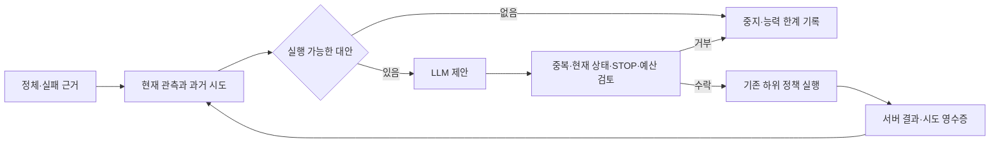

# 실패 이력을 사용하는 재계획 연결

[고정 조건](recovery-memory-protocol-2026-10-10.md). 사용자가 요청한 실패 판정→LLM 대안 검토→이전 시도 전달→중복 방지를
기존 ReplanGuard/PlanHistory와 live 요청에 연결했다. 원문 연구 명세와 기존 RM/진행도는 유지한다.

## 바뀐 연결

기존 실패 목록은 오프라인 검토에만 쓰였고 실제 LLM packet에서 빠져 있었다.
이제 `planner_context`가 실제 packet에 들어간다. 여기에 현재 관측의 결합 해시, 실제 사용 가능한 방법,
실패한 방법과 근거, 실행 전후 관측·실행한 전이 수·결과가 포함된다.
LLM은 이 이력을 근거로 대안을 설명하고 선택하며, 로컬 guard가 같은 정보와 전체 이력을 다시 검사한다.
문구의 유사도를 LLM에 판단시켜 실행 허가를 맡기지 않는다.

그림의 반복은 일반 계약이다. 현재 실제 실행 어댑터는 승인된 요청1회/탐색1회 한도를 유지한다.
호출 한도를 자동으로 늘리거나 유료 연결을 재사용하지 않는다.

## 시도와 중복의 의미

- 방법의 식별: 등록된 skill·policy binding·실제 인자. 이유 문장/시간 한도/요청 ID는 새로운 방법이 아니다.
- 같은 상황: 같은 world/episode/목표 범위에서 목표 대상·목표 인벤토리·생존 상태·관측된 자원·도달 가능성을 비교한다.
  위치 cell/선택 슬롯/내부 세대만 바뀌면 실패 기록은 유지된다. 이동만으로 경로가 달라졌다고 단정하지 않는다.
- 재검토: 관측된 목표/자원/도달 가능성 또는 실제 방법 인자가 바뀌면 새 조건으로 검토할 수 있다.
  다시 과거 조건으로 돌아오면 이전 중복 제한도 그대로 적용된다. 다른 세계의 실패를 전역 불가능 판정으로 만들지 않는다.
- 결과: `failed`, `partial`, `completed`, `interrupted`, `unverified`를 구분한다.
  발견/이동은 실제 인벤토리 완료가 아니다. STOP·미실행을 실패 방법으로 차단하지 않는다.
- 기억: 실패 최대64개, 일반 계약 요청/실행 최대3개. 프롬프트에는 최근 실패4개와 실행 결과 최대3개,
  생략 건수와 현재 차단된 방법을 넣는다. 원본 이력과 전체 중복 검사는 줄이지 않는다.
- 복원: schema1을 읽을 때 메모리에서만 schema2로 올린다. 원본 파일을 읽기만 해도 변경하지 않는다.
  실패/실행 영수증은 덮어쓰지 않으며 이전 응답과 기록 writer의 중복·stale 검사를 유지한다.

live 요청은 이제 현재 관측에 연결된 이력 context를 요구한다. 옛 유료 일회 packet은 재사용하지 않는다.
오프라인 archived draft의 기존 packet 읽기는 유지한다. 이력 조회 자체가 게임 재개 권한은 아니다.

## 검사와 실제 자료 재생

초기 회귀 검사에서 실제 packet의 이력 누락과 위치 변경에 의한 중복 우회가 실패하는 것을 확인한 뒤 수정했다.
Windows 전체453검사(19skip), WSL 전체458검사(9skip) 통과.
마지막 저장 용량/영수증 검토 후 영향 범위95검사도 Windows와 WSL에서 통과했다.
로그: `results/recovery-memory-20261010/{windows-tests-final,wsl-tests,final-review-tests,wsl-final-review-tests}.log`.
WSL 첫 기동에는 systemd 사용자 세션 경고와 파일 I/O 지연이 있었으나 검사 프로세스는exit0으로 끝났다.

기존 실제2궤적에서 새로운 관측/중립 해제를 만들지 않고 다음 요청만 반사실적으로 재생했다.
두 경우 모두 최초 채집 실패1건→탐색 부분 진전 영수증1건→재개 채집 실패가 입력에 연결됐다.
다음 입력에는 실패2건/시도1건이 남고, 같은 탐색 방법은 거부됐으며 `remain_paused`만 남았다.
새 중립 해제가 없으므로 실행 허가는 여전히 거부된다. API/게임 행동/학습0이다.
근거: `results/recovery-memory-20261010/replay/report.json` 및 각 `next-planner-input.json`.

## 실제 게임 연결 확인

새 고정 로컬 응답1회와 전수 감사를 완료했다. `results/recovery-memory-game-20261010/work.json` 완료·오류0.
고정 checkpoint/원본 world, 제어 최대180초, 유료 API/학습0이다.

실제800정체→801중립→약5.001초 대기→802현재 상태 검토→803~980탐색178전이→
980새 나무 발견/partial 영수증→981부터 wood→1082시간 제한 종료·원목0이었다.
요청5592bytes에 최초 채집 실패의 `no_goal_progress` 근거와 차단된 방법/가능한 대안이 포함됐다.
이력8815bytes에는 실패1건과 전후 관측이 있는 부분 진전 영수증1건이 남았다.
재개102전이 동안 추가 정체 판정 전에 전체 시간이 끝났다. 새 실패나 완료를 만들어 기록하지 않았다.

실제1082전이(신경망1080·중립2)의 actor logp최대오차0, 공식 행동/RM/graph/tick/조건 전환 검사를 통과했다.
실제 packet과 당시 이력으로 재구성한 입력이 같고, 영수증의 시작/끝 관측·178전이·부분 진전 분류가
원본 서버 전이와 일치했다. 대기/STOP뒤 새 추론/전송0·해제키0·소유PID0, worker/부모exit0.
마지막 정책 전송179.875949초, 종료 판정까지180.035097초, 정리7.834289초였다.
추론 중앙값49.765ms/p9559.748ms, 전체 제어 주기129.795ms/p95303.544ms.
PyTorch peak allocated1915.001MiB/reserved2056MiB, 전체 장치 표본 peak2859MiB.
장치 계측에는 nvidia-smi 0.5초 timeout이 기록돼 완전한 peak 측정으로 보지 않는다.
이 결과는 이력 전달/저장의 실제 연결 검사이며 우회 개선이나 실제 LLM 추론 성과가 아니다.

원본: `results/goal-recovery-eval-104761-20261009T154057960295Z/run/`의
`planner-input.json`, `planner-history.json`, `recovery-memory-audit.json`.
게임 당시 고정 소스는 `results/recovery-memory-20261010/source-at-game/`에 보존했다.

## 실행 후 일반 계약 검토

현재 실제 실행기는 최초 채집 실패를 인자 없는 collect_wood로 기록하고, 탐색은 인자가 있는 실행 영수증으로 기록한다.
검토 중 일반 `record_failure`를 인자가 있는 다른 방법에도 사용할 때 인자가 누락되는 경로를 별도로 재현했다.
게임 종료/감사 뒤 이 경로도 인자를 보존하도록 수정했다. 동일 인자는 차단하고 실제 다른 인자는
구분하며, 인자를 모르는 옛 기록은 새 방법임을 입증한 것으로 간주하지 않는다.
이 후속 경로는 회귀 검사로 확인하며 실제 게임에서 인자가 있는 실패 이벤트를 새로 실행했다고 주장하지 않는다.
wood 이외 dirt 수집에도 같은 실패/중복 계약을 적용하는 검사를 추가했다.
후속 수정까지 포함한 최종 전체 검사는 Windows456검사/19skip, WSL461검사/9skip으로 통과했다.
로그: `results/recovery-memory-20261010/{windows-complete-tests,wsl-complete-tests}.log`.
최종 코드·검사·보존 해시는 `results/recovery-memory-20261010/final-verification.json`에 기록한다.

## 남는 한계

현재 live 어댑터는 원목 수집의 `explore_then_resume`/`remain_paused`만 집행한다.
일반 이력/검토는 등록된 wood/dirt 수집 방법에도 쓸 수 있으나 자율 제작·방향성 우회·다중 RM 스케줄러는 미구현이다.
LLM이 다른 해결 방안을 말한다고 하위 정책이 자동으로 그 skill을 얻지는 않는다.
실행 가능한 대안이 모두 소진되면 같은 시도를 다시 호출하는 대신 중지한다.
현재 관측에 없는 경로 변경은 중복 허용 근거로 추정하지 않는 보수적 제한이 있다.
복구 성능 일반화·실제 다회 LLM 회복·새 학습 개선은 별도 과제다.
