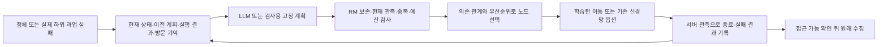
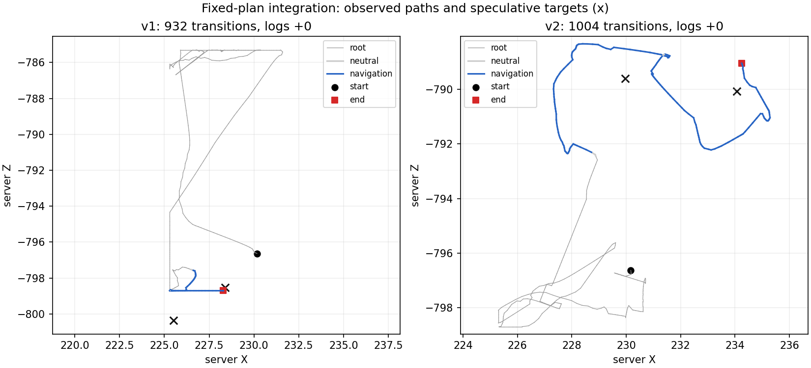

# RM 계획과 학습된 경유점 실행의 연결

이번 단위의 **구현·실행 연결 감사는 완료**했다. 원목 획득 개선과 실제 LLM 효과는 미입증이다.
조건과 실행 전 결정은 [구현 기록](rm-navigation-integration-plan-2026-10-14.md)에 보존한다.

## 연결한 범위

기존 상위 RM 스케줄러가 하위 신경망 옵션과 학습된 좌표 이동 head를 함께 선택한다.
별도 후보 선택 실험 경로에만 있던 이동 executor를 `--rl-rm-navigation-actor`로 명시적으로
연결했다. 개발 월드·기존 가중치와 embedding의 해시가 맞을 때만 사용할 수 있다.

- `navigate_waypoint_0..3`는 서로 다른 모델4개가 아니다. 현재 위치에서 만든 3블록 후보에
  목표 좌표·actor/embedding 해시·완료 조건·예산을 고정한 같은 executor의 인스턴스다.
  자유 좌표나 미지원 스킬을 LLM 문장만으로 실행하지 않는다.
- 선택 목표는 실제 head의 상대 방향·거리·높이·시선 입력으로 연결된다. 원래 STEVE-1
  행동 vocabulary와 샘플링을 유지한다. 스크립트 키 입력으로 우회시키지 않는다.
- 도달은 기존 수평0.35블록/높이차1.5블록 이하·GUI 닫힘으로 판정한다. 완료 기준을
  느슨하게 바꾸지 않았다. 원목 목표는 기존 실제 인벤토리 증가 기준 그대로다.
- 실패 결과에는 시작/끝/최소 거리, 이동량, 이동 명령 방향 불일치, 정렬됐지만 이동하지
  못한 연속 행동 수를 남긴다. 정렬 문제·정밀 도달·막힘 의심은 **가설**이며 지형 정답이 아니다.
  중단·미실행·관측 불명을 실제 실패와 분리한다.
- 실패한 이동은 근처 출발점·방향·실제 모델/조건으로 비교한다. 노드 이름·목표 문구·작은
  좌표 변화로 같은 실패를 우회하지 못한다. 실제 접근 상태나 정렬 조건의 변화는 재검토한다.
  현재 같은 출발 부근은 수평2.5/높이1.5블록, 같은 방향은40도 이내다. 정렬 관련 실패는
  마지막 시선에서45도 이상 바뀌면 재검토한다. 이 임계값의 일반 성능을 입증한 것은 아니다.
- 새 요청은 이전 계획과 성공/실패 결과를 보존한다. 성공한 이동 뒤 접근이 실패하면 그
  기록을 포함해 다시 제안한다. 미래 의존 노드의 중복 제한은 실제 선택 시 다시 검사한다.
- 응답 대기 중 위치가0.5블록 넘게 바뀌면 오래된 목표 계획을 거부한다. STOP·완료·호출/시간
  한도는 우선한다. 이동 완료만으로 root를 재개하지 않고 현재 접근 가능 근거를 요구한다.

## 저장된 실제 궤적 재생

기존 6게임4,814전이 중 실제 이동1,000전이를17구간으로 나누어 새 분류기를 적용했다.
원본 게임·기록·당시 판정은 수정하지 않았다.

| 결과 | 구간 수 |
|---|---:|
| 실제 경유점 도달 | 2 |
| 인계 또는 전체 제어 예산으로 중단 | 5 |
| 이동 실패 | 10 |

실패10개는 방향 정렬2, 정밀 도달4, 막힘 의심1, 미해결3이다.
중단5개는 root 시험 인계2·전체 예산3이며 중복 차단 근거로 쓰지 않는다.
복구 미호출3게임은 이동 성공/실패 분모에 넣지 않는다.
근거: `results/rm-navigation-integration-20261014/real-trace-replay.json`.

## 새 로컬 검사

WSL 관련61검사 통과. Windows 최종582검사 중561통과·21제외(108.072초). 초기 새 검사 배치 오류1건은
검사 함수 분리로 수정했다. 다음 전체 검사에서 기존3초짜리 대화 세션 검사가 시간 초과했으며,
같은 검사 단독 재검사는0.609초에 통과했다. 원본 실패 로그를 보존했으며 최종 전체 검사도 통과했다.

game-v1은 고정 응답 공급자/개발 far 월드/seed104761·sampling14031/제어180초/최대2요청으로
932전이를 실행했다. root800행동→중립2→이동100실패→중립2/두 번째 계획→이동28도달.
둘째 도착 거리는0.207582블록으로 기존0.35기준을 충족했다. 원목0개.
첫 실패 방향은 새 요청에서 `navigate_waypoint_3`로 이름이 바뀌었지만 차단됐고,
다른 방향을 가리키는 새 `navigate_waypoint_0`가 실행됐다. 이전 실패 결과가 다음 실제 계획에 연결됐다.

그러나 나무 목표가 unknown인 상태에서 고정 계획이 바로 approach_wood를 시도해,
현재 상태 검증이 `approach_requires_known_target`으로 막았다. 접근 행동과 root 재개는 미실행이다.
이것은 LLM이 생성한 계획의 실패가 아니다. 고정 검사용 계획의 찾기 단계 누락이다.
928개 신경망 행동의 저장특징 logp 오차0,4중립 전이, 원래 보상/RM/기억/STOP 감사를 통과했다.
STOP뒤 새 추론·행동0, 입력 해제 뒤 키0, 소유 자식7개 추적/잔존0.

수정: 이동 뒤 locate_wood를 넣고, 현재 목표가 이미 알려져 있으면 기존0행동 완료 처리를 사용한다.
기존 결과는 보존하며 수정한 조건의 game-v2를 새 디렉터리에서1회 실행했다.
별도 재현으로0행동 경유점 영수증 저장 누락과, 노드 목록 순서 때문에 마지막 실패를 잘못 찾는
오류도 수정했다. 실패 선택은 실제 종료 sequence를 사용한다. 이 순서 오류의 관련45검사가 통과했다.
유료 API 호출0, optimizer 갱신0. 완료된 이전 비교 배치를 다시 실행하지 않는다.

game-v2는 root800+중립4+이동200의1,004전이를 기록했다. 두 이동이 각각100행동 예산을
소진해 요청 한도에서 멈췄다. 첫 목표의 최소 거리1.082085/실제 이동9.324017블록,
둘째 목표는 최소0.507974/최종1.039260/이동9.755594블록이었다. 둘째는 정밀 도달 문제를
시사하지만, 두 실패 모두 벽이 원인이라는 증거는 없다. 원목0개.
찾기·접근·root 재개는 **미실행**이다. 찾기 누락 수정은 합성 전이 검사에서 확인했으며,
수정 후 실게임에서 그 분기의 성공을 확인했다고 주장하지 않는다.

1,000개 신경망 행동의 저장특징 logp 오차0, 중립4전이, 원래 RM/보상/STOP 감사 통과.
STOP뒤 새 추론·행동0, 입력 해제 뒤 키0, 소유 자식8개 추적/잔존0이다.
MineRL 종료 로그에 kill 명령 timeout 경고가 남았지만 감독자의 PID/start-time 정리와 별도
`/proc` 확인에서 잔존0을 확인했다. 경고 원문은 보존했다.

| 계측 | game-v1 | game-v2 |
|---|---:|---:|
| 총 전이 / 신경망 / 중립 | 932 / 928 / 4 | 1,004 / 1,000 / 4 |
| 검사용 계획 요청 | 2 | 2 |
| 경유점 시도 결과 | 실패1·도달1 | 실패2 |
| 원목 순증가 | 0 | 0 |
| 추론 중앙값 / p95 (ms) | 49.73 / 59.68 | 49.36 / 60.30 |
| 전체 제어 주기 중앙값 / p95 (ms) | 109.57 / 196.13 | 109.99 / 133.48 |
| PyTorch 최대 할당 / 예약 (MiB) | 1,915.00 / 2,056 | 1,915.00 / 2,056 |
| 기기 전체 표본 최대 VRAM (MiB) | 2,804 | 2,804 |
| 마지막 정책 전달 (제어 시작 후 초) | 113.38 | 119.30 |

두 실행의 최초 화면 픽셀은 같았지만 **42번째 행동부터 달랐고**, 계획 전800행동의 경로도 달랐다.
두 실행은 동일 prefix의 전후 비교가 아니다. 계획 수정에 의한 성능 증가/감소로 해석하지 않는다.
두 실행은 planning_paused 개발 진단이며 정상 성공 벤치마크로 승격하지 않는다.

회색은 원래 수집 정책, 파란색은 학습된 이동이다. ×는 제안된 목표이며 통행 가능 표시가 아니다.
작은 [결과 JSON](reports/2026-10-14/rm-navigation-summary.json),
[완료 근거](reports/2026-10-14/rm-navigation-verification.json),
전체 원본 `results/rm-navigation-integration-20261014`를 보존한다.
가중치·원문 명세·원본 월드·이전 게임 해시가 일치한다. 완료 자동 STOP 유지, 진행 중 게임0.

## 해석과 다음 단위

이 경로는 기존 RM의 privileged server 관측과 나무 목표 정보를 사용한다. 이전 후보 전용
LLM 입력 조건, F3 화면 판독 조건, 영상 전용 조건과 동일한 관측 실험으로 비교하지 않는다.
이번 고정 응답 검사는 LLM이 같은 계약을 통해 행동에 영향을 줄 수 있는 연결을 확인한다.
새 실제 LLM 호출의 유효성·성공률·규칙 대비 추가 효과는 별도 미검증이다.

남은 성능 단위는 기존 train 월드에서 정렬·정밀 도착·목표 접근 회복 자료를 보강하고,
분리한 개발 조건에서 이동 완료→접근 회복→인벤토리 획득을 각각 평가하는 것이다.
현재 개발 기록을 optimizer 정답으로 넣지 않는다. 원문 연구 범위·최종 평가5시드는 유지한다.
