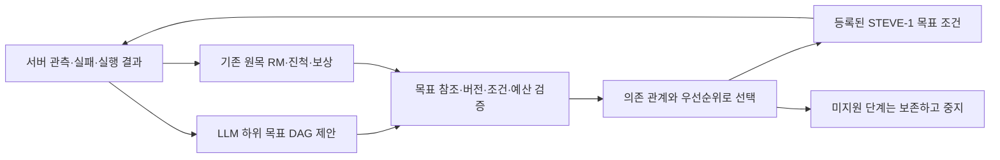

# 상위 계획 → 기존 RM 스케줄 → 신경망 정책 연결

[고정 범위](rm-planner-protocol-2026-10-10.md). 기존 두 선택지 LLM 복구는 전체 상위
플래너가 아니었다. 이번에는 하위 목표의 순서·우선순위·진입/완료 조건을 담는 계획
형식과 실제 정책 조건을 고르는 스케줄러를 연결했다. 연구 명세 원문은 그대로다.

## 연결한 동작

- 원래 RM은 `root`로 보존한다. 임시 목표 동안 실행 우선순위만 바뀌며 보상 객체,
  recurrent state, 인벤토리 완료 조건을 교체하지 않는다. 계획 최대8노드, 요청 최대3회,
  전체 제어180초이며 기존 두 선택지 실험과 별도 opt-in 경로다.
- LLM은 자유로운 목적의 단계를 제안할 수 있다. 지원되지 않는 `find_obstacle_end` 같은
  단계도 계획에 남지만, 실행 가능한 skill로 승격하거나 탐색 embedding으로 몰래 대체하지 않는다.
  현재 실제 실행 바인딩은 `collect_wood`와 한정된 `explore_then_resume`이다.
- 선행 조건을 충족한 노드 중 높은 우선순위를 선택한다. 우선순위는 선행 조건을 생략하거나
  보상/완료를 바꾸지 못한다. 새 나무 발견은 탐색 하위 목표의 완료이고 원목 획득 완료가 아니다.
- 정체와 탐색 시도 종료를 다음 계획에 연결한다. 실패·부분 진전·이전 계획을 전달하고,
  같은 관측/방법은 문구·우선순위·노드 ID를 바꿔도 차단한다. 관측된 자원 변화는 새 검토 근거가 된다.
- 정책 입력에는 선택된 실제 embedding과 기존 단계/RM 특징이 들어간다. 전이와 trajectory에는
  계획 revision·node ID·원래 목표 참조를 함께 기록한다. 동적 계획 궤적은 eval 전용이다.
- 수집 root의 정체는 재계획하지만 root 자체의 시간/틱 예산 만료는 이번 진단을 종료한다.
  모든 장기 과업을 자동 재시작하는 스케줄러는 아니다. 사용자 pause/STOP·취소·오래된 응답은 재개하지 않는다.

## 실제 고정 계획 실행

개발 월드/정책/원본을 유지한 새 실행:
`results/goal-recovery-eval-104761-20261009T162019751448Z/run`.

701정체 → 702중립 → 5.002초 계획 대기 → 703현재 상태 검토 →
704~787탐색84틱 → 새 나무 발견 → 788부터 기존 수집 RM → 1004에서 **원목+1**.
계획1개, 신경망 행동1002개, 중립 전이2개다. 실제 LLM 호출과 optimizer 갱신은0이다.

| 측정 | 값 |
|---|---:|
| 마지막 정책 전송 | 119.552초 |
| 추론 중앙값 / 95백분위 | 43.303 / 52.443ms |
| 전체 제어 주기 중앙값 / 95백분위 | 101.051 / 210.590ms |
| PyTorch peak allocated / reserved | 1915.001 / 2056MiB |
| 전체 GPU 표본 최고 사용량 | 2791MiB |
| 획득 원목 | 1 |

`rm-plan-audit.json`은1004전이의 실제 actor 확률(최대 오차0), 공식 행동 변환,
RM 특징/보상/서버tick, 계획 노드/embedding 연결, 실제 인벤토리, 입력 해제 및 소유 PID를 검증했다.
대기·STOP 후 새 추론/전송0, 해제 후 키0, 잔존 소유 PID0이다. GPU 표본 수1054, 표본 수집 오류없음.
전체 장치 메모리는 다른 프로세스를 포함하고 순간 최고점을 놓칠 수 있다.

직전 원목0 실행과 초기 서버/기억/첫 화면은 같았으나 **5번째 화면과6번째 행동부터 달랐다**.
새 계획 적용 전 차이이므로 이번 획득을 planner 변경의 인과 효과로 주장하지 않는다.
근거: `results/rm-planner-20261010/initial-comparison.json`.

## 검증 범위

첫 중단 시험 `results/goal-recovery-eval-104761-20261009T162733827875Z/run`은
800행동 뒤 중립801에서 계획 대기 중 STOP을 받았다. 입력 해제와 소유 PID 정리는 확인됐지만,
worker -9 종료로 trajectory ZIP의 끝부분과 최종 planner 요약이 저장되지 않았다.
따라서 완전한 중단 검증 표본으로 세지 않는다. 원본과 원인은
`results/rm-planner-20261010/interrupted-stop-forensics.json`에 보존했다.

원인은 취소된 실행에 기존 artifact 저장 유예를 적용하지 않던 감독 경로였다.
`run_episode`가 입력 해제·정책 close를 마친 시점에 제어 종료 marker를 남기도록 연결했다.
그 marker가 확인된 취소 실행만 기존60초 한도 안에서 환경 정리·결과 저장을 마칠 수 있다.
정책 제어는 닫힌 상태다. marker 없는 수동 STOP의 종료 규칙은 유지하며 유예도 무한 연장하지 않는다.
첫 수정 후 시험 `results/rm-planner-stop-fix-20261010/work.json`은 정체가 늦게 발생해
1083전이에서 남은 계획 예산 부족으로 중지했다. 계획 대기와 요청한 STOP 조건은 발생하지 않았으므로
중단 시험의 성공/실패 표본에 넣지 않는다. 완전한 저장물과1083전이 감사는 통과했다.
감사의 선택적 planner-history 파일 해시 처리도 수정했다. 실패한 감사만 재실행했고 게임은 반복하지 않았다.
별도 `rm-planner-cancel-fixed-20261010` 시험은 계획 대기 또는300번째 실제 전이에서 STOP을 보내
정체 발생 시점과 무관하게 취소 후 저장 경로를 검증한다.

그 시험의 실제300전이에서는 두 번째 원인이 드러났다. 화면 저장 직후 STOP이 도착하자
정책의 추론 전 guard는 올바르게 InterruptedError를 냈지만, runtime은 이를 일반 오류로 기록해
종료 marker를 만들지 않았다. 입력 해제/자식 정리는 됐고 저장 파일은 존재하지만 worker -15로 종료돼
완료된 취소 저장 검사로 인정하지 않는다. GPU 표본 조회 timeout도 발생했다.
근거: `results/rm-planner-20261010/cancel-race-forensics.json`.

확인된 STOP/시간 한도로 발생한 InterruptedError만 정상 제어 중단으로 분류하도록 수정했다.
중단 요청 없는 InterruptedError는 여전히 traceback과 오류를 남기고 저장 유예를 열지 않는다.
해제 또는 policy.close 실패 역시 유예를 열지 않는다. 해당 타이밍의 실패 검사와 수정 후29검사
(Windows에서 Linux 전용5개 skip)를 확인했다. 별도 후속 배치는 `rm-planner-cancel-race-fixed-20261010`이다.

추가 검토에서 재정체 이벤트가 중립 후 요청 생성 때 다른 ID로 한 번 더 저장되는 문제와,
같은 request_id를 새 mailbox에 재전송할 수 있는 문제를 재현·수정했다. 실제 실행 소스는
각 배치의 `source-at-game/`에 보존하며 최종 소스와 구분한다.

최종 실제 취소 실행 `results/goal-recovery-eval-104761-20261009T170303334437Z/run`은
300전이에서 같은 추론 전 STOP 예외가 발생했고, 이번에는 `control_interrupted: stop_file`로
정상 취소 처리됐다. worker exit2, cancelled_archive=true, 저장 한도 초과false,
궤적/최종 보고서 완전 저장, 입력 키0·잔존 소유 PID0, STOP 뒤 추론/전송0을 확인했다.
300전이의 actor 확률 오차0·RM/보상/tick/공식 행동 전수 감사도 통과했다.
제어40.378초·정리7.458초, API/optimizer/계획 요청0이며 훈련에 사용하지 않는다.
이 최종 시험은300번째 행동 뒤 취소다. 앞선 계획 대기 중 취소의 불완전 저장 기록과 구분한다.
전체 GPU 표본 peak2905MiB/1392표본이지만 nvidia-smi0.5초 timeout이 있어 완전한 계측으로 주장하지 않는다.

실제 게임은5회다: 고정 계획의 획득1회, 첫 취소 저장 손상1회, STOP 조건 미발생1회,
추론 전 취소 오분류1회, 최종 정상 취소/저장1회. 이를 성공률1/5로 합산하지 않는다.
완전 감사한 전이는1004+1083+300=2387개다. 원본·실패·수정 전후 소스를 모두 보존한다.
계획 근거와 단계/완료 검증은 privileged server 관측을 사용하며 영상 전용 실험이 아니다.

실제 실패 재생의 새 제안 입력은
`results/rm-planner-20261010/api-prepared-v2/manifest.json`에 준비했다. 원래 궤적은
`20261009T150414577383Z/run`이며 수집 실패2건과 탐색 partial 결과1건을 포함한다.
`archived_review`는 신선한 중립 전이를 만들었다고 주장하지 않는다. scheduler 적용과 live mailbox/
broker 진입은 거부하며, 과거 상황에 대한 LLM 대안 생성만 별도 승인 후 확인할 수 있다.
등록 탐색을 또 제안하면 같은 실패 방법으로 차단되지만, 미지원 내비게이션 하위 계획 자체는
보존된다. 이 두 로컬 비교는 모두 새 게임/API0이다.

## 승인된 실제 LLM 제안1회

사용자 `API 1회 검사 승인`을 v2 manifest 해시에 묶어 기록했다. 기존 MyWife의 키/모델 설정을
읽어 해당 Windows 자식 Python 프로세스에서만 사용했다. 키를 출력·파일 저장·전역 설정하지 않았다.
gpt-5.3-codex Responses 요청1회, 재시도0, 출력 상한2048token, timeout20초, 새 게임 행동0이다.
실제 응답9.359초·입력3131/출력584token, API 응답 상태 completed였다. 다음 의존 관계를 제안했다.

| 순서 | LLM이 제안한 목적 | 실행 상태 |
|---|---|---|
| 1 | 목표 접근을 막는 지형 원인 확인 | assess_unreachable_target_barrier: 미지원 |
| 2 | 검증된 통로 또는 장애물 끝으로 이동 | navigate_to_verified_opening: 미지원 |
| 3 | 필요한 장애물 우회 수행 | perform_local_obstacle_bypass: 미지원 |
| 4 | 기존 인벤토리 목표의 원목 수집 재개 | collect_wood: 지원하지만 선행 조건 미충족 |

실패2건/탐색 partial1건을 근거로 기존 탐색을 되풀이하지 않는 대안을 생성했다.
지형 원인은 가설로 구분했으며 실제 통로·장애물 종류를 관측했다고 주장하지 않았다.
다만 3단계의 "필요한 경우"는 설명일 뿐 조건부 실행을 구현한 것은 아니다.
실행기 없는 제안은 계획에 보존하고 멈춘다. 관측·이동·우회 능력 구현은 여전히 필요하다.

첫 검증은 `invalid RM node identity`로 거부됐다. LLM이 내부 노드 이름 `root` 대신
올바른 외부 목표 참조 해시를 넣었기 때문이다. 응답 원본·당시 소스·실패 영수증은 그대로 보존했다.
정확히 검증된 원래 목표 참조를 collect_wood 노드에 쓴 경우에만 `root`로 변환하도록 수정했다.
다른 참조·중복 root·완료 조건 변경은 계속 거부한다. 원본을 바꾸지 않고 기존 응답을 로컬 재검증했고,
변환된 필드는 `steps[3].id` 하나뿐이었다. 계획·우선순위·의존 관계·목표·완료 기준은 바꾸지 않았다.
첫 오류 재현 및 수정 후 단위검사32개가 통과했다. **추가 API 호출은 없었다.**

근거: `api-prepared-v2/paid-probe/response.json`, `receipt.json`, `raw-proposal.json`,
`offline-normalized-proposal.json`, `offline-revalidation.json` (모두 위 results 디렉터리 아래).
아카이브 제안의 live 설치 거부도 확인했다. 이번 결과는 실제 LLM의 대안 생성1건과
저장된 응답의 로컬 식별자 변환 검사이며, LLM 계획을 실제 게임에서 실행한 복구 성공은 아니다.
새 프롬프트로 추가 유료 시험도 하지 않았다. 승인 잔여0회, Colab/기본 정책 승격/최종 평가 시드 사용0이다.

Windows 실행기에는 `scripts/run_recovery_broker.py --rm-plan`을 추가했다.
명시적으로 선택한 경우 RMPlanProvider/2048token 계약을 사용하며 기존 경로는1024token의
두 선택지 제공자를 유지한다. 고정 응답도 같은 전체 계획 형식으로 반환한다.
프로토콜이 다른 입력은 전송 전에 거부하며, 브로커는 해당 request 디렉터리1건만 처리한다.
`--allow-paid`의 별도 승인과 일회 한도는 유지한다. 모의 전송/legacy/중복 호출 검사는 통과했고,
이 새 실행기로 추가 유료 호출이나 LLM 계획의 실제 게임 실행을 하지는 않았다.

대화 TaskState의 복수 사용자 과업 전체, 임의 내비게이션 skill, 장기 RL 개선은 남아 있다.

## 최종 확인

최종 Windows 전체 검사499개 중21개 skip, WSL 전체 검사504개 중9개 skip이며 실패0이다.
실제 게임5회 중 완전 감사3회/2387전이, 아카이브 LLM 제안1회, 원래 명세·월드·가중치 해시,
수정 전후 실행 소스와 승인 소비 기록을 `results/rm-planner-20261010/final-verification.json`에 묶었다.
기존 실패 배치는 실패 상태 그대로 보존했고 재실행하지 않는다. 자동 STOP을 유지한다.
다음 구현 단위는 실제 관측으로 우회 지점을 정하고 그 지점으로 이동하는 하위 skill이다.
등록/완료 판정은 실제 접근 회복과 인벤토리 획득을 검증한 뒤에만 넓힌다.
