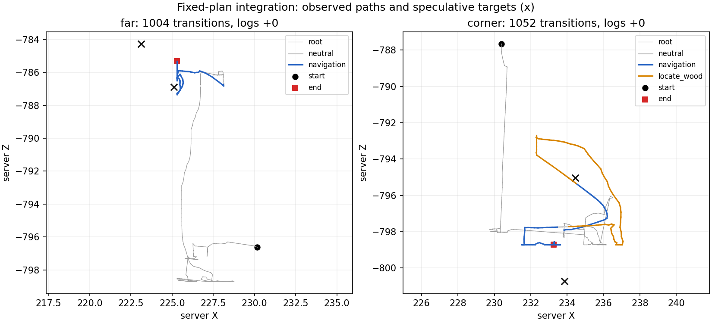

# 보강 이동 정책의 RM 연결 결과

실제 개발 게임 2회를 마쳤다. 개선된 이동 head를 기존 RM 실행기로 연결했고,
corner에서는 경유점 도달 뒤 찾기 단계까지 실행했다. 두 게임 모두 원목 획득은 0이다.
**중지 후 사용자 재개 요청으로 corner 전체 감사까지 완료했다.** 아래 중지 당시 기록과
실패 로그는 보존한다. 후속 탐험/학습은 이 두 게임과 별도 조건으로 취급한다.

## 조건과 구현

[고정 계획](rm-refined-navigation-plan-2026-10-15.md)을 따랐다.
개발 seed104761, sampling14031, blind-recovery far/corner 각1회, 제어 시간 최대180초,
고정 계획 최대2회, 각 이동100tick/20초다. 실제 LLM/API·optimizer 갱신은0이다.
서버 좌표와 과업 관측을 사용한 조건이며 영상 전용 조건이 아니다. 최종5시드는 미사용이다.

기존6차원 이동 모델만 받던 RM 연결을 보강 모델의10차원 입력에도 맞췄다.
상대 목표·직전 committed 전이의 이동/회전·노드별 남은 tick을 실제 정책 입력과 로그에
연결했다. 찾기·접근·원래 과업에는 이동 head를 해제하며 root RM과 recurrent memory를
유지한다. 후보를 명시적으로 지정한 실험이고 기본 정책 승격은 아니다.

## 실제 실행

| 월드 | 기록 전이 | 경유점 도달 | 뒤따른 단계 | 원목 획득 |
|---|---:|---|---|---:|
| far | 1,004 (신경망1,000·중립4) | 0/2, 각100행동 | 찾기·접근·root 재개 미실행 | 0 |
| corner | 1,052 (신경망1,048·중립4) | 1/2, 첫48행동·둘째100행동 | 첫 도달 후 찾기100행동 실패; 접근·root 재개 미실행 | 0 |

두 게임 모두 원래 root800행동 뒤 정체 복구가 호출됐다. 실패 영수증을 다음 계획에
전달하고 다른 목표로 재계획했으나 최종 요청 예산에서 `planning_paused`로 종료했다.
worker 종료 코드2와 `execution_valid=false`는 이 제한된 계획 중지 상태이며,
기술 오류는 `null`이다. 이를 과업 성공이나 일반 정책 실행 성공으로 세지 않는다.
미실행 단계는 성공/실패 표본에서 제외한다.

far 첫 이동은 도착 반경0.35블록에 대해 최소0.3694블록까지 접근한 뒤
0.8439블록으로 재이탈했다. 정밀 도착 문제 가설을 지지하지만 반경은 늘리지 않았다.
둘째 목표 최소 거리는2.4150블록이다. corner 첫 이동은0.3095블록으로 도착했지만,
찾기는100행동 동안 서버의 원목 목표를 확보하지 못했다. 둘째 이동의 최소 거리는
2.0414블록이다. 뒤의 이동 실패는 현재 관측만으로 통행 불가 지형이라고 단정하지 않는다.

이전 독립 이동 과제의10/12와 이번 도달1/4는 시작 상태·목표·과업이 다르다.
직접적인 성능 회귀 대조나 일반화 입증으로 해석하지 않는다. 이동 연결은 확인했지만
정밀 도착과 도달 후 목표 찾기, 접근, 획득은 여전히 분리된 후속 과제다.

## 측정과 검증

| 월드 | 추론 중앙값 / p95 (ms) | 제어 주기 중앙값 / p95 (ms) | PyTorch peak allocated / reserved (MiB) | 기기 표본 peak (MiB) |
|---|---:|---:|---:|---:|
| far | 54.649 / 65.589 | 118.019 / 147.041 | 1,915.001 / 2,126 | 2,821 |
| corner | 56.762 / 67.229 | 120.879 / 150.748 | 1,915.001 / 2,126 | 2,857 |

기기 메모리는 다른 프로세스도 포함하는 표본 측정이다. 두 실행의 표본 오류는 없다.
Windows598검사 중577통과·21제외, WSL 신규4검사 통과, 기존 이동12검사 통과.
far1,004전이의 입력·행동확률·보상·RM·STOP 독립 감사는 통과했고 행동확률 오차는0이다.
corner1,052전이도 재개 후 전체 행동확률 재감사를 통과했으며 오차0이다.
저장된 서버 상태·인벤토리·보상·RM·STOP 이후 활동·입력 해제·PID 정리를 확인했다.

corner의 첫 감사는 중립 입력의 목표 임베딩 가정 때문에 실패했다. 실행기는 찾기 실패 후
중립 release/refresh에서 명시적으로 원래 wood 임베딩으로 복귀하지만, 감사기가 직전
찾기 임베딩의 유지를 기대했다. 실행 코드는 바꾸지 않고 감사의 기대값을 root로 수정했다.
실패 로그와 원래 `workflow.json`은 보존했다. 저장된 궤적만 재감사했으나180초 제한을
넘겼고 출력도 남지 않아 원인은 미확정이다. 해당 재시도는 통과로 세지 않는다.
`audit-corner-recovery.json`에 `completed=false`로 기록했다. 원래 배치나 게임을 다시
실행하지 않았다. 중지 후 사용자 재개 요청으로 저장 궤적만 다시 감사했다.

첫 진단 재실행은 행동확률 계산을 통과한 뒤 진단 wrapper의 `scripts` import 경로 누락으로
실패했다(298.062초). 경로를 복원하고 WSL 격리 Python·CPU thread1·단계 출력·소유 프로세스
시간 제한을 적용한 실행은62.641초에 통과했다. `audit-corner-resume-v2.json`에 보존한다.
기존 timeout의 원인을 CPU thread 하나로 확정하는 대조 실험은 아니다.

관측 결과·측정·확인된 안전 항목과 미완료 검증은
[중지 시점 기록](reports/2026-10-15/rm-refined-navigation-pause.json)에 남긴다.
이 과거 기록의 `verified=false`는 중지 당시 상태다. 재개 후
[최종 검증](reports/2026-10-15/rm-refined-navigation-verification.json)은 `verified=true`이며,
[측정 요약](reports/2026-10-15/rm-refined-navigation-summary.json)과 경로 그림도 생성했다.
원시 결과·프레임·궤적·월드·실행 소스는
`results/rm-refined-navigation-20261015`에 보존한다.
원문 명세, 부모/후보 가중치, 원본 월드의 SHA256을 대조한다.

## 중지 상태와 남은 일

아래는 중지 당시 상태다. 이후 사용자 재개 지시로 [탐험 보강](exploration-coverage-validation-2026-10-15.md)과
[근거리 교정](near-navigation-validation-2026-10-15.md)을 완료했다.

STOP 파일을 유지하며 입력 해제와 소유 게임 PID 종료를 확인했다.
별도 프로세스 확인에서 잔존 게임/학습/감사 프로세스는0이다.
[근거리·역방향 보강 준비안](near-navigation-plan-2026-10-15.md)은 대기 상태다.
부분적으로 준비한 trainer 변경은 검증된 기존 코드로 복구했고, 해당 수집·학습·평가를
실행하지 않았다. 준비 단계 RED 로그는 실제 실험 표본이 아니다.
찾기 단계 개선도 당시 미실행이었다. corner의 저장 감사는 위 재개 기록대로 완료했다.

