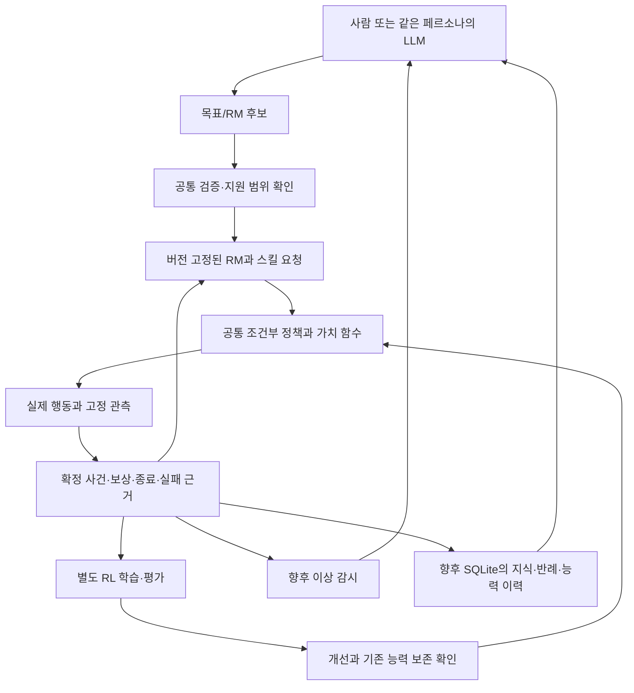

# RM → RL 재진단과 공통 구조 개선 제안

2026-11-03. 사용자 요청에 따른 **진단·설계 제안**이다. 정책 구현 변경, 추가 학습, 게임,
API 호출, 원격 게시를 수행하지 않았다. 기존 네 단계 명세와 OPEN 결정은 유지한다.

## 결론

현재 연결·버전·서버 성공 판정은 작동하지만, RM의 의미를 사용하는 행동 학습과
하위 결과들을 전체 과업으로 연결하는 학습은 충분히 검증되지 않았다.
E1은 원목/흙 수집의 다음 획득을 학습하는 경로다. 모든 RM의 조합을 수행하는 정책을
완성한 것이 아니다. 계약 일반화, 행동 능력 일반화, 새 능력의 추가 학습을 구분해야 한다.

우선순위는 **학습 신호/자료 개선 → 실제 조건 사용과 전환 검증 → 전체 목표와 스킬 가치 정렬**이다.
이후에도 표현 한계가 관측될 때 학습 층을 확장한다. CNN/CLIP 결함이나 특정 실패의 단일 원인을
확정할 근거는 부족하다. 기존 설명인 ‘원목 자료 70% 때문에 원목만 하게 됐다’도 확정할 수 없다.

## 이번에 직접 검사한 범위

- 이전 실제 16회·6,980행동의 궤적을 CPU로 읽고 목표/효과 계약을 재검증했다. 새 실행 표본은 0이다.
- 각 궤적에서 균등 간격 16행과 목표 전환 첫 행을 골라 총 **261개 고정 특징**에서 초기/후보
  행동 분포와 추가 RM 입력 제거 효과를 비교했다. GPU를 사용하지 않았다.
- 실제 train 4회·1,417행동 전체의 보상 전파·정규화 advantage·단계/목표 분포를 재계산했다.
- 원본 16개 궤적과 후보 체크포인트의 전후 SHA256이 같았다. STOP 유지.
- 별도 합성 계약 검사에서 최종 보상과 하위 학습의 분리, 활성 목표 우선순위 변경 거부를 재현했다.
- 근거: `results/rm-rl-diagnosis-20261103/diagnose.py`, `diagnosis.json`,
  `contract_probes.py`, `contract-probes.json`. 주 실행 흐름의 순차 진단이며 독립 리뷰는 아니다.

고정 특징에는 이미 공식 모델의 영상/목표/순환 기억 처리가 들어 있다. 이번 검사는 **추가 RM
숫자 입력**의 직접 효과를 조사한 것이다. MineCLIP 목표를 바꾸고 영상을 다시 처리한 검사가 아니다.
입력을 0으로 만드는 개입은 분포 밖일 수 있다. 행동 분포의 숫자 변화가 지시 수행 능력을 증명하지 않는다.

## 병목과 증거 수준

| 우선순위 | 확인된 사실 | 의미와 아직 확인하지 못한 인과 |
|---|---|---|
| P0 학습 신호 | 초기 critic 값이 1,417행 모두 0. 전체 배치 정규화 후 자연 원목 탐색/접근의 평균 advantage가 음수 | 성공까지 오래 걸리는 과정이 억제 신호를 받는 구간이 있다. 이 계산은 PPO 오류가 아니며, 제한된 자료/미학습 baseline의 영향과 실제 퇴행의 인과는 대조 필요 |
| P0 조건 활용 | 고정 특징에서 후보의 추가 RM 입력 제거 효과가 정책 업데이트 전체 효과보다 훨씬 작음 | 구조화 조건의 직접 영향이 작다. 목표 임베딩 전체 무시나 숫자 효과가 작을수록 나쁜 정책이라는 주장은 아님 |
| P0 자료/보존 | train 4회, 획득 성공 8회, 자연 시작 1개 시드, 목표 전환 0회. KL 보존은 이 train 특징에서만 계산 | 접근·회수·목표 전환·실패 복구·기존 능력을 뒷받침할 경험 범위가 좁음 |
| P1 학습 목적 | E1은 skill_reward만 사용하고 매 획득에서 return을 끊음. root reward는 별도 기록 | 다음 획득을 개선해도 후속 목표에 유리한 종료 상태나 전체 RM 성공이 개선된다는 보장 없음 |
| P1 관측/대상 | 원목의 단계/기억 관측은 있고 자연 흙에는 세부 단계가 없어 unknown. 회수할 item의 위치도 정책 구조화 입력에는 없음 | 같은 형식이 같은 관측 능력을 뜻하지 않음. 정체가 인지·접근·회수 중 무엇인지 일반적으로 판별하는 데 제한 |
| P1 학습 범위 | 공식 영상/목표/순환 표현과 motor는 고정. 작은 residual actor와 critic만 학습 | 기존 표현으로 행동을 조정할 수 있지만 새 시각 특징/새 순환 기억은 이 학습으로 직접 바뀌지 않음. 표현이 부족하다는 증거는 아직 없음 |
| P1 후속 통합 | 활성 목표 reprioritize 후 live effect는 revision 불일치로 거부. 실제 실행 vocabulary는 wood/dirt의 획득 | LLM의 동시 수정과 미지원 학습 요청을 처리할 명시적인 경계가 필요. 현재 거부는 오염을 막는 보호 동작 |

### 1. 보상 전달 속도만의 문제가 아니다

현 E1은 gamma=0.999, lambda=1이며 다음 획득 이전까지 return을 전파한다.
자연 원목 첫 획득까지 479행동이 걸린 구간의 첫 return도 **0.6199**였다. 신호가 수치적으로
사라진 것이 아니다. 초기 value가 모두 0인 상태에서 배치 평균 **0.8521**, 표준편차 **0.1050**으로
advantage를 정규화하면서 아래 분포가 생겼다.

| train 구간 | 행동 수 | 정규화 advantage 평균 | 양수인 행동 수 |
|---|---:|---:|---:|
| 원목 pickup | 37 | +1.239 | 37 |
| 흙 pickup | 276 | +0.211 | 160 |
| 자연 원목 전체 | 996 | -0.231 | 454 |
| 자연 원목 중 탐색 | 137 | -0.844 | 57 |
| 자연 원목 중 접근 | 212 | -0.565 | 60 |
| 자연 원목 중 회수 | 341 | +0.260 | 203 |
| 자연 흙 전체 | 108 | +1.169 | 108 |

이것은 성공한 궤적의 모든 행동이 좋은 행동이라는 뜻도, 음수 advantage가 항상 오류라는 뜻도 아니다.
정상적인 접근과 방황을 구별할 대조 경험·상태별 baseline이 부족한 첫 업데이트라는 점이 핵심이다.
‘원목 자료가 많으므로 원목 행동만 양수로 강화됐다’는 단순 설명은 이 결과와 맞지 않는다.
단계별 부호를 강제로 양수로 바꾸거나 정규화를 제거하는 수정은 권하지 않는다.

다음 대조에서는 actor를 바꾸지 않는 critic 보정과 신선한 수집→업데이트 주기를 검증한다.
보정 value는 원래 rollout value와 별도 기록하고 behavior logp/부모 정체성을 유지한다.
train 내부의 별도 검증으로 value 오차/설명력을 보고, 난도·목표별 학습 비중을 명시한다.
가치 보정만으로 실제 접근 퇴행이 줄어드는지는 독립 대조해야 한다.

근거: `scripts/train_recovery_adapter.py:121`~ advantage 계산,
`src/minecraftrl/effect_skill.py:76`~ 획득별 GAE.

### 2. RM을 넣었다는 것과 RM을 활용한다는 것은 다르다

261개 특징 표본에서 초기→후보의 최대 행동 인자 TV는 **0.05775**,
후보의 추가 RM 입력 전체 제거 효과는 최대 **0.002185**,
단계 one-hot만 제거한 효과는 최대 **0.0004414**였다.
보충 흙 실패 궤적의 중앙값은 각각 **0.01111**과 **0.0001374**였다.
TV는 카메라/버튼 중 큰 인자의 분포 거리이며 전체 결합 행동의 TV나 성공률이 아니다.
CPU 행동 logp 재현 최대 절대 오차는 **0.00005532**로 원래 CUDA 계산과 소폭 차이가 있었다.

원목 collection에서 search는 seek 임베딩, approach/mine/collect는 같은 root 임베딩이다.
흙 collection은 모든 단계에서 같은 공식 dirt 임베딩이며 세부 단계는 unknown이다.
pickup 전용 train은 별도 pickup 임베딩이므로, 자연 수집의 회수 시점과 조건/장면 분포가 다르다.
이 차이는 전달 버그가 아니라 현재의 명시적 바인딩이다. 회수 학습의 전이를 저해할 가능성이 있다.

현재 숫자 context에는 대상 이름/의미 벡터 자체가 없고, 대상 의미는 공식 모델의 목표 조건화 특징에
의존한다. **같은 GoalContract에서 나온 목표 벡터·기대 효과·유지 조건을 actor와 critic에 명시적으로
연결**하는 대조를 권한다. 새 LLM이나 별도 의미 예측기는 필요 없다. 기존 임베딩을 재사용하고
공통 변환 모듈 하나로 처리한다. 단계마다 무조건 임베딩을 바꾸지는 않는다.

먼저 같은 시작/관측 이력에서 의미가 다른 목표를 바꿔 전체 모델을 다시 처리하는 검사를 해야 한다.
원목/흙의 조건부 행동과 실제 수집, collect 전환 후 추가 채굴을 분리한다. 수량만 바뀐 경우
첫 행동이 같은 것은 정상일 수 있으므로, 인위적인 분포 차이를 성공 기준으로 삼지 않는다.
입력 강화로 해결되지 않을 때만 작은 시간 처리 adapter 등 표현 학습을 별도 대조한다.

근거: `src/minecraftrl/goal_spec.py:101`, `semantic_goal.py`의 CONTEXT_FIELDS,
`s2_learning.py:106`, `conditioned_head.py`, `recovery_learning.py:47`.

### 3. 하위 성공과 전체 과업 목적을 함께 보존해야 한다

합성 검사에서 첫 획득 후 다음 과업이 성공하든 실패하든 첫 스킬 return은 1이었다.
root reward만 바꾸어도 E1 학습 return은 변하지 않았다. E1의 ‘다음 획득’ 목적에는 맞지만,
후속 제작 재료 보존이나 다음 목표로 접근하기 좋은 종료 상태를 학습할 목적은 빠져 있다.
한 행동으로 여러 개 획득해도 skill 보상은 1회라는 사실도 전체 획득량 목적과 구별해야 한다.

후속 계약은 `신규 획득(acquire)`과 `현재 보유(possess)`를 구분하고 유지해야 할 재료/조건,
허용 부작용, 시작 조건과 종료 효과를 명시한다. 기존 E1 의미는 소급 변경하지 않는다.
공통 스킬은 계약상 허용된 종료 상태를 만들어야 하고, 상위 RM은 이후 과업의 성공/비용을 평가한다.

첫 대조는 **상위 목표 return을 유지하는 조건부 PPO**와 현재 획득 전용 목적을 비교하는 것이 단순하다.
중간 진행 보상이 필요하면 전체 목표와의 관계를 정의하고, 잠재함수 기반 shaping을 후보로 둔다.
이 경우 확장 상태에 RM/진전 정보를 포함하고 할인율·진짜 종료·시간 제한 bootstrap을 일치시켜야 한다.
이론적 정책 불변성은 해당 가정 아래의 성질이며 유한 자료/PPO/부분 관측에서 개선을 보장하지 않는다.
[Ng et al., 1999](https://ai.stanford.edu/~ang/papers/shaping-icml99.pdf).

명시적 스킬 계층으로 확장할 때에는 스킬 단위 local 가치와 상위 과업 가치를 구분하고,
스킬 지속 시간에 맞는 할인 및 종료 상태를 상위에 전달한다. 이는 options/HRM 계열의 설계 근거이며
현재 코드에 상위 가치 학습이 구현됐다는 뜻은 아니다.
[Options](https://people.eecs.berkeley.edu/~russell/classes/cs294/f05/papers/sutton%2Bal-1999.pdf),
[Hierarchies of Reward Machines](https://arxiv.org/abs/2205.15752).

### 4. 관측 가능한 것만 공통 스킬로 묶는다

원목의 target_known은 ‘서버가 기억하는 나무’이며 현재 화면에서 보인다는 뜻이 아니다.
이 의미는 현재 validator에도 명시되어 있다. 원목과 달리 흙은 phase_valid=0으로 전달한다.
회수 구간은 블록 known/reachable를 item 위치로 재사용하지 않고 unknown으로 지운다.
이는 올바른 제한 처리다. 그런데 이후 정책이 회수할 item의 위치를 알게 됐다는 보장은 없다.

공통 실행기는 `탐색/접근/상호작용/회수`라는 문자열이 아니라 **판정 가능한 시작·종료 사건**을
등록한다. 값·unknown·관측 시점·출처·대상 참조를 함께 관리하고, 오래된 기억과 현재 관측을 구분한다.
현재 고정 관측으로 판정 불가능한 사건은 미지원으로 남긴다. 센서의 신규 버전이 필요하다면 별도
연구 조건으로 먼저 검증하며 운영 중 실패마다 관측기를 바꾸지 않는다. privileged 정보도 계속 표시한다.

‘관측 불충분/목표 조건 불일치/행동 능력 부족/실행 자원 문제/명세 불일치’를 구분해서 모니터에
넘겨야 한다. 단순 timeout은 학습 필요성을 확정하는 증거가 아니다. RM의 사건 해석을 잘못하면
완벽한 RM 실행기에도 문제가 생긴다는 연구와도 일치한다.
[Reward Machines under noisy interpretations](https://arxiv.org/abs/2406.00120).

## 후속 파이프라인에 유지할 경계

| 경계 | 공통으로 고정할 의미 |
|---|---|
| GoalContract | 대상/기대 상태 변화/수량/선행 조건/보존 조건. 해시는 감사용이며 과업 의미 입력의 대체가 아님 |
| SkillRequest | 현재 달성할 효과, 실제 이용 가능한 관측, 시작 조건, 성공/실패/timeout, 예산 |
| PolicyContext | 현재 관측·필요한 기억 + 같은 계약의 목표 표현. actor와 critic 모두 사용 |
| Event/Outcome | 실제 행동 전후의 확정 근거, unknown/성공/실패/중단/미실행 구분 |
| TrainingJob | RM·보상·관측·부모 정책 버전, split, 경험/계산 예산, 보존 대상, 채택 기준 |
| ModelArtifact | 지원 효과와 검증한 환경 범위, 결과/비용/퇴행, 부모/자료 해시, 후보/채택 상태 |

LLM은 이 계약을 작성하고 학습 필요성을 제안한다. SQLite 정보는 지식/가설/반례로 사용하며,
검색 사실을 현재 관측으로 취급하거나 곧바로 보상 true로 만들지 않는다. 수정·철회 이력은 보존한다.
LLM/KB 수정은 다음 선언된 실행/학습 경계에 적용하고, 진행 중인 자료의 보상 의미를 바꾸지 않는다.
우선순위만 바꾸는 scheduling revision과 과업 의미를 바꾸는 semantic revision의 구분도 검토한다.
현재 active revision guard를 없애는 것만으로 비동기 수정 기능을 구현해서는 안 된다.

새 RM 일반화는 (a) 학습한 효과들의 새 순서/수량/시작 상태와 (b) 미학습 효과 자체를 나눠 평가한다.
(a)도 합성 과업과 종료 상태 호환 검사가 필요하며, (b)는 기존 가중치의 즉시 수행을 전제하지 않고
미지원 또는 추가 학습 요청으로 처리한다. 사람이 작성한 RM과 LLM RM은 같은 경로를 사용한다.
QRM의 표 형태 수렴 성질을 현재의 frozen-feature PPO나 임의 LLM RM 성공 보장으로 옮길 수 없다.
[QRM 원논문](https://proceedings.mlr.press/v80/icarte18a/icarte18a.pdf).

## 권장 검증 순서와 중단 기준

| 순서 | 비교/구현 | 통과 근거 또는 다음 분기 |
|---|---|---|
| D0 완료 | 원본 보존·입력/return/계약 CPU 진단 | 이번 기록. 실제 능력 개선 주장은 하지 않음 |
| D1 조건/관측 분리 | 동일 시작에서 원목/흙, 상호작용/회수 조건을 초기/후보에 교차 적용. full backbone 및 기억 경계 처리 | 분포 변화와 실제 목표 수행을 함께 기록. 초기부터 안 되면 목표/관측/기본 능력, 후보만 악화면 학습 퇴행을 우선 조사 |
| D2 학습 신호 | 같은 새 train 자료/공식 초기값에서 기존 E1과 critic 보정 대조. 별도로 목표/난도 균형 수집 효과 대조 | 접근/회수 행동 및 value 오차 개선 여부. 둘을 동시에 바꿔 원인을 합치지 않음 |
| D3 보존/전환 | train 전용 보존 관측·목표를 추가한 KL 대조, 새 rollout으로 양방향 목표 전환 학습 | 목표별 성공/전환 지연/불필요한 채굴/보존 과업 퇴행. 과거 자료를 새 on-policy PPO 자료처럼 재사용하지 않음 |
| D4 목적/조건 표현 | 상위 return 보존 대 획득 전용 목적; 별도로 명시적 목표/효과 입력 대 현재 입력 | 전체 RM 완료와 비용, 하위 성공 후 후속 수행. 의미 전달/능력/정책 유지의 어느 항목이 개선됐는지 분리 |
| D5 표현/일반화 | 이전 조건으로도 정체되면 작은 시간 처리 adapter 등 학습 범위 대조. 미사용 월드·조합·수량 평가 | 같은 경험/정보 권한/예산에서 개선과 보존. 새 primitive를 익힌 경우와 기존 primitive 조합을 구분 |

전체 조합을 한 번에 실행하지 않는다. 각 가설의 효과가 없으면 원본을 보존하고 그 가설을 약화시킨다.
임의 재시도로 성공률을 맞추거나 최근 개발 실패 월드를 학습에 섞지 않는다.
학습 job 실행법과 실제 실행은 독립 모듈로 유지한다. 원래 완료 배치는 재실행하지 않는다.
첫 실험 전에 표본/예산/조건별 허용 퇴행과 종료 기준을 잠근다. 숫자 임계값은 아직 OPEN이다.

## 지금 확정하지 않은 것

- CNN/CLIP에 결함이 있다는 주장, 작은 head가 반드시 부족하다는 주장.
- 입력 조건을 강화하거나 critic을 보정하면 목표 준수가 개선된다는 인과.
- 모델 기반 planner, 새로운 competence 예측기, 추가 LLM을 도입해야 한다는 결론.
- 임의 RM zero-shot 수행, 영상 전용 조건의 성공, 자동 지속 학습/SQL 통합 완료.
- 이번 261개 수치 진단을 독립 환경 평가 표본으로 계산하는 해석.

기존 [E1 실제 결과](effect-skill-e1-results-2026-11-03.md),
[네 단계 명세](specs/2026-10-31-four-stage-research-spec.md)와 함께 읽는다.
