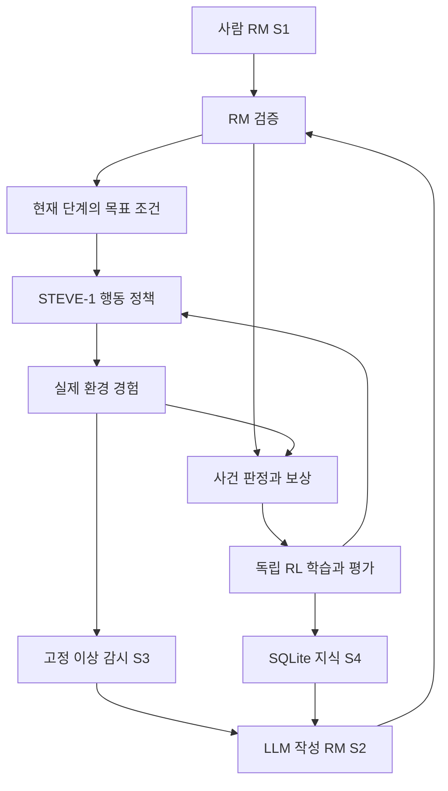

# MinecraftRL Four-Stage Research Specification

2026-10-31. 사용자 합의에 따른 전체 구현 명세. 단계별 성능은 검증 대상이며 구현 완료를 뜻하지 않는다.
[1단계 상세 명세와 첫 실험](2026-10-31-stage1-rm-conditioned-rl-spec.md), [원문 연구 명세](../research-spec.md).

## Objective

공식 STEVE-1을 출발점으로, 사용자의 자연어 목표와 새 지식이 RM을 통해 실제 RL 가중치 학습에
관여하는 Minecraft 에이전트를 만든다. 플레이와 병행하는 고정 관측/이상 감시가 문제의 근거를
제공하고, 같은 페르소나의 LLM이 대화와 개선 판단을 함께 생성한다. 검증된 학습 결과를 정책에
반영하고 SQLite에 지식과 적용 범위·반례를 축적한다. 기존 지식은 수정·철회 가능해야 한다.

명령 변경, 지식 저장, RM 생성, 가중치 업데이트, 실제 수행 개선을 각각 다른 결과로 측정한다.
기존 추가 학습 후보는 사용자 요청으로 정리되었으며, 새 실험은 공식 가중치에서 시작한다.
Minecraft 1.16.5/MineRL 계열 환경을 사용한다. 최신 서버 호환성이나 인간다움의 입증을 주장하지 않는다.

## Four Stages

| 단계 | 구현 | 단계 종료 시 필요한 근거 |
|---|---|---|
| S1 사람 RM + RL | 사람이 작성한 RM의 현재 하위 목표를 정책 조건에 연결하고, 사건/보상/독립 RL 학습/평가를 구현 | 연결 정확성, 실제 학습 여부, 미학습 초기 조건에서의 개선·퇴행·한계 |
| S2 LLM RM + 같은 RL | 같은 LLM 응답에 사용자 답변과 구조화된 RM 후보를 생성. 공통 검증기와 S1 학습기로 전달 | 목표 의미 보존·미지원 거부·실제 학습, 사람 RM과 공정한 비교 |
| S3 이상 감시 + LLM 피드백 | 별도 감시 흐름이 이상 근거를 만들고 LLM이 관측 확인/재계획/추가 학습/보류를 선택 | 오탐·미탐·지연, 불필요한 학습, 실제 추가 학습의 개선과 기존 능력 유지 |
| S4 SQLite 지식 확장 | 빈 사실/경험 테이블에서 후보 지식·출처·검증·충돌·철회·능력 이력을 저장/검색 | 지식 재사용의 효과, 잘못된 지식의 수정, 정책 가중치 효과와 구분 |

S2부터 LLM이 만든 RM으로 RL을 학습한다. S3은 실행 결과가 다시 학습 요청으로 돌아오는 경로를
추가하며, S4는 지속적 지식 재사용을 추가한다. S1~S3의 실행 파일·체크포인트는 재현/재개용이다.
별도 run의 지식을 JSON으로 검색하는 장기 KB를 S3에 숨기지 않는다. 기술적 resume과 현재 run의
제한된 시도 이력은 허용한다. 증류의 교사/학생·시점·자료는 미결정이며 RL 갱신과 동의어가 아니다.

## Shared Contract

- RM 작성자가 사람인지 LLM인지에 따라 숨은 보상이나 별도 행동 구현을 두지 않는다.
- RM에는 루트 목표, 현재 단계의 수행 목표, 허용 관측으로 판정 가능한 전이, 종료, 보상, 버전을 둔다.
- RM 상태 ID는 과업 의미가 아니다. 현재 목표/제약을 policy와 value가 실제 사용할 수 있게 표현한다.
- 배치의 목표 조건·보상·정책 버전을 고정한다. 변경된 RM은 다음 선언된 경계에서 적용한다.
- 화면 정책, 외부 감시, 성공 평가의 정보 권한을 구분한다. 서버 정보가 RM을 거쳐 정책으로 들어가면
  privileged 조건이다. 빈 SQLite도 사전학습 모델·지원 사건 registry가 없는 상태를 뜻하지 않는다.
- 실사용 관측기를 새 실패마다 수정하지 않는다. 관측 불가능한 조건은 unknown/미지원으로 처리한다.
- 본 게임은 검증된 정책으로 계속 플레이하고 학습 후보는 별도 작업에서 갱신·평가한다. 이 병행 운영은
  S3에서 자원/순환 상태/정책 전환을 검증하며, S1의 순차 파일럿을 병행 운영 완료로 해석하지 않는다.

## Evidence and Release Gates

G1은 관측→RM→조건→행동→보상→학습→저장/재개 연결과 STOP 계약을 검사한다.
G2는 사전 고정한 개발 조건/표본/예산에서 실제 인벤토리 또는 저장 NBT로 학습 효과와 퇴행을 평가한다.
G1 뒤 S2 생성기 개발은 가능하지만 G2가 미통과면 학습 병목 해결을 선언하지 않는다.
모든 미지 RM의 zero-shot 성공을 S1 종료 조건으로 요구하지 않고 지원 범위와 실패를 명시한다.

개발 중 체크포인트를 이어 쓸 수 있으나, 연구 비교는 같은 출발점·정보 권한·경험 예산에서 수행한다.
공식 동결 정책 대비 향상만으로 RM이나 LLM의 독립 기여를 주장하지 않는다. 추가 학습 전의 일반화와
정해진 경험량 학습 후의 적응을 나눠 측정한다. 최종 평가의 결과를 학습/LLM/KB에 다시 넣지 않는다.

## Open Decisions

이 목록은 최종 연구 설계의 OPEN 항목이다. 첫 파일럿에 고정한 값은 상세 명세의 범위 안에서만 적용한다.

| ID | 상태 | 남은 결정 |
|---|---|---|
| D01 | OPEN | 연구 가설, 과업 범위, RM 조합, 성능 기준 |
| D02 | OPEN | 최종 관측 권한과 사건 판정, unknown 처리, 정보 유입 경계 |
| D03 | OPEN | 고정 이상 감지 모델·보정·VLM 영상 길이/호출 방식 |
| D04 | OPEN | 외부 검색 시점/출처, KB 검증·충돌·철회 정책 |
| D05 | OPEN | 단일 페르소나 응답/API 계약, 개입 권한·비용·재시도 |
| D06 | OPEN | 범용 RM 문법, 자원 소모/수량/반복/수정 의미 |
| D07 | OPEN | 최종 정책/value 조건 표현, adapter, 기억 전환 |
| D08 | OPEN | RL 보상·시간·discount/GAE·종료/독립 평가 |
| D09 | OPEN | 학습 층·경험 분포·optimizer·예산·무신호 대응 |
| D10 | OPEN | 증류의 교사/학생·자료·시점·능력 보존 |
| D11 | OPEN | 학습 job·병행 운영·정책 전환·DB 수명주기 |
| D12 | OPEN | 본 실험 비교군·통계·표본·최종 평가 봉인 |
| D13 | OPEN | 실제 자원·지연·API 예산·운영 담당·재현 |

## Sources

- [ARM-FM](https://proceedings.iclr.cc/paper_files/paper/2026/file/68f24fad8f460d4b7bbac402c252ebbb-Paper-Conference.pdf): RM 단계의 언어 조건과 보상을 함께 사용하는 연구 근거. STEVE-1에서의 성공 보장은 아니다.
- [STEVE-1](https://arxiv.org/abs/2306.00937): 목표 조건을 사용하는 행동 정책과 제한된 prompt chaining 실험.
- [PPO](https://arxiv.org/abs/1707.06347): 실제 경험으로 정책을 갱신하는 알고리즘 후보.
