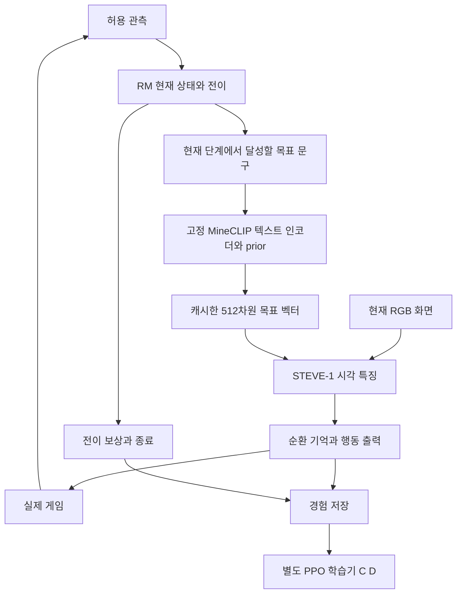

# Stage 1 RM-Conditioned RL Specification

2026-10-31. [전체 네 단계](2026-10-31-four-stage-research-spec.md)의 S1 상세 명세.
현재 사용자의 요청은 명세 공개 후 로컬 실험 개시다. 아래 첫 파일럿을 먼저 실행하며 결과는 별도 보고서에 남긴다.
문서 자체는 실행 성공이나 학습 완료의 근거가 아니다.

## Research Question

사람이 작성한 RM의 현재 하위 목표에 맞게 STEVE-1의 목표 임베딩을 바꾸면, 같은 수집 목표를 계속
유지하는 경우보다 실제 수행이 개선되는가? 이후 그 조건을 사용한 RL이 부족한 능력을 추가로 학습하는가?

| 조건 | 가중치 | 목표 조건 |
|---|---|---|
| A | 공식 STEVE-1 동결 | 고정 루트 목표 |
| B | A와 같은 공식 가중치 동결 | RM의 현재 단계에 따른 목표 |
| C | A와 같은 초기값에서 추가 RL | 고정 목표 |
| D | C와 같은 초기값/학습 예산에서 추가 RL | RM 단계별 목표 |

B-A는 조건 전환의 효과, D-C는 같은 학습 예산에서 단계별 조건 사용의 효과를 평가한다. 첫 파일럿은 A/B만 실행한다.
C/D는 유효한 rollout/학습기/수집 확률/종료 처리의 검증 뒤 별도 프로토콜을 잠그고 수행한다. A/B 개선을 RL 학습이나
RM의 모든 구성 요소에 대한 인과 효과로 보고하지 않는다. 전이·보상·관측·guidance는 비교군 사이에서 맞춘다.

## Architecture

현재 STEVE-1은 목표 벡터를 학습된 선형층으로 변환하여 화면 특징에 더한 뒤 순환부와 행동 출력부로 전달한다.
문구가 바뀔 때 MineCLIP/prior로 생성한 벡터를 선택하고 매 tick 재인코딩하지 않는다. 목표 변경과 episode reset을
분리한다. 기본 파일럿은 목표 교체 때 기억을 유지하며, 현재 단계와 사용한 벡터 hash를 실제 전달 행동에 연결한다.
행동을 전달하기 전에 STOP/시간 초과가 발생하면 추론 결과를 버리고 새 정책 행동을 전송하지 않는다.

루트 목표는 유지한다. 상태 이름(예: 접근 완료) 대신 그 상태에서 앞으로 달성할 목표를 조건으로 쓴다.
모든 상태를 다른 문구로 나눌 필요는 없으며 지원하지 않는 문구/행동을 검증된 스킬로 등록하지 않는다.
RM 전이·조건·보상이 같은 revision을 사용해야 한다. 임의 LLM 임베딩을 기존 512차원 입력으로 대체하지 않는다.

## Implementation Packages

| 작업 | 구현과 검증 |
|---|---|
| A 계약 | 목표·전이·관측 권한·버전·예산·split·종료를 명시한 불변 실행 설정 |
| B 진단 | 공식 동결 정책에서 목표 변경의 행동 확률 영향과 실제 획득을 별도로 기록 |
| C RM 실행 | 이미 충족한 단계, 동시 사건, 재탐색, unknown, 중복 보상, 복구 복귀 검사 |
| D 조건 연결 | 현재 단계의 목표를 실제 정책에 전달. 추후 추가 정보/adapter는 policy와 value에 같은 의미로 연결 |
| E 독립 학습 | 수집→PPO→checkpoint→평가와 상태·중단·재개. 실제 gradient/가중치 갱신·확률 재현 검사 |
| F 평가 | 동결/학습, 고정/단계 조건, 학습 전 일반화/학습 후 적응, 기존 능력 퇴행을 분리 |

신규 실험은 삭제된 전용 체크포인트나 retired RL 명령을 복원해 실행하지 않는다. 공용 화면 정책·관측·중단·자식
프로세스 소유권 코드를 재사용한다. 새 조건의 테스트와 실제 실행 기록을 만든다. 학습기는 별도 모듈/명령으로 관리한다.

## Pilot P1 Locked Before Gameplay

아래는 최종 연구 결정을 닫는 값이 아니라 **첫 개발 파일럿 P1에 한정한 고정 조건**이다.

| 항목 | P1 조건 |
|---|---|
| 모델 | 공식 `steve1.weights`, `2x.model`, MineCLIP `attn.pth`, 공식 prior. 파일 hash 기록, optimizer 갱신 0 |
| 환경 | 프로젝트 격리 WSL Ubuntu-24.04/STEVE-1/MineRL Minecraft 1.16.5. 현재 버전·CUDA·렌더링 실측 |
| 루트 목표 | 원목이 없는 상태에서 첫 원목 1개 획득, 실제 서버 인벤토리의 6종 log 합으로 판정 |
| 개발 seed | 81031001, 81031003, 81031007, 81031009, 81031013. 각 seed에서 A/B 각 1회 |
| 순서 | seed 순서 유지. 홀수 번째 seed A→B, 짝수 번째 seed B→A |
| 예산 | 실행당 실제 제어 최대 180초, 각 시작은 기존 supervisor의 600초 상한. 실험 10회, 성능 실패의 임의 재시도 없음 |
| 초기 조건 | 같은 seed에서 새 월드 생성, 고정 플레이어 identity와 동일 중립 준비 60 tick. 원본 초기 화면/상태 보존. 완전 동일 상태/렌더링이라고 가정하지 않음 |
| 정책 난수 | world seed와 같은 episode sampling seed. 임베딩 생성 seed는 31031로 별도 고정, 결과 벡터를 캐시 |
| guidance | A/B 동일 6. 목표 전환 시 기억 유지, 별도 초기화 없음 |
| RM 센서 | 기존 서버 wood_v3 종류/거리/접근 가능·server inventory. 새 센서 학습 없음 |
| 단계 | search / approach / mine / collect / complete. ShapedWoodRewardV3 상태 의미를 참고하되 실제 목표 획득은 서버 inventory로 독립 확인 |
| 단계 안정화 | 종료는 즉시 처리. 비종료 단계는 같은 후보가 3회 연속 관측될 때 조건을 교체. A에서도 같은 RM 상태를 기록 |
| 보상 | 첫 원목 +1, 나머지 0. P1은 학습하지 않으며 성능 판정에 shaping 점수를 사용하지 않음 |
| 학습·API | 가중치 갱신 0, 외부 LLM/API 0, Colab 연결 0 |

P1의 RM은 서버 정보를 사용한다. B는 그 정보가 조건 선택을 통해 정책에 들어가는 **privileged RM 조건**이다.
A/B는 같은 관측 수집 장치를 쓰지만 B의 단계 정보 활용까지 포함한 개입이다. 영상 전용 일반화나 임베딩
인코더 하나만의 효과로 해석하지 않는다. 최종 고정 관측 모델의 지원 여부/사건 계약은 별도 D02 결정이다.
collect 센서는 실제 아이템 entity가 아니라 이전 파괴 위치를 사용하므로 실제 획득 전까지는 완료가 아니다.
대상 없음과 미관측을 일반적인 세계 사실로 혼동하지 않는다. 필수 관측 누락은 기술 오류이며 성공/정책 실패 표본에 넣지 않는다.

## P1 Goal Conditions

| key | 텍스트 | 적용 |
|---|---|---|
| root | collect wood | A의 모든 비종료 단계 |
| search | go explore | B search. 공식 예제의 문구지만 이 조건의 나무 탐색 성공은 미검증 |
| approach | approach a tree | B approach. 새 문구 후보, 검증된 스킬이 아님 |
| mine | chop down the tree | B mine. 짧은 후보 문구 |
| collect | pick up wood | B collect. 짧은 후보 문구 |

실제 사용한 임베딩 파일·문구·생성 난수·모델 hash를 저장하고 실패를 본 뒤 같은 P1 안에서 바꾸지 않는다.
서로 다른 문구가 실제 행동을 구별하지 못하거나 원래 목표를 방해할 수 있다. 이 경우 결과를 보존한 후 P2를 별도로 설계한다.
RM 입력을 바꿨다고 도달/채굴 능력이 새로 생겼다고 보지 않는다. 문구 효과와 원래 모델 능력을 구분한다.

## Measurements and Stop

- 실제 원목 획득 여부/수량, 획득까지 서버 tick과 제어 시간. 미획득 시간 초과는 정책 실패, 미실행/기술 오류는 별도.
- 단계 체류·전환, 목표 벡터 hash, 실제 전달 버튼/카메라, 관측·행동 시각, PNG, 이벤트, 초기 상태, 원본 소스 snapshot.
- GPU 메모리, 추론 중앙값/p95, 전체 제어 주기 중앙값/p95. 시작/임베딩 준비 시간은 제어 시간과 분리.
- STOP 뒤 새 정책 dispatch 0, 중립 입력 이후 held key 0, 종료 후 소유 자식 PID 0을 로그로 확인.
- 별도 STOP 진단은 성능 10회에 포함하지 않는다. 종료 시점에 진행 중인 step과 새 dispatch를 구분한다.
- 기술 오류는 원인/로그를 남기고 수정 버전으로 별도 실행한다. 성능 실패를 지우거나 누락하지 않는다.

첫 P1은 소규모 개발 진단이다. 모든 실행과 정보/초기 상태 차이를 보고하며 통계적 일반화 성공이나 RL 개선을
선언하지 않는다. 단계 전환이 실제로 발생하지 않은 실행은 전환 효과의 증거가 아니다. 메모리 부족이 관측되면
원본 로그를 보존하고 동일 조건의 Colab 준비를 진행하되 실제 연결은 별도 승인으로 남긴다.

## Subsequent Learning C D

P1이 기술적으로 유효하면 단계별 실패와 목표 조건의 효과를 분석한다. 미학습 여러 배치/목표에서 추가 경험을
수집하는 공통 학습 과제로 연결하고, frozen 특징의 head PPO부터 점검하되 학습 범위를 영구 고정하지 않는다.
보상/experience/gradient가 유효한데도 개선되지 않으면 목표 표현·시각/기억·학습 범위를 구분해 후보를 비교한다.
순환부를 학습할 때는 순차 원본 관측·episode 경계·burn-in을 처리한다. 오래된 특징 캐시로 새 순환부를 학습하지 않는다.
PPO의 확률/advantage/value 타깃, 종료/시간 초과 bootstrap, 단계 전환 전후의 목표 벡터를 실제 수집 조건과 일치시킨다.
수집 정책과 다른 오래된 rollout을 일반 PPO 입력으로 무조건 재사용하지 않는다.

G1 연결 통과와 G2 행동 개선을 분리한다. C/D의 학습량·할인/GAE·층·비교 seed·최소 개선/허용 퇴행은
학습과 평가 전에 별도 고정한다. 미결정 D01~D13 전체를 P1 승인으로 닫지 않는다. 이상 감지/KB는 S3/S4에서 추가한다.

## Sources

- [STEVE-1](https://arxiv.org/abs/2306.00937): 목표 조건 정책과 영상 prompt chaining. 본 P1의 문구/전이 효과는 새 검증 대상.
- [ARM-FM](https://proceedings.iclr.cc/paper_files/paper/2026/file/68f24fad8f460d4b7bbac402c252ebbb-Paper-Conference.pdf): RM 상태의 의미 표현과 보상의 연결. 본 Minecraft 조건에서의 보장은 아님.
