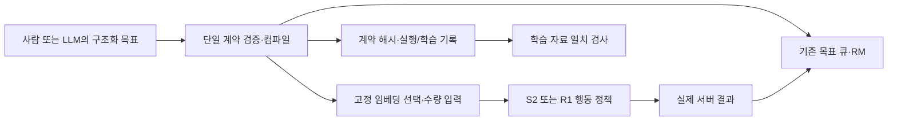

# 단일 목표 계약 — 구현 및 검증

2026-11-01. [명세](specs/2026-11-01-unified-goal-contract.md)를 현재 S2/R1 실행·학습 경로에 연결했다.
원본 연구 명세, 공식 가중치, 고정 관측기, 기존 실험 자료는 유지했다. 새 게임/학습/API 실행은 0이다.

## 바뀐 연결

사람/LLM은 `goal_spec_v1`에 대상·최소 획득량·우선순위·선행 목표·필요 아이템만 작성한다.
컴파일러가 기존 목표 큐의 아이템 집합·스킬 바인딩·완료 조건과 정책 조건을 함께 결정한다.
별도 자유 문장이나 성공 판정식을 모델이 중간에서 다시 작성하지 않는다.



| 정보 | RM/실행에서의 사용 | 정책/학습으로의 전달 |
|---|---|---|
| 대상 | 등록 아이템 집합의 증가 확인 | 같은 대상에 묶인 고정 임베딩 선택, 대상 참조/해시 기록 |
| 수량 | 활성화 시 인벤토리 대비 순증가 >= quantity | quantity_log2, 진행률, 잔량률 입력 |
| 우선순위·의존 관계 | 기존 스케줄러로 활성 목표 선택 | 선택된 목표를 전달하며 모든 우선순위를 새 tensor로 넣지는 않음 |
| 필요 아이템 | 현재 인벤토리로 실행 전제 확인 | 미충족 목표는 행동으로 전달하지 않음 |
| 완료 | 실제 서버 인벤토리, 일회성 보상, 다음 목표 선택/중단 | 해당 목표 완료 후 새 행동 차단 |

임베딩에 수량·선행 조건이 모두 표현됐다고 가정하지 않는다. 대상 목록도 별도의 새 신경망 입력으로
추가한 것은 아니며, 기존 임베딩 경로를 통해 전달한다. 숫자 입력의 차원과 정책/가치망 구조는 유지했다.
기존 LOGO bank의 단일 아이템 관측 메타데이터는 내부 사건 판별용이다. 상위 목표 수량의 완료 기준은
새 계약에서 생성한 GoalQueue가 담당한다.

## 사용

예제: [원목 최소 3개 → 흙 최소 1개](../configs/unified-goals-wood-then-dirt.json).
원목은 현재 등록된 여섯 원목 종류의 합계이고, 기존 보유량은 새 획득으로 세지 않는다.
기준 인벤토리는 각 목표가 활성화되는 순간에 고정한다. requires는 새 획득량이 아닌 현재 보유량이다.
이 계약은 순 인벤토리 증가를 측정하며 아이템 개체의 전체 획득 이력을 추적하는 기능은 아니다.

PowerShell, 프로젝트 루트에서 아래 명령은 게임/모델/API를 실행하지 않는다. 출력은 새 경로를 사용한다.

```powershell
$env:PYTHONPATH = 'src'
& '.runtime/fixture-tools/Scripts/python.exe' -m minecraftrl.goal_spec request --output results/goal-request.json
& '.runtime/fixture-tools/Scripts/python.exe' -m minecraftrl.goal_spec compile --input configs/unified-goals-wood-then-dirt.json --output results/goal-compiled.json
```

LLM 요청 패킷은 지시·응답 JSON Schema·등록 대상 목록을 제공한다. API 호출은 별도 호출자가 수행한다.
표현 가능한 요청은 `status=candidate, reason="", spec=<goal_spec_v1>`로 받고,
미지원 요청은 `status=unsupported, reason=<이유>, spec=null`로 받는다.
`compile-response --input <응답 파일> --output <새 출력>`이 동일 컴파일러를 적용한다.
미지원 응답에서는 실행 프로그램이 생성되지 않는다. 이 변경이 자연어 해석의 정확성까지 검증한 것은 아니다.

실제 실행 시 기존 `--rm-program`에 **원본 goal_spec_v1 파일**을 전달한다. 검토용 컴파일 결과 전체를
실행 파일로 전달하지 않는다. `--s2-variant linear-on/nonlinear-on` 또는
`--recovery-variant nonlinear-on` 등 추가 RM 입력이 켜진 경로가 필요하다. R1은 기존대로 단일 목표만 허용한다.
이 문서는 STOP 재해제나 기존 배치 재실행을 지시하지 않는다.

목표 대상/수량/선행 조건을 실행 도중 바꾸면 보상 계산과 행동 선택 전에 거부한다.
우선순위는 기존 `reprioritize`의 revision 검사와 이력을 유지해 변경할 수 있다.
현재 등록된 실행 대상은 wood/dirt다. 제작·이동 등의 새 대상은 관측/실행 능력을 추가한 뒤 등록해야 한다.
미등록 대상이나 자유 prompt/skill/성공식/미지원 제약은 거부한다.

## 검증 결과와 한계

- 최종 관련 WSL 테스트 **112개 통과**. 새 계약의 수량/대상/의존/우선순위, 실제 큐 어댑터,
  완료 후 행동 차단, 기존 STOP/종료 경로, S2/R1 학습 자료 검사를 포함한다.
- 작은 CPU 정책 head를 사용해 실제 `act → commit → archive → trainer.validate` 경로를 검사했다.
  원시 영상 모델과 게임은 시험용 대체물을 사용했다. 공식 정책의 게임 성공으로 세지 않는다.
- 입력 수량·목표 바인딩·임베딩 식별자·저장된 수량 tensor를 어긋나게 바꾼 자료는 학습 전에 거부됐다.
- 기존 S2 초기 정책 5회와 R1 초기 정책 10회의 **15회·3,982행동** 원본 서버 이벤트를 새 계약으로 재생했다.
  보상·완료·목표 대상·수량·진행률·잔량률·임베딩 키의 불일치 **0**. 수량 1/3, 원목/흙 양방향 순서,
  회수 전용/자연 수집, 성공/실패를 포함한다. 원본 이벤트 해시도 보존했다.
- 기존 고정 bank의 root/seek/pickup 문구와 새 바인딩이 일치했다. 새 임베딩은 생성하지 않았다.
- 첫 WSL 실행은 시작 지연 뒤 정상 완료됐다. 추가 시험에서 테스트 메서드의 클래스 배치 오류 1개를
  수정하고 최종 전체 관련 검사를 다시 통과했다. 중간 실패 로그도 보존한다.
- 새 검사 파일이 가져온 다른 TestCase를 중복 실행하지 않도록 모듈 참조로 정리했다.
- 단일 계약을 전달한다는 사실은 정책이 조건을 활용하거나 새 과업을 수행한다는 증거가 아니다.
  이후 실험은 전달 오류와 실행 능력 부족을 분리해 평가해야 한다. 새 성능 표본·가중치 업데이트는 없다.

자료: `results/unified-goal-contract-20261101`의 `work.json`, `compiled-example.json`, `llm-request.json`,
`tests-final.log`, `replay.json`, `review.json`, `completion.json`.
코드 검토는 프로젝트 지침대로 주 실행 흐름에서 순차 수행했다. 독립 서브에이전트 검토는 하지 않았다.
기존 branch의 무관한 수정/삭제는 건드리지 않았고 커밋·게시를 실행하지 않았다.
